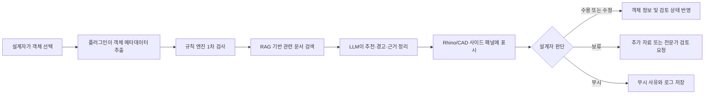

# 1. 주제 선정 배경

## 1.1 프로젝트 주제

> **나는 건축·공간 설계 산업의 CAD/Rhino 설계자를 위해, 설계 객체의 재료 정보 누락과 부재 두께·성능 검토의 비효율을 줄이는 Rhino/CAD 플러그인형 AI Agent를 설계한다.**

본 프로젝트의 최종 주제는 **CAD/Rhino 기반 건축·공간 설계자를 위한 재료-성능 주석형 AI Agent**이다. 프로젝트에서 제안하는 AI Agent는 Rhino 또는 CAD 환경에서 설계자가 특정 객체를 선택했을 때 해당 객체의 유형, 치수, 레이어, 재료 속성, 공간 용도와 같은 메타데이터를 분석한다. 이후 재료 후보, 일반적인 두께 검토 범위, 누락된 속성, 성능상 주의사항, 대체 재료와 관련 기준 문서를 주석 또는 사이드 패널 형태로 제공한다.

이 Agent의 목적은 설계 도면을 자동으로 생성하거나 설계자의 판단을 대체하는 것이 아니다. 설계 과정에서 반복적으로 발생하는 정보 확인과 1차 검토를 지원하고, 설계자가 더 빠르고 일관된 판단을 내릴 수 있도록 돕는 것이 핵심이다.

---

## 1.2 산업 및 업무 배경

건축·인테리어·공간 설계 업무는 고객 요구를 시각적인 형태로 표현하는 작업이지만, 실제 실무는 단순한 도면 작성이나 3D 모델링만으로 끝나지 않는다. 설계자는 공간의 용도, 사용 인원, 구조적 조건, 시공성, 비용, 유지관리, 단열, 차음, 내화, 마감 특성 등을 동시에 고려해야 한다. 하나의 벽체나 바닥 객체를 설계할 때도 형상과 치수뿐 아니라 재료, 두께, 성능, 시방 조건과 같은 비형상 정보가 함께 검토되어야 한다.

Rhino는 정밀한 곡선과 자유형 표면을 다루는 NURBS 기반 3D CAD 도구로, 건축·산업 디자인과 복잡한 형상 설계에 활용된다. 또한 SDK와 플러그인 구조를 제공하기 때문에 사용자 정의 명령, 패널, 객체 분석 기능을 추가할 수 있다. 이러한 확장성은 설계자가 사용하는 기존 작업 환경 안에 AI Agent를 배치하기에 적합한 조건이다.

그러나 Rhino와 일반 CAD 중심의 작업에서는 BIM 도구에 비해 객체의 의미와 재료·성능 정보가 체계적으로 연결되지 않는 경우가 많다. 동일한 벽체라도 객체명, 레이어명, 블록명, 색상 또는 사용자가 입력한 속성에 따라 의미가 표현되며, 프로젝트와 사용자마다 정보 입력 방식이 달라질 수 있다. 이 때문에 형상은 완성되었지만 재료, 용도, 두께 근거 또는 검토 상태가 누락되는 문제가 발생한다.

---

## 1.3 현행 업무의 핵심 문제

### 1.3.1 형상 정보와 재료·성능 정보의 분리

CAD/Rhino 모델에는 객체의 위치, 길이, 면적, 체적과 같은 형상 정보가 존재하지만, 해당 객체가 실제로 어떤 재료와 구성으로 시공되어야 하는지는 별도의 도면, 재료표, 시방서 또는 담당자의 경험에 의존하는 경우가 많다.

예를 들어 모델에 `Wall_01`이라는 벽체가 존재하더라도 다음 정보가 모두 포함되어 있다고 보장할 수 없다.

- 벽체의 실제 용도
- 마감재와 구조재의 구성
- 요구 차음 성능
- 내화 또는 단열 요구사항
- 권장 두께와 검토 근거
- 적용한 제조사 제품과 시방 정보

따라서 설계자는 모델을 확인하면서 별도의 문서와 카탈로그를 동시에 검색해야 한다. 모델과 문서가 분리되어 있기 때문에 검토 과정이 길어지고, 문서의 내용을 모델의 어떤 객체에 적용했는지 추적하기도 어렵다.

### 1.3.2 반복적인 기준 문서 검색

설계자는 재료를 선택하거나 부재 구성을 검토할 때 다음과 같은 자료를 반복적으로 확인한다.

- 사내 설계 표준
- 프로젝트 시방서
- 제조사 자재 카탈로그
- 과거 프로젝트 도면
- 구조·단열·차음·내화 관련 기준
- 발주처의 요구사항과 협의 기록

이 자료들은 PDF, 문서 파일, 웹페이지, 도면 주석 등 여러 위치에 분산되어 있다. 같은 유형의 벽체나 바닥을 반복해서 설계하더라도 필요한 근거를 매번 다시 찾아야 하며, 검색어와 문서 구조를 잘 모르는 초급 설계자는 필요한 정보를 찾는 데 더 많은 시간이 걸린다.

### 1.3.3 부재 두께와 구성 판단의 부담

부재 두께는 단순한 숫자가 아니라 재료, 구조 방식, 공간 용도, 요구 성능과 연결된 값이다. 회의실 구획벽은 일반 칸막이보다 차음 요구가 높을 수 있고, 외벽은 단열·방수·외장재 조건을 함께 검토해야 한다. 슬래브는 구조 방식과 경간, 하중 조건에 따라 전문가의 검토가 필요하다.

그럼에도 초기 설계 단계에서는 제한된 정보로 빠르게 대안을 작성해야 하므로 임시값이나 과거 프로젝트의 값을 그대로 사용하는 경우가 발생할 수 있다. 이후 검토 단계에서 문제가 발견되면 도면, 모델, 재료표와 관련 문서를 다시 수정해야 하며 이는 재작업 비용으로 이어진다.

### 1.3.4 설계자 경험에 따른 품질 편차

숙련된 설계자는 객체의 용도와 형상을 보고 필요한 재료와 검토 항목을 빠르게 판단할 수 있다. 반면 초급 설계자는 어떤 문서를 확인해야 하는지, 어떤 속성을 입력해야 하는지, 어떤 항목을 구조 또는 시공 담당자에게 전달해야 하는지 판단하기 어렵다.

따라서 동일한 조직과 프로젝트에서도 작업자에 따라 다음과 같은 차이가 발생할 수 있다.

- 속성 입력의 완성도
- 기준 문서 검색 속도
- 위험 항목의 발견 시점
- 재료 선택의 일관성
- 검토 요청의 적절성

이 문제는 단순한 작업 속도의 차이를 넘어 설계 품질과 협업 효율의 편차로 이어질 수 있다.

### 1.3.5 검토 근거와 변경 이력의 추적 어려움

설계 검토 과정에서는 “왜 이 재료를 선택했는가”, “왜 두께를 변경했는가”, “누가 검토했는가”가 중요하다. 그러나 검토 결과가 메신저, 회의록, 이메일 또는 구두 협의에 흩어져 있으면 최종 판단의 근거를 추적하기 어렵다.

특히 프로젝트 후반에 담당자가 변경되거나 유사 프로젝트에서 기존 판단을 재사용하려는 경우, 도면만으로는 당시의 판단 과정과 참고 자료를 알기 어렵다. 설계 객체와 추천 근거, 사용자 결정, 검토 상태를 함께 기록할 수 있는 구조가 필요하다.

---

## 1.4 기존 접근 방식의 한계

현재 설계자는 문제를 해결하기 위해 주로 수작업 검색, 체크리스트, BIM 전환, 일반형 생성 AI 또는 개별 플러그인을 사용한다. 그러나 각 방식에는 한계가 존재한다.

| 기존 방식 | 장점 | 한계 |
|---|---|---|
| 수작업 문서 검색 | 정확한 원문 확인 가능 | 시간이 오래 걸리고 검색 역량에 따라 결과가 달라짐 |
| 사내 체크리스트 | 검토 항목을 표준화할 수 있음 | 현재 선택한 객체와 자동으로 연결되지 않음 |
| BIM 기반 객체 관리 | 객체 속성과 정보를 구조화하기 좋음 | 초기 자유형 설계 또는 Rhino 중심 업무에서는 적용 부담이 존재함 |
| 일반형 생성 AI | 질문에 대한 빠른 설명 가능 | 프로젝트 객체와 문서 근거를 직접 인식하지 못하며 환각 가능성이 있음 |
| 룰 기반 CAD 플러그인 | 정해진 조건을 빠르게 검사함 | 비정형 문서와 프로젝트 맥락을 해석하기 어려움 |
| 제조사 검색 서비스 | 제품 정보가 구체적임 | 여러 제조사와 기준을 통합적으로 비교하기 어려움 |

따라서 필요한 것은 하나의 기술로 모든 판단을 자동화하는 시스템이 아니다. **객체 메타데이터를 읽는 플러그인, 명확한 조건을 검사하는 규칙 엔진, 관련 문서를 검색하는 RAG, 결과를 설명하는 LLM, 최종 결정을 수행하는 설계자**를 결합한 업무 보조 구조가 더 현실적이다.

---

## 1.5 플러그인형 AI Agent가 필요한 이유

### 1.5.1 설계자가 사용 중인 화면에서 동작

별도의 웹서비스에 파일을 업로드하는 방식은 사용자가 작업을 중단하고 다른 시스템으로 이동해야 한다. 또한 업로드한 결과와 원본 모델의 특정 객체를 다시 연결해야 한다.

반면 플러그인형 Agent는 Rhino/CAD 내부의 객체 선택 이벤트와 연동할 수 있다. 설계자는 작업 중인 객체를 클릭하는 것만으로 필요한 정보를 확인할 수 있고, 추천 결과를 현재 객체 및 프로젝트 문맥과 연결할 수 있다.

### 1.5.2 객체 단위의 문맥 확보

일반적인 챗봇은 사용자가 질문에 포함한 정보만을 기반으로 답변한다. 플러그인은 선택 객체에서 다음과 같은 데이터를 직접 추출할 수 있다.

- 객체 ID와 객체 유형
- 길이, 면적, 체적, 두께 등의 치수
- 레이어, 블록, 그룹 정보
- 사용자 정의 속성
- 현재 지정된 재료
- 프로젝트와 공간의 용도
- 인접 객체 또는 관련 객체 정보

이 데이터를 기반으로 질문을 자동 구성하면, 사용자가 모든 정보를 직접 입력하는 것보다 더 일관되고 구체적인 결과를 제공할 수 있다.

### 1.5.3 규칙 기반 검토와 생성형 AI의 역할 분리

건축 설계에서는 명확한 조건과 설명이 필요한 판단이 함께 존재한다. 예를 들어 재료 속성이 비어 있는지는 규칙으로 확실하게 판단할 수 있지만, 여러 기준 문서의 내용을 요약해 사용자에게 설명하는 작업은 LLM이 더 적합하다.

따라서 본 프로젝트는 다음과 같이 역할을 분리한다.

- **Rule Engine:** 누락 속성, 값의 범위, 필수 검토 항목 등 결정적인 조건 검사
- **RAG Retriever:** 사내 표준, 시방서, 카탈로그, 과거 사례에서 관련 근거 검색
- **LLM Agent:** 검색 결과와 객체 정보를 조합해 이해하기 쉬운 추천·경고 문구 생성
- **Designer:** 추천 수용, 수정, 보류, 무시 및 전문가 검토 요청 결정

이 구조는 LLM이 모든 것을 임의로 판단하게 하는 것보다 결과의 신뢰성과 설명 가능성을 높일 수 있다.

### 1.5.4 Human-in-the-loop 적용

건축 설계는 안전, 법규, 공사비, 시공성과 관련된 고책임 업무이므로 AI의 출력을 자동으로 설계에 반영해서는 안 된다. 특히 구조와 법규 관련 판단은 프로젝트의 전체 조건을 검토할 수 있는 전문가의 승인이 필요하다.

본 Agent는 다음과 같은 원칙을 따른다.

1. AI는 추천과 경고를 제공한다.
2. 추천에는 가능한 한 근거 문서와 출처를 함께 표시한다.
3. 설계자가 추천의 수용 여부를 결정한다.
4. 고위험 항목은 시니어 설계자 또는 구조·법규 전문가에게 전달한다.
5. 승인되지 않은 값은 모델에 자동 반영하지 않는다.
6. 사용자의 결정과 수정 이유를 로그로 남긴다.

따라서 본 프로젝트에서 AI는 **자동 설계자**가 아니라 **근거를 제시하는 설계 검토 보조자**로 정의된다.

---

## 1.6 제안하는 해결책

본 프로젝트에서 제안하는 **Material Insight AI**는 Rhino/CAD 환경 안에서 동작하는 플러그인형 Agent이다. 사용자가 객체를 선택하면 플러그인이 객체 메타데이터를 수집하고, 규칙 엔진과 RAG 검색을 수행한 후, LLM이 결과를 주석형 정보로 정리한다.

### 핵심 기능

- 선택 객체의 재료 및 주요 속성 확인
- 누락된 재료·두께·용도 속성 탐지
- 객체 및 공간 용도에 따른 재료 후보 제시
- 일반적인 두께 검토 범위와 주의사항 제공
- 시방서, 카탈로그, 사내 기준 및 과거 사례 검색
- 대체 재료와 추가 검토 항목 제안
- 설계자의 승인·보류·무시·수정 처리
- 고위험 항목에 대한 전문가 검토 요청 생성
- 추천 결과와 사용자 결정의 이력 저장

### 기본 사용 흐름

---

## 1.7 프로젝트 목표

본 프로젝트는 다음 다섯 가지 목표를 갖는다.

### 목표 1. 반복적인 검토 시간을 줄인다

객체와 관련된 문서를 자동으로 검색하고 주요 내용을 요약하여, 설계자가 여러 파일과 카탈로그를 반복적으로 탐색하는 시간을 줄인다.

### 목표 2. 속성 누락을 조기에 발견한다

재료, 두께, 용도, 검토 상태 등 필수 속성을 초기 설계 단계에서 확인하여 후반 수정과 재작업 가능성을 낮춘다.

### 목표 3. 설계 판단의 근거를 제공한다

단순히 “추천한다”는 문장을 출력하는 것이 아니라, 어떤 객체 정보와 문서 근거를 바탕으로 추천했는지를 함께 제시한다.

### 목표 4. 설계 품질의 일관성을 높인다

조직의 설계 표준과 과거 프로젝트 지식을 Agent의 지식 기반으로 활용하여 작업자별 경험 차이로 인한 편차를 줄인다.

### 목표 5. 인간의 최종 책임을 유지한다

AI가 설계 값을 자동 확정하지 않고, 설계자와 전문가의 검토·승인 절차 안에서 사용되도록 구성한다.

---

## 1.8 기대되는 사용자 가치

| 사용자 | 기존 불편 | Agent 도입 후 기대 가치 |
|---|---|---|
| 초급 설계자 | 확인해야 할 기준과 문서를 알기 어려움 | 객체별 체크 항목과 근거를 안내받음 |
| 실무 설계자 | 문서 검색과 속성 입력을 반복함 | 현재 작업 화면에서 즉시 추천과 경고 확인 |
| 시니어 검토자 | 누락 및 위험 객체를 수작업으로 탐색함 | 우선순위가 지정된 검토 목록 확인 |
| 프로젝트 관리자 | 변경 근거와 검토 상태 추적이 어려움 | 객체별 결정 이력과 검토 진행 상태 관리 |
| 조직 관리자 | 프로젝트 지식이 개인에게 축적됨 | 사내 표준과 피드백을 재사용 가능한 지식으로 축적 |

---

## 1.9 MVP 범위

프로젝트의 범위를 지나치게 넓히지 않기 위해 초기 MVP에서는 모든 건축 객체와 법규를 다루지 않는다. 우선 빈도가 높고 데모가 명확한 객체와 기능에 집중한다.

### MVP 대상 객체

- 비내력 내벽
- 바닥 마감
- 천장
- 일반 슬래브 검토 요청 항목

### MVP 지원 기능

- 객체 속성 읽기
- 재료 미지정 여부 확인
- 두께 값 입력 여부와 일반 범위 비교
- 공간 용도 기반 검토 체크리스트 제공
- 내부 샘플 시방서 및 재료 카탈로그 RAG 검색
- 추천·경고·출처 표시
- 사용자의 승인·수정·무시 처리
- 검토 로그 저장

### MVP에서 제외하는 기능

- 구조 안전성의 자동 확정
- 법규 적합성의 최종 판정
- 전체 건축물의 자동 설계
- 제조사 제품의 자동 발주
- AI 추천값의 무승인 자동 반영
- 모든 CAD/BIM 프로그램과의 동시 연동

이러한 범위 설정은 제한된 프로젝트 기간 안에서 핵심 가설을 검증하고, 고위험 업무의 자동화를 피하기 위한 것이다.

---

## 1.10 핵심 검증 가설

본 프로젝트는 다음 가설을 검증하는 것을 목표로 한다.

> 설계자가 Rhino/CAD에서 객체를 선택했을 때, 객체 정보와 기준 문서를 결합한 근거 기반 추천을 즉시 제공하면 재료·속성 누락을 더 빨리 발견하고 문서 검색 및 1차 검토 시간을 줄일 수 있다.

이를 평가하기 위해 후속 장에서 다음 지표를 구체화한다.

- 객체 속성 누락 탐지율
- 잘못된 경고 비율
- 관련 문서 검색 정확도
- 평균 응답 시간
- 추천 수용률
- 객체당 검토 소요 시간
- 사용자 만족도
- 전문가 검토로 전환된 고위험 항목 비율

---

## 1.11 본 보고서의 전개 방향

이후 보고서는 다음 순서로 프로젝트의 타당성과 구현 가능성을 분석한다.

1. 건축·공간 설계 산업과 CAD/Rhino 업무 특성 분석
2. 건축 설계 분야의 현재 AI 도입 사례와 한계 조사
3. 적용 가능한 AI Agent 후보 10개 도출 및 비교
4. Material Insight AI를 MVP로 선정한 근거 제시
5. 사용자 시나리오, 데이터, 도구, RAG 및 업무 흐름 설계
6. 플러그인·규칙 엔진·검색 계층·LLM을 포함한 기술 아키텍처 설계
7. Human-in-the-loop, 위험 통제 및 평가 지표 정의
8. 프로토타입 화면과 End-to-End 데모 시나리오 제시

---

## 참고 자료

1. Robert McNeel & Associates, *Rhino Developer Documentation*.
2. Robert McNeel & Associates, *RhinoCommon API Documentation*.
3. Autodesk, *Building Information Modeling and Object Properties Documentation*.
4. buildingSMART International, *openBIM and IFC Resources*.

> 구체적인 산업 사례, 제품 기능 및 기술 현황에 대한 출처는 `03-ai-landscape.md`와 최종 참고문헌에서 상세히 정리한다.
