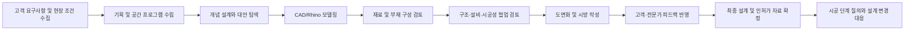
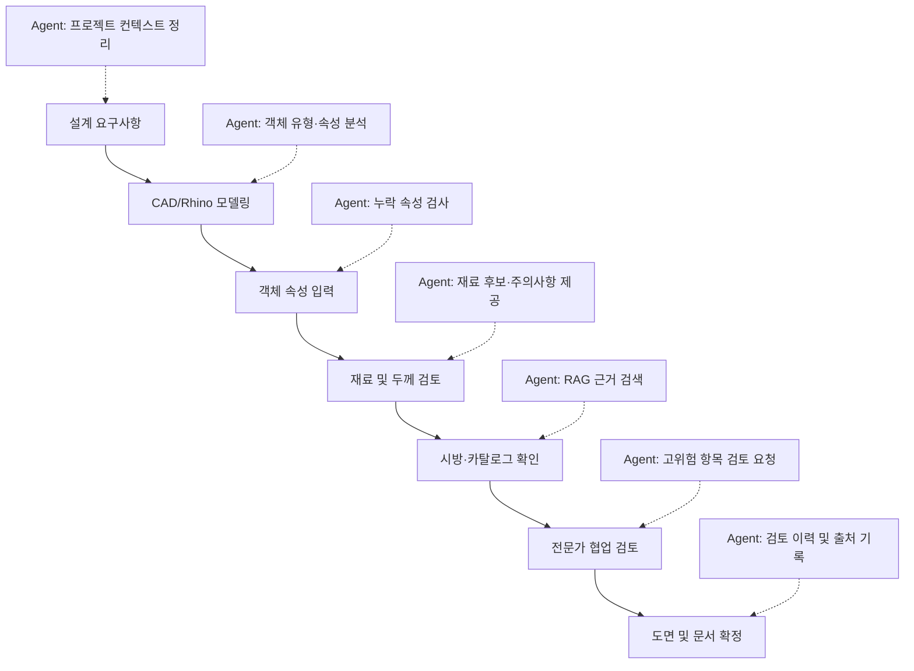

# 2. 산업 및 업무 특성 분석

## 2.1 분석 대상 산업의 범위

본 프로젝트의 대상은 건축·인테리어·공간 설계 산업 중에서도 **CAD/Rhino를 활용해 2D 도면과 3D 형상을 작성하고, 이를 재료·시방·구조·시공 정보와 연결하는 설계 업무**이다.

건축 산업 전체에는 기획, 설계, 인허가, 구조·설비 엔지니어링, 견적, 조달, 시공, 감리, 운영 및 유지관리까지 다양한 단계가 포함된다. 그러나 본 과제에서는 범위를 지나치게 넓히지 않고 다음 사용자와 업무에 집중한다.

- 건축 설계자
- 인테리어 및 공간 디자이너
- Rhino/CAD 모델러
- 설계 검토자
- 설계 프로젝트 관리자
- 구조·시공·자재 담당자와 협업하는 실무자

핵심 분석 대상 업무는 **설계 객체에 재료·두께·성능 정보를 부여하고, 관련 기준과 시방을 확인하며, 검토 결과를 기록하는 과정**이다.

---

## 2.2 산업의 구조적 특성

### 2.2.1 프로젝트 기반 산업

건축·공간 설계는 동일한 제품을 반복 생산하는 산업이 아니라, 프로젝트마다 요구사항과 조건이 달라지는 프로젝트 기반 산업이다. 프로젝트의 결과는 대지, 고객 요구, 예산, 일정, 법규, 구조 방식, 시공 조건과 사용 목적에 따라 달라진다.

이러한 특성 때문에 하나의 기준이나 과거 사례를 그대로 적용하기 어렵다. 설계자는 기존 자료를 참고하되 현재 프로젝트의 맥락에 맞게 재해석해야 한다.

프로젝트 기반 업무의 대표적인 특징은 다음과 같다.

- 프로젝트마다 고객 요구와 공간 용도가 다름
- 설계 변경이 빈번하게 발생함
- 여러 전문 분야가 동시에 참여함
- 단계별 산출물이 서로 연결되어 있음
- 결정 근거와 변경 이력의 추적이 중요함
- 일정 지연이나 오류가 후속 공정에 영향을 줌

따라서 AI Agent도 고정된 정답을 출력하기보다는, 현재 프로젝트의 맥락을 입력받아 적절한 근거와 검토 항목을 제시해야 한다.

### 2.2.2 다수 이해관계자의 협업

하나의 설계안은 단독 설계자의 작업만으로 완성되지 않는다. 발주처, 건축 설계자, 인테리어 디자이너, 구조·기계·전기 엔지니어, 시공사, 자재 공급업체, 감리자와 인허가 기관 등이 서로 다른 관점에서 결과물을 검토한다.

각 참여자는 동일한 모델이나 도면을 보더라도 관심 정보가 다르다.

| 이해관계자 | 주요 관심 사항 | 주로 사용하는 정보 |
|---|---|---|
| 고객·발주처 | 공간 품질, 예산, 일정, 요구사항 반영 | 요구사항 문서, 제안서, 변경 요청 |
| 건축 설계자 | 공간 구성, 형태, 법규, 도면 완성도 | CAD/Rhino 모델, 도면, 설계 기준 |
| 인테리어 디자이너 | 마감재, 색상, 사용성, 디테일 | 재료 보드, 카탈로그, 상세도 |
| 구조 엔지니어 | 하중, 경간, 구조 방식, 안전성 | 구조 모델, 계산서, 구조 기준 |
| 설비 엔지니어 | 배관·덕트·전기 설비와 공간 간섭 | MEP 모델, 장비 사양, 협업 모델 |
| 시공사 | 시공 가능성, 공정, 원가, 자재 조달 | 시공도, 시방서, 견적서 |
| 자재 공급업체 | 제품 성능, 규격, 납기, 단가 | 제품 카탈로그, 시험성적서 |
| 감리·인허가 기관 | 법규 및 기준 적합성 | 제출 도면, 허가 문서, 검토 기록 |
| 프로젝트 관리자 | 일정, 책임, 승인 상태, 이슈 관리 | 회의록, 변경 이력, 이슈 목록 |

본 프로젝트의 Agent는 이들 모두를 직접 대체하지 않는다. 1차 사용자는 CAD/Rhino 설계자이며, 필요할 경우 검토 결과를 다른 이해관계자에게 전달하는 역할을 수행한다.

### 2.2.3 정보 집약적 산업

건축 설계는 시각적인 작업으로 보이지만 실제로는 많은 문서와 데이터를 동시에 다루는 정보 집약적 업무이다. 설계자는 형상을 작성하면서도 다음 자료를 반복적으로 확인한다.

- 고객 요구사항
- 공간 프로그램
- 설계 기준서
- 법규 및 인허가 기준
- 구조·단열·차음·내화 기준
- 프로젝트 시방서
- 제조사 재료 카탈로그
- 시험성적서와 인증 정보
- 과거 프로젝트 사례
- 회의록과 변경 요청
- 견적 및 자재 단가
- 공정 및 조달 정보

이 자료들은 구조화 정도와 형식이 다르다. 객체 속성과 같은 정형 데이터도 있지만, PDF 시방서, 카탈로그, 회의록처럼 비정형 문서도 많다. 따라서 단순 데이터베이스 조회만으로 모든 업무를 지원하기 어렵고, 규칙 기반 검사와 문서 검색형 RAG를 함께 사용하는 것이 적합하다.

---

## 2.3 CAD, Rhino, BIM의 역할

### 2.3.1 CAD의 역할

CAD는 선, 곡선, 면, 치수, 문자, 블록 등을 이용해 설계 내용을 정밀하게 표현하는 도구다. 2D 도면 작성과 상세 표현에 강하며, 건축 실무에서 평면도, 입면도, 단면도와 상세도를 작성하는 데 널리 사용된다.

CAD 작업의 장점은 다음과 같다.

- 정밀한 도면 작성
- 비교적 자유로운 표현
- 기존 도면 자산과의 높은 호환성
- 실무자가 익숙한 작업 방식
- 상세도와 시공도 작성에 유리함

그러나 일반적인 CAD 객체는 실제 건축 부재의 의미를 자동으로 보장하지 않는다. 사용자가 그린 두 개의 선이 벽체인지, 가구인지, 기준선인지 프로그램이 스스로 판단하기 어렵다. 레이어명, 블록명, 주석과 사용자 규칙에 따라 의미가 부여되기 때문에 프로젝트별 입력 품질의 차이가 발생할 수 있다.

### 2.3.2 Rhino의 역할

Rhino는 NURBS 기반의 정밀한 자유형 곡선과 표면 모델링에 강점을 가진 3D CAD 도구다. 복잡한 형태, 비정형 외피, 가구, 인테리어 요소와 초기 디자인 모델을 제작하는 데 유용하다.

또한 Rhino는 RhinoCommon SDK와 플러그인 구조를 제공한다. 공식 개발 문서는 C# 기반의 일반 목적 플러그인 프로젝트를 생성하고, 플러그인 내부에 사용자 정의 명령과 UI를 추가할 수 있음을 설명한다. 객체 속성 API에서는 객체별 색상, 재료, 레이어, 이름, 고유 ID, 사용자 정의 데이터 등을 읽거나 저장할 수 있다.

이 특성은 본 프로젝트에 다음과 같은 이점을 제공한다.

- 사용자가 선택한 객체를 고유 ID로 식별 가능
- 레이어와 객체 이름을 분석 가능
- 재료 인덱스와 재료 출처 확인 가능
- UserData 또는 UserDictionary에 사용자 정의 속성 저장 가능
- 명령, 패널, 이벤트 기반 기능을 플러그인으로 추가 가능
- 기존 Rhino 작업 흐름 안에 Agent UI를 배치 가능

그러나 Rhino의 자유도는 동시에 정보 표준화의 어려움으로 이어진다. 사용자가 객체를 자유롭게 생성하고 이름과 레이어를 임의로 정할 수 있기 때문에, 동일한 건축 부재도 프로젝트마다 다른 방식으로 표현될 수 있다.

### 2.3.3 BIM의 역할

BIM은 건축물의 형상뿐 아니라 부재의 의미, 속성, 관계와 생애주기 정보를 함께 관리하는 접근 방식이다. BIM 환경에서는 벽, 문, 창, 바닥과 같은 객체가 단순한 선이나 면이 아니라 의미를 가진 건축 객체로 관리된다.

BIM의 주요 장점은 다음과 같다.

- 객체와 속성의 연결
- 도면과 모델의 연동
- 수량과 일정 정보의 활용
- 분야 간 협업
- 변경 사항의 일관된 반영
- 설계, 시공, 운영 정보의 재사용

그러나 모든 프로젝트가 처음부터 BIM 중심으로 수행되는 것은 아니다. 초기 형상 탐색, 인테리어 디자인, 비정형 외피 설계 또는 기존 CAD 자산을 활용하는 업무에서는 Rhino와 CAD가 계속 사용된다. 또한 BIM 모델로 전환하기 전에 많은 판단과 수정이 발생한다.

따라서 본 프로젝트는 CAD/Rhino를 BIM으로 대체하려는 것이 아니라, **정보가 부족한 자유형 설계 환경에 객체 단위 검토와 지식 검색 기능을 보완하는 것**을 목표로 한다.

### 2.3.4 IFC와 상호운용성

buildingSMART의 IFC는 건축·엔지니어링·건설 분야의 정보를 소프트웨어 중립적으로 교환하기 위한 개방형 데이터 표준이다. IFC는 객체와 속성, 관계를 구조화해 서로 다른 BIM 소프트웨어 사이의 정보 교환을 지원한다.

본 프로젝트의 초기 MVP가 IFC 전체를 구현할 필요는 없지만, 다음과 같은 확장 방향에서 IFC 개념을 참고할 수 있다.

- 객체 유형의 표준화
- 재료와 속성의 공통 이름 정의
- 외부 BIM 모델과의 데이터 교환
- 프로젝트 간 정보 재사용
- 향후 BIM 검토 도구와의 연동

초기에는 Rhino 객체의 레이어, 이름, 형상, 사용자 정의 속성을 사용하고, 이후에는 IFC 객체 유형 또는 사내 표준 분류체계와 연결하는 단계적 접근이 현실적이다.

---

## 2.4 건축·공간 설계의 주요 업무 프로세스

프로젝트마다 세부 절차는 다르지만 일반적인 흐름은 다음과 같이 정리할 수 있다.



### 2.4.1 요구사항 수집

프로젝트 초기에는 발주처의 목적, 예산, 일정, 공간별 요구, 브랜드 방향과 운영 조건을 파악한다. 이 단계에서 수집한 정보는 이후 재료와 성능 판단의 기준이 된다.

예를 들어 같은 벽체라도 다음 조건에 따라 요구가 달라진다.

- 회의실인지 복도인지
- 습식 공간인지 건식 공간인지
- 외부에 노출되는지
- 소음 차단이 중요한지
- 내화 구획인지
- 유지보수가 쉬워야 하는지

Agent가 정확한 추천을 하려면 객체 정보뿐 아니라 이러한 프로젝트 맥락도 입력받아야 한다.

### 2.4.2 개념 설계 및 형태 탐색

개념 설계에서는 공간 배치와 형태 대안을 빠르게 검토한다. Rhino와 Grasshopper는 복잡한 형상과 파라메트릭 대안을 탐색하는 데 유용하다.

이 단계에서는 아직 모든 속성이 확정되지 않기 때문에, Agent가 확정값을 요구하기보다 다음 정보를 제공하는 것이 적절하다.

- 현재 누락된 정보
- 다음 단계에서 확인해야 할 항목
- 재료 후보군
- 위험도가 높은 가정
- 전문가 협업이 필요한 조건

### 2.4.3 기본·실시설계 모델링

형태가 구체화되면 객체의 치수, 위치, 레이어, 재료와 구성 정보가 추가된다. 이 단계에서 속성 누락과 값의 불일치가 누적되기 쉽다.

본 Agent의 주요 개입 시점은 이 단계다. 객체를 선택하거나 전체 모델을 검사해 다음 작업을 지원할 수 있다.

- 객체 유형 추정 또는 사용자 확인
- 필수 속성 입력 여부 검사
- 재료와 두께의 기본 범위 확인
- 유사 객체 간 속성 일관성 검사
- 관련 시방서와 과거 사례 검색

### 2.4.4 전문 분야 협업 검토

건축, 구조, 설비, 시공 담당자는 각자의 모델과 문서를 교환하면서 충돌과 위험을 검토한다. 이 과정에서 단순 형상 충돌뿐 아니라 의미와 성능 기준의 불일치도 발생한다.

예를 들면 다음과 같다.

- 차음이 필요한 공간인데 일반 칸막이가 지정됨
- 습식 공간에 부적절한 마감재가 선택됨
- 내화 구획에 필요한 성능 정보가 없음
- 슬래브 두께가 입력되었지만 구조 검토 상태가 없음
- 제조사 제품이 단종되었거나 최신 자료가 아님

Agent는 이를 최종 판정하지 않고, 검토 필요 항목과 근거를 구조화해 담당자에게 전달해야 한다.

### 2.4.5 도면·시방·재료표 작성

최종 산출물에는 모델뿐 아니라 도면, 상세도, 시방서와 재료표가 포함된다. 같은 정보가 여러 산출물에 반복되므로 변경 사항이 일관되게 반영되지 않을 수 있다.

객체별 재료와 검토 상태를 구조화하면 향후 다음 기능으로 확장할 수 있다.

- 재료표 자동 생성 보조
- 객체와 시방 항목 연결
- 변경된 객체 목록 추출
- 미검토 객체 목록 생성
- 검토 근거가 없는 항목 표시

---

## 2.5 반복 업무 분석

건축 설계에서 AI Agent 적용 가능성이 높은 업무는 반복 빈도가 높고, 일정한 입력과 판단 근거가 존재하며, 최종 승인을 사람이 수행할 수 있는 업무다.

| 반복 업무 | 현재 수행 방식 | 문제점 | Agent 지원 방식 |
|---|---|---|---|
| 객체별 재료 확인 | 레이어, 도면, 재료표 수동 비교 | 누락과 불일치 가능성 | 객체 속성과 재료표 자동 비교 |
| 부재 두께 확인 | 과거 도면과 기준서 참조 | 경험 의존, 검색 반복 | 기본 범위와 검토 필요 조건 표시 |
| 시방서 검색 | PDF 목차와 키워드 검색 | 문서가 많고 표현이 다름 | 객체 문맥 기반 RAG 검색 |
| 카탈로그 검색 | 제조사 사이트 개별 방문 | 최신성 및 비교 어려움 | 제품 속성 검색과 출처 표시 |
| 누락 속성 검사 | 체크리스트와 육안 검토 | 대형 모델에서 시간 증가 | 필수 속성 규칙 검사 |
| 유사 객체 일관성 검사 | 레이어별 선택 후 비교 | 예외 누락 가능성 | 동일 유형 객체의 속성 차이 탐지 |
| 검토 요청 작성 | 메신저·이메일로 설명 | 객체와 이슈 연결이 약함 | 객체 ID와 근거가 포함된 이슈 생성 |
| 변경 이력 정리 | 회의록과 파일 버전 비교 | 결정 이유 추적 어려움 | 추천·수정·승인 로그 저장 |

이들 업무 중에서 구조 계산이나 법규 최종 판정처럼 고위험 업무는 자동화 대상이 아니라 **검토 요청을 생성하는 보조 대상**으로 제한해야 한다.

---

## 2.6 판단이 필요한 업무 분석

반복 업무와 달리 다음 업무는 프로젝트 맥락과 전문성이 필요하다.

### 2.6.1 재료 적합성 판단

재료는 미관만으로 선택되지 않는다. 사용 환경, 유지관리, 화재, 습기, 마모, 비용과 조달 조건을 함께 고려해야 한다.

Agent는 후보와 체크리스트를 제시할 수 있지만 다음 상황에서는 사람의 판단이 필요하다.

- 고객이 특정 브랜드 또는 질감을 요구함
- 디자인 의도가 성능 기준과 충돌함
- 공급 가능성과 공사 일정이 불확실함
- 여러 성능을 동시에 만족해야 함
- 프로젝트에 특수한 시공 조건이 존재함

### 2.6.2 두께 및 구성 판단

벽체, 바닥, 천장과 슬래브의 두께는 여러 층의 구성과 성능 요구에 따라 달라진다. “권장 두께”를 단일 값으로 제시하면 오히려 위험할 수 있다.

따라서 Agent는 다음 형식으로 결과를 제시해야 한다.

- 일반적인 참고 범위
- 해당 범위가 적용되는 전제
- 현재 객체가 범위를 벗어났는지 여부
- 추가로 확인해야 할 성능
- 구조·시공 전문가 검토 필요 여부
- 참고한 문서와 버전

### 2.6.3 법규와 구조 관련 판단

법규와 구조 안전성은 프로젝트 위치, 용도, 규모, 구조 시스템과 최신 기준에 따라 달라진다. AI가 일부 문서를 검색할 수 있더라도 최종 적합성을 확정해서는 안 된다.

해당 영역에서 Agent의 역할은 다음으로 제한한다.

- 관련 기준 후보 검색
- 누락된 입력 조건 안내
- 위험 가능성 표시
- 전문가 검토 요청
- 검토 결과와 승인자 기록

### 2.6.4 대체안 비교

재료 대체안은 단가뿐 아니라 성능, 시공법, 납기, 디자인과 유지관리 측면을 함께 비교해야 한다. Agent는 비교표를 생성할 수 있지만 최종 선택은 설계자와 프로젝트 관계자가 결정한다.

---

## 2.7 문서 중심 업무와 지식 흐름

### 2.7.1 주요 문서 유형

| 문서 유형 | 포함 정보 | 데이터 특성 | Agent 활용 방식 |
|---|---|---|---|
| 프로젝트 요구사항 | 용도, 예산, 일정, 성능 목표 | 비정형 | 프로젝트 컨텍스트 추출 |
| 설계 기준서 | 객체별 설계 원칙 | 반정형 | RAG 검색 및 규칙 생성 |
| 시방서 | 재료, 시공법, 품질 기준 | 반정형 | 객체별 관련 조항 검색 |
| 제조사 카탈로그 | 규격, 성능, 인증, 제품 코드 | 반정형 | 재료 후보와 근거 제공 |
| 법규·표준 | 의무 조건과 기준 | 반정형·정형 | 관련 조항 검색, 전문가 검토 연결 |
| 과거 프로젝트 | 유사 객체와 결정 사례 | 비정형·정형 혼합 | 사례 기반 참고 |
| 회의록·변경 요청 | 결정, 책임자, 변경 이유 | 비정형 | 변경 맥락과 승인 상태 추출 |
| CAD/Rhino 파일 | 형상, 레이어, 객체 속성 | 정형·반정형 | 객체 메타데이터 추출 |

### 2.7.2 지식 단절 문제

현재 업무에서는 모델, 문서, 커뮤니케이션 기록이 서로 다른 시스템에 저장되는 경우가 많다. 이로 인해 다음과 같은 지식 단절이 발생한다.

- 모델 객체와 시방 조항이 직접 연결되지 않음
- 변경 요청의 근거가 모델에 남지 않음
- 과거 프로젝트의 판단을 검색하기 어려움
- 최신 문서와 오래된 문서가 혼재함
- 개인의 경험이 조직 지식으로 전환되지 않음

Agent는 이 자료를 완전히 하나의 데이터베이스로 통합하기보다, 객체를 중심으로 필요한 자료를 검색하고 연결하는 **지식 접근 계층**으로 설계할 수 있다.

---

## 2.8 주요 데이터 분석

### 2.8.1 객체 및 형상 데이터

- 객체 ID
- 객체 형식: Curve, Surface, Brep, Mesh, Block 등
- 위치와 좌표
- 길이, 면적, 체적
- 경계 상자
- 두께 또는 두께 추정값
- 인접 객체와 교차 관계

### 2.8.2 객체 속성 데이터

RhinoCommon의 `ObjectAttributes`를 통해 레이어, 재료, 이름, 고유 ID와 사용자 정의 정보를 활용할 수 있다.

- 객체 이름
- 레이어 인덱스와 레이어 경로
- 재료 인덱스와 재료 출처
- 그룹 및 블록 정보
- 객체 표시 상태
- UserData
- UserDictionary
- 사용자 문자열
- 외부 참조 URL

프로젝트에서는 사용자 정의 속성을 다음과 같이 구성할 수 있다.

```yaml
object_type: interior_wall
space_type: meeting_room
material_code: null
thickness_mm: 75
fire_rating: null
acoustic_required: true
review_status: pending
source_document: null
```

### 2.8.3 프로젝트 컨텍스트 데이터

- 프로젝트 유형
- 건물 용도
- 지역 및 적용 기준
- 설계 단계
- 공간별 요구사항
- 고객의 우선순위
- 예산 등급
- 구조 시스템
- 시공 방식
- 승인자와 담당자

### 2.8.4 지식 베이스 데이터

- 사내 설계 표준
- 프로젝트 시방서
- 재료 카탈로그
- 과거 프로젝트 사례
- 법규와 기술 기준
- 승인된 설계 상세
- 자주 발생한 검토 이슈
- 사용자 피드백과 추천 수용 기록

### 2.8.5 로그 및 평가 데이터

- Agent 요청 시간
- 선택 객체 ID
- 입력 컨텍스트
- 검색된 문서와 문서 버전
- 생성된 추천
- 사용자의 수용·수정·무시 행동
- 수정 이유
- 전문가 검토 결과
- 응답 시간
- 오류 및 실패 기록

로그는 성능 개선에 중요하지만, 프로젝트 정보와 사용자 행동을 포함할 수 있으므로 최소 수집과 접근 통제가 필요하다.

---

## 2.9 데이터 품질 문제

AI Agent의 성능은 입력 데이터의 품질에 크게 영향을 받는다. 건축 모델에서는 다음 문제가 자주 발생할 수 있다.

- 레이어명이 프로젝트마다 다름
- 객체 이름이 비어 있음
- 동일 객체 유형이 다른 방식으로 모델링됨
- 단위가 불명확하거나 혼재함
- 재료명이 약어 또는 별칭으로 입력됨
- 속성값이 최신 상태가 아님
- 과거 프로젝트 문서가 현재 기준과 충돌함
- 제조사 카탈로그의 버전 정보가 없음
- PDF 표와 이미지의 텍스트 추출 품질이 낮음

따라서 시스템은 입력값을 그대로 신뢰해서는 안 된다. 다음과 같은 데이터 품질 관리가 필요하다.

1. 프로젝트 단위와 좌표계 확인
2. 레이어 및 객체 분류 매핑
3. 재료명 표준화 사전
4. 필수 속성 스키마
5. 문서 버전과 유효기간 관리
6. 출처별 신뢰도 등급
7. 정보 부족 시 확정 답변 금지
8. 사용자 확인 요청 기능

---

## 2.10 규제, 책임 및 보안 이슈

### 2.10.1 설계 책임

건축 설계 결과는 안전과 재산에 영향을 줄 수 있다. AI 추천이 잘못되어도 최종 결과에 대한 책임은 프로젝트 참여자와 승인 체계 안에서 관리되어야 한다.

시스템은 다음 원칙을 가져야 한다.

- AI 출력은 참고 정보로 명시
- 최종값 자동 확정 금지
- 구조·법규 항목은 전문가 승인 필수
- 추천 근거와 출처 표시
- 승인자와 승인 시간 기록
- 변경 전후 값과 사유 기록

### 2.10.2 기준의 최신성

법규, 기술 기준과 제조사 제품 정보는 변경될 수 있다. 오래된 문서를 검색하면 잘못된 추천이 생성될 수 있다.

통제 방안은 다음과 같다.

- 문서 등록일과 개정일 저장
- 최신 버전 우선 검색
- 폐기 문서 검색 제외
- 출처와 문서 버전 표시
- 고위험 답변의 유효성 검토
- 주기적인 지식 베이스 갱신

### 2.10.3 프로젝트 기밀

설계 도면에는 고객명, 위치, 보안 구역, 시설 배치와 아직 공개되지 않은 디자인이 포함될 수 있다. 외부 LLM API에 모델 전체 또는 원본 문서를 전송하면 정보 유출 위험이 발생한다.

필요한 통제는 다음과 같다.

- 전체 파일 대신 필요한 객체 메타데이터만 전송
- 고객명과 위치 등 식별 정보 마스킹
- 사내망 또는 전용 배포 옵션
- 전송 및 저장 데이터 암호화
- 역할 기반 접근 제어
- 프로젝트별 지식 베이스 분리
- 로그 보존 기간 설정
- 외부 모델 제공자의 데이터 처리 조건 검토

### 2.10.4 지식재산권

도면, 설계 기준, 제조사 카탈로그에는 저작권과 사용 조건이 존재할 수 있다. Agent는 원문 전체를 재배포하는 방식보다 필요한 범위의 근거를 제시하고 원본 문서로 연결하는 방식이 적합하다.

### 2.10.5 프롬프트 인젝션과 문서 오염

RAG 시스템은 문서에 포함된 악의적 문장이나 잘못된 지시를 모델이 따르는 위험이 있다. 외부 카탈로그와 협력사 문서를 수집할 경우 특히 주의가 필요하다.

통제 방안은 다음과 같다.

- 신뢰 가능한 문서만 지식 베이스에 등록
- 문서 내용과 시스템 지시 분리
- 검색 결과를 명령이 아닌 참고 데이터로 처리
- 허용된 Tool만 실행
- 모델이 객체를 직접 수정하지 못하게 제한
- 관리자 승인 없는 문서 자동 등록 금지

---

## 2.11 산업의 주요 Pain Point 정리

| Pain Point | 원인 | 업무 영향 | Agent 기회 |
|---|---|---|---|
| 재료 정보 누락 | 자유로운 모델링과 속성 입력 규칙 부족 | 도면·시방 불일치, 후반 수정 | 필수 속성 검사 |
| 반복적인 문서 검색 | 문서가 여러 시스템에 분산 | 검토 시간 증가 | 객체 문맥 기반 RAG |
| 두께 판단의 경험 의존 | 조건과 기준이 복합적 | 품질 편차와 재작업 | 범위·전제·검토 항목 제시 |
| 모델과 결정 근거의 분리 | 이메일·회의록 중심 협업 | 변경 이유 추적 어려움 | 객체별 검토 로그 |
| 기준 최신성 문제 | 개정 문서와 과거 문서 혼재 | 잘못된 기준 적용 | 버전 기반 검색 |
| 전문 분야 전달 누락 | 이슈가 비정형 메시지로 전달 | 협업 지연 | 구조화된 검토 요청 |
| 초급 인력의 온보딩 부담 | 암묵지가 개인에게 집중 | 교육 시간 증가 | 근거가 포함된 가이드 |
| 프로젝트 기밀 유출 위험 | 외부 서비스로 원본 전송 | 보안과 계약 위험 | 최소 데이터 전송·사내 배포 |

---

## 2.12 AI Agent 도입 적합성 평가

본 업무가 AI Agent에 적합한지 다음 기준으로 평가하였다.

| 평가 기준 | 평가 | 근거 |
|---|---|---|
| 업무 반복성 | 높음 | 재료·속성·기준 확인이 객체마다 반복됨 |
| 데이터 존재 여부 | 중상 | 객체 속성, 시방서, 카탈로그, 사례가 존재함 |
| 규칙화 가능성 | 중상 | 누락 검사와 일부 범위 검토는 규칙화 가능 |
| 자연어 처리 필요성 | 높음 | 시방서와 카탈로그가 문서 중심임 |
| 도구 연동 가능성 | 높음 | RhinoCommon 플러그인과 객체 API 활용 가능 |
| 사용자 가치 | 높음 | 설계 화면에서 검색·검토 시간을 줄일 수 있음 |
| 완전 자동화 위험 | 높음 | 구조·법규·재료 판단에 책임 문제가 있음 |
| Human-in-the-loop 적합성 | 매우 높음 | AI 추천 후 설계자가 승인하는 흐름이 자연스러움 |
| MVP 구현 가능성 | 중상 | 제한된 객체와 샘플 문서로 데모 가능 |
| 확장 가능성 | 높음 | BIM, 이슈 관리, 재료표, 기업 지식으로 확장 가능 |

분석 결과, 이 업무는 **완전 자동화 대상은 아니지만 Agent 기반 의사결정 지원에는 적합한 영역**이다. 명확한 검사는 규칙 엔진이 담당하고, 관련 문서 검색은 RAG가 담당하며, 최종 판단은 설계자가 수행하는 역할 분담이 필요하다.

---

## 2.13 AI Agent 개입 지점



가장 현실적인 초기 개입 지점은 **객체 속성 입력, 재료·두께 1차 검토, 관련 문서 검색과 전문가 검토 요청**이다.

---

## 2.14 산업 분석에 따른 설계 원칙

산업과 업무 특성을 분석한 결과, 본 Agent에는 다음 원칙이 필요하다.

1. **객체 중심성**  
   모든 추천은 현재 선택한 객체와 프로젝트 컨텍스트에 연결한다.

2. **근거 우선**  
   추천 문장보다 검색한 문서, 규칙과 전제를 함께 제시한다.

3. **역할 분리**  
   규칙 검사, 문서 검색, 자연어 설명과 인간 승인을 분리한다.

4. **불확실성 표시**  
   정보가 부족하면 추정값과 신뢰도를 표시하고 추가 입력을 요청한다.

5. **고위험 자동화 금지**  
   구조와 법규 관련 결과는 검토 요청으로 전환한다.

6. **최소 데이터 전송**  
   모델 전체가 아니라 필요한 메타데이터와 검색 문맥만 사용한다.

7. **버전 및 이력 관리**  
   문서 버전, 추천 근거, 사용자 결정과 승인 상태를 기록한다.

8. **단계적 확장**  
   비내력 내벽과 마감재 등 제한된 범위에서 시작해 BIM과 기업 시스템으로 확장한다.

---

## 2.15 소결

건축·공간 설계 산업은 프로젝트별 조건이 다르고, 여러 이해관계자가 협업하며, 모델과 다수의 문서를 동시에 검토해야 하는 복합 업무 환경이다. 특히 CAD/Rhino 중심의 자유로운 설계 환경은 형태 탐색에 강하지만 객체의 의미와 재료·성능 정보가 일관되게 입력되지 않을 수 있다.

이 때문에 설계자는 반복적으로 문서를 검색하고, 속성 누락을 확인하며, 경험을 바탕으로 재료와 두께를 검토한다. 그러나 구조와 법규를 포함한 최종 판단은 책임과 위험이 크기 때문에 AI가 자동으로 확정하기 어렵다.

따라서 본 프로젝트의 적절한 전략은 설계자를 대체하는 자동 설계 시스템이 아니라, Rhino/CAD 객체와 관련 문서를 연결하고 검토 근거를 제시하는 **플러그인형 Human-in-the-loop AI Agent**를 구축하는 것이다. 이 분석 결과는 이후 AI 도입 사례 조사, Agent 후보 도출과 MVP 설계의 기준으로 사용한다.

---

## 참고 자료

1. Robert McNeel & Associates, **Your First Plugin (Windows)**, Rhino Developer Documentation.  
   <https://developer.rhino3d.com/guides/rhinocommon/your-first-plugin-windows/>

2. Robert McNeel & Associates, **Rhino.DocObjects.ObjectAttributes Class**, RhinoCommon API Documentation.  
   <https://developer.rhino3d.com/api/rhinocommon/rhino.docobjects.objectattributes>

3. buildingSMART International, **Industry Foundation Classes (IFC)**.  
   <https://www.buildingsmart.org/standards/bsi-standards/industry-foundation-classes/>

4. Autodesk, **What Is BIM?**  
   <https://www.autodesk.com/solutions/aec/bim>

> 국내 법규와 구조·재료 기준은 MVP의 최종 판정 규칙으로 직접 사용하지 않고, 공식 원문과 전문가 검토를 연결하는 참고 지식으로 제한한다.
