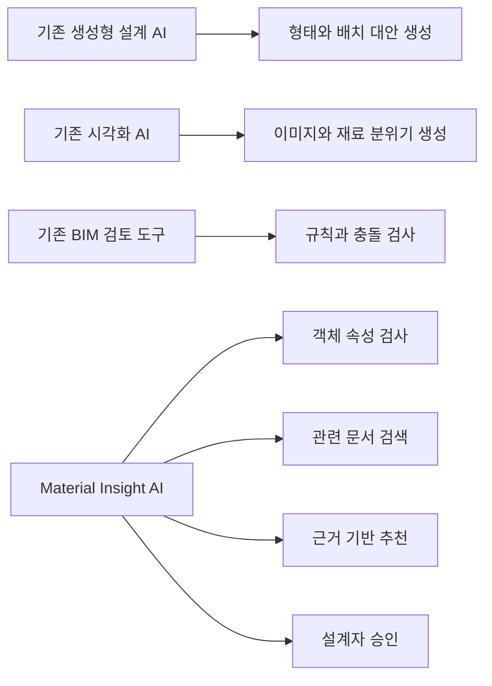

# 3. 현재 AI 도입 현황

## 3.1 조사 목적

건축·공간 설계 분야에서는 AI가 이미 **대안 생성, 대지 분석, 렌더링, 타당성 검토**에 활용되고 있다. 그러나 대부분은 초기 설계나 시각화에 집중되어 있으며, CAD/Rhino 객체의 재료·두께·성능 정보를 근거 문서와 연결해 검토하는 기능은 제한적이다.

본 장에서는 현재 활용 중인 대표 사례 4개를 비교하고, 본 프로젝트의 차별점을 도출한다.

---

## 3.2 대표 사례

### 사례 1. Autodesk Forma

Autodesk Forma는 초기 기획 및 개념 설계 단계에서 대지와 건물 배치를 분석하는 AI 기반 클라우드 도구다. 자동 면적 산정, 대지·건물 배치 대안 생성, 소음·바람·탄소 분석 등을 지원하며 Rhino와 Revit 등 기존 도구와도 연동된다.

| 항목 | 내용 |
|---|---|
| 해결 문제 | 초기 대지 검토와 설계 대안 비교에 많은 시간이 소요되는 문제 |
| 주요 기술 | 생성형 설계, 예측 분석, 환경 시뮬레이션, 클라우드 협업 |
| 주요 사용자 | 건축가, 도시계획가, 부동산 개발자 |
| 기대 효과 | 여러 배치안을 빠르게 비교하고 데이터 기반 의사결정 가능 |
| 현재 한계 | 초기 계획 단계에 강하지만 개별 객체의 재료·시방·두께 검토는 중심 기능이 아님 |

Forma는 AI가 설계자의 선택을 돕는 방식이 실제 제품으로 구현되고 있음을 보여준다. 다만 본 프로젝트가 다루는 객체 단위 재료 검토보다 상위 단계의 도시·대지 계획에 초점이 맞추어져 있다.

---

### 사례 2. TestFit

TestFit은 부동산 개발과 건축 초기 단계에서 대지 조건, 도로, 주차, 건물 배치 등을 자동 생성해 사업성과 설계 가능성을 검토하는 플랫폼이다. 사용자는 AI가 생성한 배치안을 직접 수정할 수 있다.

| 항목 | 내용 |
|---|---|
| 해결 문제 | 초기 배치안과 사업성 검토에 수일 또는 수주가 걸리는 문제 |
| 주요 기술 | 생성형 설계, 제약조건 기반 최적화, 공간 배치 자동화 |
| 주요 사용자 | 개발사, 건축가, 시공사, 도시계획 담당자 |
| 기대 효과 | 대지별 가능성을 빠르게 검토하고 설계 대안을 반복 생성 |
| 현재 한계 | 재료·시방·성능 검토보다 배치와 사업성 분석에 집중 |

TestFit의 장점은 AI가 결과를 한 번 생성하고 끝나는 것이 아니라 사용자가 직접 수정하면서 대안을 발전시킬 수 있다는 점이다. 이는 본 프로젝트의 Human-in-the-loop 방식과 유사하다.

---

### 사례 3. Veras

Veras는 Revit, Rhino, SketchUp 등 설계 프로그램에 연결해 현재 모델을 기반으로 이미지를 생성하는 AI 시각화 도구다. 사용자는 프롬프트와 Geometry Override 설정을 이용해 원본 형상을 유지하거나 새로운 디자인 대안을 탐색할 수 있다.

| 항목 | 내용 |
|---|---|
| 해결 문제 | 초기 렌더링과 재료·분위기 시각화에 많은 시간이 필요한 문제 |
| 주요 기술 | 생성형 이미지 AI, 프롬프트 기반 편집, 이미지 선택 영역 재생성 |
| 주요 사용자 | 건축가, 인테리어 디자이너, 시각화 담당자 |
| 기대 효과 | 모델을 기반으로 빠르게 디자인 이미지와 재료 분위기 탐색 |
| 현재 한계 | 시각적 재료 표현은 가능하지만 실제 제품 성능, 시방, 두께 근거를 검증하지 않음 |

Veras는 Rhino 내부에 AI 기능을 연결할 수 있다는 점에서 본 프로젝트와 가장 유사하다. 그러나 Veras의 주요 목적은 시각화이며, 본 프로젝트는 설계 객체의 정보 누락과 기술적 검토에 초점을 둔다.

---

### 사례 4. BIM 기반 자동 검토

Revit, Navisworks와 같은 BIM 도구에서는 객체 속성 검사, 간섭 검토, 수량 산출과 설계 규칙 확인이 이미 활용되고 있다. 이러한 기능은 전통적인 머신러닝보다는 객체 데이터와 규칙 기반 자동화에 가까우나, 최근에는 AI 분석 및 문서 검색과 결합되는 방향으로 발전하고 있다.

| 항목 | 내용 |
|---|---|
| 해결 문제 | 설계 요소 간 충돌과 속성 누락을 사람이 직접 검사하는 문제 |
| 주요 기술 | BIM 객체 분석, 규칙 엔진, Clash Detection, 데이터 검증 |
| 주요 사용자 | BIM 코디네이터, 설계 검토자, 시공사 |
| 기대 효과 | 설계 오류를 시공 전에 발견하고 협업 품질 향상 |
| 현재 한계 | 명확한 규칙 검사는 강하지만 비정형 시방서 해석과 설명형 추천은 제한적 |

이 사례는 본 프로젝트에서 LLM만 사용해서는 안 되며, 규칙 엔진을 함께 사용해야 한다는 근거가 된다.

---

## 3.3 사례 비교

| 사례 | 주요 적용 단계 | 핵심 강점 | 본 프로젝트와의 차이 |
|---|---|---|---|
| Autodesk Forma | 기획·개념 설계 | 대지 분석과 환경 성능 비교 | 객체별 재료·두께 검토가 아님 |
| TestFit | 사업성·초기 배치 | 빠른 배치안 생성과 수정 | 건축 상세정보보다 배치에 집중 |
| Veras | 디자인·시각화 | Rhino/Revit 모델 기반 이미지 생성 | 기술 성능보다 시각적 결과 중심 |
| BIM 자동 검토 | 실시설계·협업 | 객체 속성과 충돌 검사 | 비정형 문서 검색과 설명 기능이 약함 |
| Material Insight AI | 기본·실시설계 | 객체, 규칙, 문서 근거를 결합한 검토 | 재료·두께·성능 주석에 특화 |

---

## 3.4 현재 AI 도입의 공통 한계

대표 사례를 비교하면 다음과 같은 한계가 나타난다.

1. **초기 설계와 시각화에 집중**  
   대안 생성과 렌더링 기능은 발전했지만 실제 설계 객체의 재료·시방 검토는 상대적으로 부족하다.

2. **모델과 문서가 분리됨**  
   AI가 모델을 분석하거나 문서를 검색할 수는 있어도, 특정 객체와 기준 문서를 직접 연결하는 기능은 제한적이다.

3. **설명 가능한 근거 부족**  
   생성 결과가 빠르더라도 왜 해당 결과가 적절한지 기준과 출처를 제시하지 못하는 경우가 있다.

4. **고위험 판단 자동화의 어려움**  
   구조, 법규, 내화와 같은 항목은 프로젝트 조건이 복잡해 전문가의 최종 검토가 필요하다.

5. **자유형 CAD/Rhino 정보의 비표준화**  
   객체 의미와 속성이 BIM처럼 정형화되어 있지 않아 AI가 바로 이해하기 어렵다.

---

## 3.5 본 프로젝트의 차별점

Material Insight AI는 기존 AI 도구와 경쟁하기보다, 이들이 충분히 다루지 못한 **객체 단위 기술 검토 영역**을 보완한다.

### 핵심 차별점

- Rhino/CAD에서 선택한 객체를 직접 분석
- 재료와 두께 속성의 누락 여부 검사
- 규칙 엔진과 RAG를 함께 사용
- 추천 결과에 시방서와 카탈로그 출처 표시
- 구조·법규 항목은 자동 확정하지 않고 검토 요청으로 전환
- 설계자의 승인·수정·무시 이력을 저장

---

## 3.6 소결

현재 건축 설계 분야의 AI는 초기 대안 생성, 환경 분석, 사업성 검토, 시각화와 BIM 자동 검사 분야에서 빠르게 활용되고 있다. 그러나 CAD/Rhino 설계자가 실제 업무 중 반복적으로 수행하는 **재료 정보 확인, 두께 검토, 시방서 검색, 속성 누락 탐지**를 하나의 흐름으로 지원하는 도구는 상대적으로 부족하다.

따라서 본 프로젝트는 기존 AI 서비스의 기능을 반복하는 것이 아니라, Rhino/CAD 객체와 기술 문서를 연결하는 실무형 검토 Agent로 차별화할 수 있다.

---

## 참고 자료

1. Autodesk, **Forma Site Design Overview**  
   <https://www.autodesk.com/products/forma/overview>

2. TestFit, **Real Estate Feasibility Platform**  
   <https://www.testfit.io/>

3. EvolveLAB, **Veras AI Visualization**  
   <https://www.evolvelab.io/veras>

4. Autodesk, **Building Information Modeling Solutions**  
   <https://www.autodesk.com/solutions/aec/bim>
