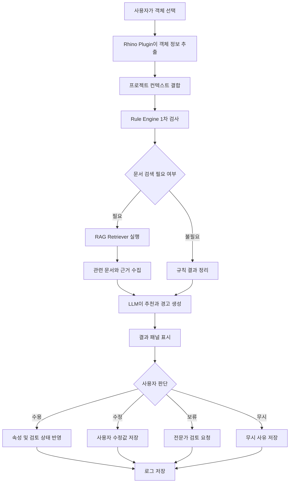

# 5. MVP AI Agent 상세 설계

## 5.1 Agent 개요

**Material Insight AI**는 Rhino/CAD에서 선택한 객체의 속성을 분석하고, 재료·두께·성능 관련 누락과 위험 요소를 탐지한 뒤, 관련 시방서와 기준 문서를 근거로 추천을 제공하는 플러그인형 AI Agent다.

본 Agent는 설계자의 판단을 대체하지 않는다. AI는 추천, 경고, 참고 자료를 제공하고 최종 반영 여부는 설계자가 결정한다.

---

## 5.2 대상 사용자

### 1차 사용자

- 건축 설계자
- 인테리어 디자이너
- Rhino/CAD 모델러
- CAD 오퍼레이터

### 2차 사용자

- 시니어 설계 검토자
- 프로젝트 관리자
- 구조 엔지니어
- 시공 및 자재 담당자

---

## 5.3 핵심 사용자 시나리오

### 시나리오 1. 재료 속성이 누락된 벽체 검토

설계자가 Rhino에서 회의실 구획벽 객체를 선택한다.

Agent는 객체의 레이어, 두께, 공간 용도와 재료 속성을 분석한다. 재료가 지정되지 않은 것을 확인하고 관련 시방서와 과거 사례를 검색한다.

결과 패널에는 다음 내용이 표시된다.

- 재료 속성 누락 경고
- 회의실 벽체에 필요한 차음 검토 안내
- 경량철골 및 석고보드 조합 후보
- 일반적인 두께 검토 범위
- 참고 시방서와 문서 출처
- `수용`, `수정`, `보류`, `무시` 버튼

설계자는 추천을 참고해 재료와 두께를 수정하고 검토 완료 상태로 변경한다.

### 시나리오 2. 두께가 얇은 객체 검토

설계자가 두께 75mm로 설정된 벽체를 선택한다.

규칙 엔진은 공간 용도와 현재 두께를 비교해 추가 검토가 필요하다고 판단한다. Agent는 단순히 오류라고 단정하지 않고 다음과 같이 안내한다.

> 현재 두께는 회의실 구획벽의 일반 검토 범위보다 얇을 수 있습니다. 차음 요구사항과 벽체 구성 확인이 필요합니다.

사용자는 근거 문서를 확인한 뒤 값을 수정하거나 시니어 설계자에게 검토를 요청한다.

### 시나리오 3. 전체 모델 누락 검사

사용자가 `전체 모델 검사` 명령을 실행한다.

Agent는 대상 객체를 순회하면서 다음 항목을 검사한다.

- 재료 미지정 객체
- 두께 미입력 객체
- 용도 정보 누락 객체
- 동일 유형 간 속성 불일치
- 검토 상태가 없는 고위험 객체

결과는 우선순위가 포함된 검토 목록으로 제공된다.

---

## 5.4 입력 데이터

### 객체 데이터

| 입력 | 설명 |
|---|---|
| Object ID | Rhino 객체의 고유 식별자 |
| Object Type | Curve, Surface, Brep, Block 등 |
| Layer | 객체가 속한 레이어 |
| Name | 객체 이름 |
| Geometry | 길이, 면적, 체적, 경계 정보 |
| Material | 현재 지정된 재료 |
| User Attributes | 사용자 정의 속성 |
| Group/Block | 그룹과 블록 정보 |

### 프로젝트 컨텍스트

| 입력 | 설명 |
|---|---|
| Project Type | 신축, 리모델링, 인테리어 등 |
| Space Type | 회의실, 복도, 화장실, 사무실 등 |
| Design Stage | 개념, 기본, 실시설계 |
| Building Use | 업무, 주거, 상업, 교육 등 |
| Region | 적용 법규와 기준 확인을 위한 지역 |
| Priority | 비용, 성능, 미관, 시공성 등의 우선순위 |

### 지식 데이터

- 사내 설계 기준
- 프로젝트 시방서
- 제조사 카탈로그
- 과거 프로젝트 사례
- 검토 체크리스트
- 승인된 재료 및 상세 목록

---

## 5.5 출력 데이터

Agent는 결과를 다음 구조로 제공한다.

```json
{
  "object_id": "W-012",
  "status": "review_required",
  "detected_issues": [
    "material_missing",
    "thickness_review_required"
  ],
  "recommended_materials": [
    "경량철골 + 석고보드",
    "고밀도 차음 보드 조합"
  ],
  "thickness_guidance": {
    "current_mm": 75,
    "reference_range_mm": "100-150",
    "warning": "공간 용도와 차음 요구 확인 필요"
  },
  "evidence": [
    {
      "document": "사내 시방서",
      "section": "4.2 회의실 구획벽"
    }
  ],
  "required_action": "designer_review"
}
```

### 사용자 화면에 표시되는 정보

- 현재 객체 요약
- 탐지된 문제
- 추천 재료 후보
- 두께 검토 정보
- 성능상 주의사항
- 관련 문서와 출처
- 추천 신뢰도
- 추가 입력 요청
- 승인·수정·보류·무시 버튼

---

## 5.6 업무 흐름



---

## 5.7 주요 기능 모듈

### 1. Object Inspector

선택 객체의 형상과 속성을 읽고 Agent가 사용할 표준 데이터로 변환한다.

주요 기능:

- 객체 ID 추출
- 레이어와 이름 확인
- 재료와 사용자 정의 속성 확인
- 길이·면적·체적 계산
- 객체 유형과 공간 용도 매핑

### 2. Rule Engine

명확한 조건을 규칙으로 검사한다.

예시 규칙:

```yaml
rule_id: WALL_MATERIAL_REQUIRED
target: interior_wall
condition:
  material: null
result:
  severity: warning
  message: 재료 정보가 입력되지 않았습니다.
```

규칙 엔진이 담당하는 항목은 다음과 같다.

- 필수 속성 누락
- 값 형식 오류
- 범위 벗어남
- 검토 상태 누락
- 동일 유형 객체 간 불일치

### 3. RAG Retriever

객체 정보와 탐지된 문제를 검색 질의로 변환하고 관련 문서를 검색한다.

검색 대상:

- 프로젝트 시방서
- 사내 설계 기준
- 제조사 카탈로그
- 승인된 과거 프로젝트
- 기술 체크리스트

### 4. LLM Agent

규칙 결과와 검색 문서를 바탕으로 사람이 이해하기 쉬운 문장을 생성한다.

LLM의 역할:

- 검색 결과 요약
- 추천 후보 설명
- 위험과 전제 표시
- 추가 확인 항목 제시
- 전문가 검토 필요 여부 설명

LLM이 수행하지 않는 역할:

- 구조 안전성 확정
- 법규 적합성 최종 판정
- 근거 없는 재료 수치 생성
- 사용자 승인 없는 객체 자동 수정

### 5. Review Panel

Rhino/CAD 내부 사이드 패널에서 결과를 제공한다.

주요 UI 요소:

- 객체 정보 카드
- 문제 및 위험도 표시
- 추천 결과
- 근거 문서 링크
- 신뢰도와 정보 부족 표시
- 사용자 행동 버튼
- 검토 이력

### 6. Feedback Logger

사용자의 결정을 기록한다.

저장 항목:

- 추천 내용
- 수용·수정·보류·무시 여부
- 수정 전후 값
- 사용자 의견
- 문서 출처
- 승인자
- 처리 시간

---

## 5.8 외부 도구 및 API

| 도구 | 역할 |
|---|---|
| RhinoCommon SDK | 객체 선택, 속성 추출, 패널 UI 구현 |
| C# Plugin | Rhino 내부 연동 |
| FastAPI | Agent 백엔드 API |
| PostgreSQL | 객체 검토 이력 및 사용자 행동 저장 |
| Vector Database | 시방서와 카탈로그 임베딩 검색 |
| LLM API | 검색 결과 기반 추천 문장 생성 |
| Embedding Model | 문서와 질의 벡터화 |
| Object Storage | 원본 문서와 카탈로그 저장 |
| Issue Tracker API | 고위험 항목의 검토 요청 생성 |

MVP에서는 복잡도를 줄이기 위해 Rhino Plugin, FastAPI, 간단한 Vector DB와 LLM API를 중심으로 구성한다.

---

## 5.9 RAG 활용 방식

본 Agent는 문서의 내용을 모델이 임의로 기억하는 방식보다, 필요한 순간에 관련 문서를 검색하는 RAG 방식을 사용한다.

### 검색 절차

1. 객체와 프로젝트 컨텍스트 수집
2. 규칙 엔진으로 문제 유형 분류
3. 검색 질의 생성
4. 문서 메타데이터 필터 적용
5. 유사 문서 조각 검색
6. 출처와 버전 확인
7. LLM에 객체 정보와 검색 결과 전달
8. 추천과 근거 생성

### 메타데이터 예시

```yaml
document_id: SPEC-2026-014
document_type: internal_specification
category: interior_wall
space_type: meeting_room
version: 3.1
effective_date: 2026-01-01
status: active
```

문서 최신성과 신뢰도를 보장하기 위해 비활성 문서와 이전 버전은 기본 검색 대상에서 제외한다.

---

## 5.10 Human-in-the-loop 설계

| 위험 수준 | 예시 | 처리 방식 |
|---|---|---|
| 낮음 | 재료 속성 누락 | 설계자가 직접 수정 |
| 중간 | 일반 범위를 벗어난 두께 | 시니어 설계자 검토 권장 |
| 높음 | 구조, 내화, 법규 관련 문제 | 전문가 검토 필수 |
| 매우 높음 | 안전에 영향을 줄 수 있는 판단 | AI 자동 처리 금지 |

### 사용자 행동

- **수용:** 추천값 또는 체크리스트를 채택
- **수정:** 사용자가 값을 변경해 반영
- **보류:** 추가 자료가 필요해 미결 상태 유지
- **무시:** 추천을 적용하지 않고 이유 기록
- **검토 요청:** 시니어 또는 전문가에게 전달

---

## 5.11 예외 및 실패 처리

### 정보가 부족한 경우

객체 유형이나 공간 용도를 판단할 수 없으면 확정 추천을 생성하지 않는다.

출력 예시:

> 현재 객체의 용도와 공간 정보가 부족해 재료를 추천할 수 없습니다. 객체 유형과 공간 용도를 입력해 주세요.

### 검색 결과가 없는 경우

> 등록된 시방서와 카탈로그에서 관련 근거를 찾지 못했습니다. 일반 안내만 제공하며 전문가 확인이 필요합니다.

### 문서가 오래된 경우

> 검색된 문서는 이전 버전입니다. 최신 기준 확인 전에는 추천값을 반영하지 마세요.

### 시스템 오류가 발생한 경우

규칙 검사 결과는 유지하되 LLM 추천을 생략하고 오류 상태를 표시한다.

---

## 5.12 MVP 성공 기준

MVP는 다음 조건을 만족하면 기본 가설을 검증한 것으로 판단한다.

- 사용자가 Rhino에서 객체를 선택할 수 있음
- 객체의 레이어, 이름, 재료, 사용자 속성을 추출할 수 있음
- 재료와 두께 누락 규칙을 검사할 수 있음
- 샘플 시방서에서 관련 문서를 검색할 수 있음
- 추천, 경고, 출처를 패널에 표시할 수 있음
- 사용자가 수용·수정·무시를 선택할 수 있음
- 결과와 사용자 행동이 로그에 저장됨

---

## 5.13 MVP 범위 요약

| 구분 | MVP 포함 | 향후 확장 |
|---|---|---|
| 대상 프로그램 | Rhino | AutoCAD, Revit, 기타 BIM |
| 대상 객체 | 내벽, 바닥, 천장 | 구조체, 외벽, 설비 객체 |
| 문서 | 샘플 시방서와 카탈로그 | 기업 전체 지식 베이스 |
| 검토 | 누락·일반 범위·체크리스트 | 법규·구조 통합 검토 |
| 반영 방식 | 사용자 승인 후 반영 | 기업 승인 워크플로우 연동 |
| 사용자 | 단일 설계자 중심 | 다중 사용자 협업 |

---

## 5.14 소결

Material Insight AI의 MVP는 Rhino 객체 분석, 규칙 기반 검사, 문서 검색형 RAG, LLM 설명, 설계자 승인으로 구성된다.

핵심은 LLM이 설계를 대신하는 것이 아니라, 규칙과 문서 근거를 결합해 설계자가 더 빠르고 일관된 판단을 내리도록 지원하는 것이다. 다음 장에서는 이를 구현하기 위한 기술 아키텍처와 데이터 흐름을 구체화한다.
