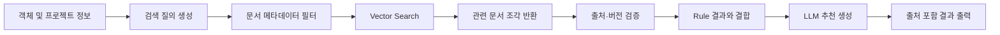
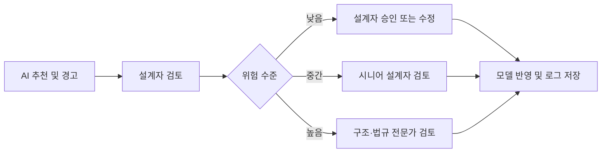

# 7. RAG, Human-in-the-loop 및 평가 설계

## 7.1 RAG 활용 목적

Material Insight AI는 재료, 시방, 과거 사례와 설계 기준을 모델이 임의로 생성하지 않고, 관련 문서를 검색해 근거와 함께 제시하기 위해 RAG를 사용한다.

RAG의 역할은 다음과 같다.

- 객체와 관련된 문서 검색
- 최신 문서 우선 제공
- 추천 근거와 출처 표시
- 사내 설계 기준 재사용
- 과거 승인 사례 참고
- LLM 환각 감소

---

## 7.2 RAG 처리 흐름



### 검색 질의 예시

```text
객체 유형: 비내력 내벽
공간 용도: 회의실
현재 두께: 75mm
재료: 미지정
검색 목적: 차음 성능과 권장 벽체 구성
```

---

## 7.3 지식 베이스 구성

| 데이터 소스 | 활용 목적 | 우선순위 |
|---|---|---:|
| 프로젝트 시방서 | 현재 프로젝트 기준 확인 | 1 |
| 사내 설계 표준 | 조직 공통 기준 적용 | 2 |
| 승인된 과거 사례 | 유사 설계 참고 | 3 |
| 제조사 카탈로그 | 재료 규격과 성능 확인 | 4 |
| 일반 체크리스트 | 추가 검토 항목 제공 | 5 |

문서에는 다음 메타데이터를 저장한다.

```yaml
document_id: SPEC-INT-024
document_type: project_specification
category: interior_wall
space_type: meeting_room
version: 2.1
effective_date: 2026-03-01
status: active
source: internal
```

---

## 7.4 문서 관리 원칙

RAG의 품질은 문서 최신성과 신뢰도에 좌우된다. 따라서 다음 원칙을 적용한다.

1. 활성 상태의 최신 문서만 기본 검색
2. 문서 버전과 개정일 표시
3. 프로젝트 문서를 사내 일반 기준보다 우선
4. 출처가 불명확한 문서 제외
5. 관리자 승인 후 지식 베이스 등록
6. 검색 결과가 없으면 근거 없음 표시
7. 원문 링크 또는 문서 위치 제공

---

## 7.5 Human-in-the-loop 설계

건축 설계는 안전, 법규, 비용과 책임이 연결되는 업무이므로 AI 결과를 자동 반영하지 않는다.

### 기본 승인 흐름



### 사용자 행동

| 행동 | 의미 |
|---|---|
| 수용 | AI 추천을 그대로 채택 |
| 수정 | 사용자가 값을 변경한 뒤 반영 |
| 보류 | 추가 자료 확인 후 결정 |
| 무시 | 추천을 적용하지 않고 사유 기록 |
| 검토 요청 | 시니어 또는 전문가에게 전달 |

---

## 7.6 위험 수준 분류

| 수준 | 예시 | 처리 방식 |
|---|---|---|
| 낮음 | 재료 속성 누락 | 설계자가 직접 수정 |
| 중간 | 일반 범위를 벗어난 두께 | 시니어 검토 권장 |
| 높음 | 내화, 구조, 법규 관련 문제 | 전문가 승인 필수 |
| 매우 높음 | 안전에 영향을 주는 자동 변경 | AI 수행 금지 |

Agent는 구조 안전성과 법규 적합성을 확정하지 않고, 검토 필요성과 관련 근거만 제공한다.

---

## 7.7 주요 위험 요소와 통제 방안

| 위험 요소 | 발생 가능 문제 | 통제 방안 |
|---|---|---|
| LLM 환각 | 존재하지 않는 기준이나 수치 생성 | RAG 근거 제한, 출처 표시, 규칙 엔진 병행 |
| 오래된 문서 | 폐기된 기준 적용 | 버전·유효기간 관리, 최신 문서 우선 |
| 잘못된 객체 분류 | 부적절한 재료 추천 | 신뢰도 표시, 사용자 확인 요청 |
| 프로젝트 맥락 부족 | 일반 기준을 특수 프로젝트에 적용 | 프로젝트 유형과 공간 용도 필수 입력 |
| 과도한 자동화 | 잘못된 값이 모델에 반영 | 사용자 승인 없는 자동 수정 금지 |
| 보안 유출 | 도면과 고객 정보 외부 전송 | 최소 메타데이터 전송, 마스킹, 권한 제어 |
| 문서 오염 | 악의적 또는 부정확한 문서 검색 | 관리자 승인 문서만 등록 |
| 책임 불명확 | 오류 발생 시 판단 주체 추적 불가 | 승인자, 시간, 변경 사유 로그 저장 |
| 과도한 경고 | 사용자가 경고를 무시하게 됨 | 우선순위와 심각도 분류 |
| 검색 실패 | 근거 없는 추천 생성 | 근거 없음 표시, 추천 제한 |

---

## 7.8 평가 지표

### 정량 지표

| 지표 | 정의 | 목표 예시 |
|---|---|---:|
| 속성 누락 탐지율 | 실제 누락 중 Agent가 탐지한 비율 | 90% 이상 |
| 오탐률 | 정상 객체를 문제로 분류한 비율 | 10% 이하 |
| 문서 검색 적합도 | 상위 검색 결과가 질문과 관련된 비율 | 80% 이상 |
| 추천 수용률 | 전체 추천 중 사용자가 수용한 비율 | 60% 이상 |
| 검토 시간 단축률 | 기존 대비 객체당 검토 시간 감소율 | 30% 이상 |
| 평균 응답 시간 | 객체 선택부터 결과 표시까지 시간 | 5초 이내 |
| 전문가 전환 정확도 | 고위험 항목이 적절히 전달된 비율 | 90% 이상 |

### 정성 지표

- 추천 설명이 이해하기 쉬운가
- 근거 문서가 신뢰할 수 있는가
- Rhino 작업 흐름을 방해하지 않는가
- 사용자가 결과를 통제할 수 있는가
- 초급 설계자의 검토 업무에 도움이 되는가
- 시니어 설계자의 검토 부담을 줄이는가

---

## 7.9 평가 방법

### 테스트 데이터셋

다음 유형의 객체를 포함한 샘플 프로젝트를 구성한다.

- 재료가 정상 입력된 객체
- 재료가 누락된 객체
- 두께가 일반 범위를 벗어난 객체
- 공간 용도가 누락된 객체
- 구조 검토가 필요한 객체
- 서로 다른 문서 버전이 연결된 객체

### 비교 실험

동일한 검토 작업을 두 방식으로 수행한다.

1. 기존 방식: 설계자가 직접 문서 검색 및 검토
2. Agent 방식: Material Insight AI 사용

비교 항목:

- 작업 시간
- 누락 탐지 수
- 잘못된 경고 수
- 검색한 문서 수
- 사용자 만족도
- 최종 수정 결과

---

## 7.10 로그와 피드백 활용

사용자의 승인과 수정 기록은 향후 시스템 개선에 사용한다.

활용 예시:

- 자주 수용되는 추천 유형 파악
- 반복적으로 무시되는 경고 조정
- 잘못 검색되는 문서 개선
- 공간 용도별 규칙 보완
- 사용자별 UI 개선
- 조직 표준과 실제 업무 차이 분석

단, 사용자 로그를 자동 학습에 사용하기 전에는 데이터 품질과 개인정보를 검토해야 한다.

---

## 7.11 실패 시나리오

### 실패 시나리오 1. 객체 정보 부족

객체의 레이어와 이름이 불명확해 Agent가 유형을 판단하지 못한다.

**대응**

- 객체 유형 입력 요청
- 추정 결과와 신뢰도 표시
- 확정 추천 생성 금지

### 실패 시나리오 2. 오래된 시방서 검색

과거 프로젝트 문서가 최신 기준보다 높은 유사도로 검색된다.

**대응**

- 활성 문서 필터
- 개정일 기반 우선순위
- 오래된 문서 경고

### 실패 시나리오 3. 과도한 일반화

일반적인 벽체 기준을 특수 방음실에 적용한다.

**대응**

- 공간 용도 필수 입력
- 특수 공간 감지 시 전문가 검토
- 일반 범위와 적용 전제 명시

### 실패 시나리오 4. LLM 서비스 장애

LLM API가 응답하지 않는다.

**대응**

- Rule Engine 결과는 그대로 표시
- 문서 검색 결과만 제공
- 재시도와 오류 로그 저장

---

## 7.12 소결

Material Insight AI의 신뢰성은 LLM 성능만으로 확보할 수 없다. 최신 문서를 검색하는 RAG, 명확한 조건을 검사하는 Rule Engine, 최종 결정을 담당하는 설계자와 전문가가 함께 구성되어야 한다.

본 설계는 다음 원칙을 따른다.

- 근거 없는 추천 금지
- 고위험 자동화 금지
- 문서 버전과 출처 표시
- 사용자 승인 절차 유지
- 모든 결정과 변경 이력 기록
- 정량·정성 지표를 통한 지속 평가

다음 장에서는 실제 발표와 시연에 사용할 수 있는 프로토타입 및 데모 시나리오를 설계한다.
