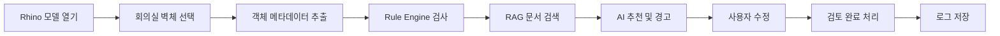

# 8. 프로토타입 및 데모 시나리오

## 8.1 데모 목적

본 데모의 목적은 Material Insight AI가 단순한 챗봇이 아니라, Rhino 객체를 읽고 규칙 검사와 문서 검색을 수행한 뒤 설계자의 판단까지 연결하는 **업무형 AI Agent**임을 보여주는 것이다.

데모에서는 다음 흐름을 검증한다.

1. 객체 선택
2. 속성 추출
3. 누락 및 위험 탐지
4. 관련 문서 검색
5. 추천과 경고 생성
6. 사용자 승인 또는 수정
7. 검토 이력 저장

---

## 8.2 프로토타입 화면 구성

### 화면 1. 객체 정보 패널

선택한 객체의 기본 정보를 표시한다.

- 객체 ID
- 객체 유형
- 레이어
- 공간 용도
- 현재 재료
- 현재 두께
- 검토 상태

### 화면 2. AI 검토 결과

Agent가 탐지한 문제와 추천을 표시한다.

- 누락 속성
- 위험 수준
- 재료 후보
- 두께 검토 안내
- 성능상 주의사항
- 관련 문서 출처
- 추천 신뢰도

### 화면 3. 사용자 액션

사용자가 다음 행동을 선택할 수 있다.

- 수용
- 수정
- 보류
- 무시
- 전문가 검토 요청

### 화면 4. 전체 모델 QA 목록

모델 전체를 검사한 결과를 우선순위별로 보여준다.

- 재료 누락 객체
- 두께 검토 필요 객체
- 공간 용도 누락 객체
- 고위험 검토 대상
- 처리 완료 여부

---

## 8.3 대표 데모 시나리오

### 시나리오 A. 회의실 구획벽 검토

#### 입력 객체

```yaml
object_id: W-012
object_type: interior_wall
space_type: meeting_room
material: null
thickness_mm: 75
review_status: pending
```

#### Agent 처리

1. 재료 속성 누락 탐지
2. 회의실 공간 용도 확인
3. 두께 75mm를 일반 검토 범위와 비교
4. 차음 관련 시방서 검색
5. 추천과 경고 생성

#### 출력 예시

> **검토 필요**
>
> 현재 객체에는 재료 정보가 입력되어 있지 않습니다.  
> 회의실 구획벽은 차음 성능 검토가 필요할 수 있습니다.  
> 경량철골과 석고보드 조합을 후보로 검토하고, 현재 두께 75mm가 프로젝트 기준을 만족하는지 확인하세요.
>
> **참고 문서:** 사내 시방서 4.2 회의실 구획벽  
> **권장 행동:** 시니어 설계자 검토 후 재료와 두께 수정

#### 사용자 행동

- 재료: `경량철골 + 석고보드`
- 두께: `125mm`
- 상태: `검토 완료`
- 행동: `수정 후 수용`

---

### 시나리오 B. 전체 모델 누락 검사

사용자가 `Scan Model` 버튼을 실행한다.

#### 검사 결과 예시

| 분류 | 객체 수 | 우선순위 |
|---|---:|---|
| 재료 미지정 | 18 | 중 |
| 두께 미입력 | 7 | 중 |
| 두께 검토 필요 | 5 | 높음 |
| 공간 용도 누락 | 9 | 낮음 |
| 구조 전문가 검토 필요 | 2 | 매우 높음 |

사용자는 위험도가 높은 객체부터 선택해 개별 검토를 수행한다.

---

## 8.4 End-to-End 데모 흐름



발표에서는 이 흐름을 2~3분 안에 보여주는 것이 적절하다.

---

## 8.5 대화형 출력 예시

### 사용자 요청

```text
선택한 벽체의 재료와 두께를 검토해줘.
```

### Agent 응답

```text
객체 W-012를 분석했습니다.

탐지된 문제
- 재료 속성이 비어 있습니다.
- 현재 두께 75mm는 회의실 구획벽 기준으로 추가 검토가 필요합니다.

추천
- 경량철골 + 석고보드 조합 검토
- 차음 성능을 고려한 충진재 및 보드 겹수 확인
- 두께 100~150mm 범위 참고

근거
- 사내 시방서 4.2 회의실 구획벽
- 승인 프로젝트 사례 PRJ-021

주의
- 본 결과는 참고용이며 최종 반영 전 시니어 설계자 검토가 필요합니다.
```

---

## 8.6 시스템 프롬프트 예시

```text
당신은 건축·공간 설계자를 지원하는 AI Agent다.

입력으로 제공된 CAD/Rhino 객체 정보, 프로젝트 컨텍스트,
Rule Engine 결과와 검색 문서를 바탕으로 재료, 두께,
성능상 주의사항과 추가 검토 항목을 설명한다.

반드시 다음 원칙을 따른다.

1. 검색 문서에 없는 수치나 기준을 임의로 만들지 않는다.
2. 구조 및 법규 적합성을 확정하지 않는다.
3. 추천에는 근거 문서와 출처를 표시한다.
4. 정보가 부족하면 추가 입력을 요청한다.
5. 고위험 항목은 전문가 검토로 전환한다.
6. 출력은 문제, 추천, 근거, 주의사항, 사용자 행동 순서로 작성한다.
```

---

## 8.7 사용자 프롬프트 템플릿

```text
[객체 정보]
객체 ID: {{object_id}}
객체 유형: {{object_type}}
공간 용도: {{space_type}}
현재 재료: {{material}}
현재 두께: {{thickness_mm}}

[프로젝트 정보]
프로젝트 유형: {{project_type}}
설계 단계: {{design_stage}}
지역: {{region}}

[Rule Engine 결과]
{{rule_results}}

[검색 문서]
{{retrieved_documents}}

위 정보를 바탕으로 다음 형식으로 답하라.

1. 탐지된 문제
2. 추천 재료
3. 두께 검토
4. 성능상 주의사항
5. 참고 근거
6. 사용자에게 필요한 다음 행동
```

---

## 8.8 Tool 목록

| Tool | 역할 |
|---|---|
| `get_selected_object` | Rhino에서 현재 선택 객체 정보 추출 |
| `get_project_context` | 프로젝트 유형과 공간 용도 조회 |
| `run_rule_check` | 속성 누락과 값 범위 검사 |
| `search_documents` | 시방서와 카탈로그 검색 |
| `get_document_source` | 문서 버전과 출처 반환 |
| `create_recommendation` | 결과 구조화 |
| `update_object_attribute` | 승인 후 객체 속성 수정 |
| `create_review_request` | 전문가 검토 요청 생성 |
| `save_review_log` | 사용자 행동과 결과 저장 |

Agent는 모든 Tool을 자유롭게 실행하지 않는다. 객체 수정과 검토 요청은 사용자 승인 후에만 실행한다.

---

## 8.9 데모용 API 예시

### 요청

```json
POST /api/v1/review-object
{
  "project_id": "PRJ-001",
  "object": {
    "object_id": "W-012",
    "object_type": "interior_wall",
    "space_type": "meeting_room",
    "material": null,
    "thickness_mm": 75
  }
}
```

### 응답

```json
{
  "status": "review_required",
  "severity": "medium",
  "issues": [
    "material_missing",
    "thickness_review_required"
  ],
  "recommendation": {
    "material_candidates": [
      "경량철골 + 석고보드"
    ],
    "message": "회의실 구획벽은 차음 성능 검토가 필요합니다."
  },
  "sources": [
    {
      "document_id": "SPEC-INT-024",
      "section": "4.2"
    }
  ],
  "required_action": "designer_review"
}
```

---

## 8.10 발표용 데모 구성

### 1단계. 문제 제시

“현재 객체에는 재료가 입력되어 있지 않고, 두께가 적절한지 확인하려면 여러 문서를 직접 검색해야 합니다.”

### 2단계. 객체 선택

Rhino에서 회의실 벽체를 클릭한다.

### 3단계. Agent 분석

사이드 패널에서 다음 과정이 표시된다.

- 객체 정보 확인
- 규칙 검사 완료
- 관련 문서 검색
- 추천 생성

### 4단계. 결과 확인

재료 누락, 두께 검토 경고, 관련 시방서와 추천 결과를 보여준다.

### 5단계. 사용자 승인

설계자가 재료와 두께를 수정한 뒤 검토 완료 버튼을 누른다.

### 6단계. 이력 확인

추천 내용, 수정값, 처리자와 시간이 기록된 로그를 보여준다.

---

## 8.11 실패 데모 시나리오

성공 사례만 보여주기보다 Agent가 모르는 상황에서 어떻게 대응하는지도 제시한다.

### 입력

```yaml
object_type: unknown
space_type: null
material: null
thickness_mm: null
```

### 출력

> 객체 유형과 공간 용도를 확인할 수 없어 재료와 두께를 추천할 수 없습니다.  
> 객체 유형과 공간 정보를 입력한 뒤 다시 검토하세요.

이 결과는 Agent가 근거 없이 답변하지 않도록 설계되었음을 보여준다.

---

## 8.12 프로토타입 구현 범위

### 구현 가능 범위

- Rhino 객체 선택
- 객체 속성 추출
- 규칙 기반 누락 검사
- 샘플 문서 검색
- AI 추천 결과 표시
- 사용자 행동 저장

### 화면 설계로 대체 가능한 범위

- 다중 사용자 승인
- 구조 엔지니어 시스템 연동
- 실제 제조사 API
- 전체 법규 데이터베이스
- 기업용 보안 배포

---

## 8.13 데모 성공 기준

데모는 다음 조건을 만족하면 성공한 것으로 본다.

- 객체 선택 결과가 패널에 표시됨
- 누락 속성과 위험이 정확히 탐지됨
- 관련 문서 출처가 표시됨
- AI 추천이 구조화된 형태로 출력됨
- 사용자가 수용·수정·무시를 선택할 수 있음
- 사용자 행동이 로그에 저장됨
- 정보 부족 시 추천을 중단함

---

## 8.14 소결

본 데모는 Material Insight AI가 Rhino 객체, 규칙 엔진, RAG, LLM, 사용자 승인을 하나의 흐름으로 연결한다는 점을 보여준다.

핵심 시연 장면은 다음과 같다.

> **객체 선택 → 누락 탐지 → 문서 검색 → 근거 기반 추천 → 사용자 수정 및 승인 → 이력 저장**

이 흐름을 통해 본 Agent가 단순한 질의응답 도구가 아니라 실제 설계 업무에 적용 가능한 의사결정 지원 시스템임을 설명할 수 있다.
