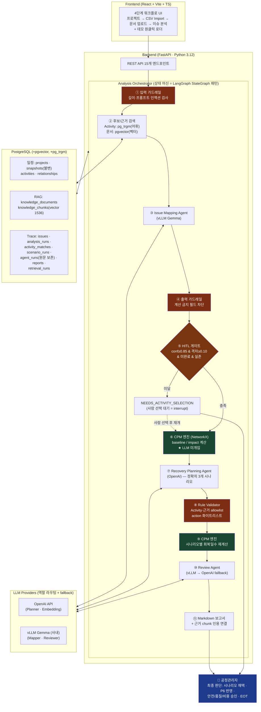
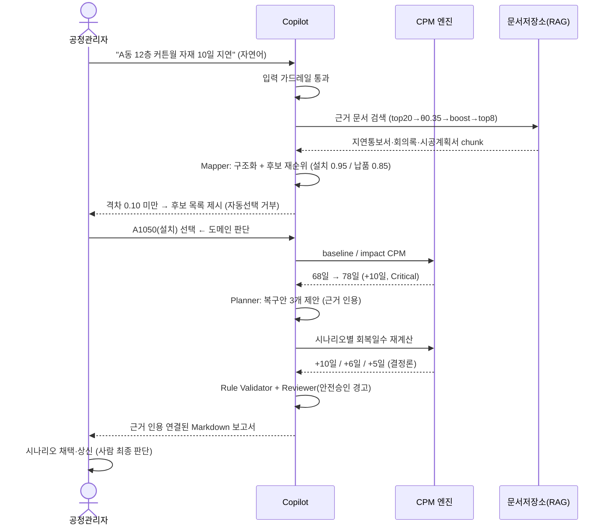

# P6 Schedule Recovery Copilot — 아키텍처 설계도

## 1. 전체 시스템 아키텍처



- **초록** = 결정론적 계산(LLM 배제) · **적색** = 가드레일/검증 계층 · **황색** = Human-in-the-loop 분기 · **청색** = 사람의 최종 판단

## 2. 업무 흐름도 (사용자 관점)



## 3. 텍스트 폴백 (mermaid 미지원 환경용)

```text
사용자(자연어 이슈)
  → [입력 가드레일] → Activity 검색(pg_trgm) + RAG 검색(pgvector)
  → [Mapper·vLLM] → [출력 가드레일]
  → [HITL 게이트] ─ 미달 → NEEDS_ACTIVITY_SELECTION → 사람 선택 → 재개
  → [CPM 엔진] baseline/impact  (LLM 미개입 · 초록)
  → [Planner·OpenAI] 3개 시나리오 → [출력 가드레일] → [Rule Validator]
  → [CPM 엔진] 회복일수 재계산 → [Reviewer·vLLM→OpenAI]
  → Markdown 보고서(근거 인용) → 👤 사람 최종 판단
  (전 과정 trace: PostgreSQL 13개 테이블)
```
