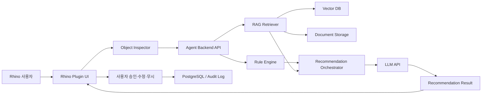
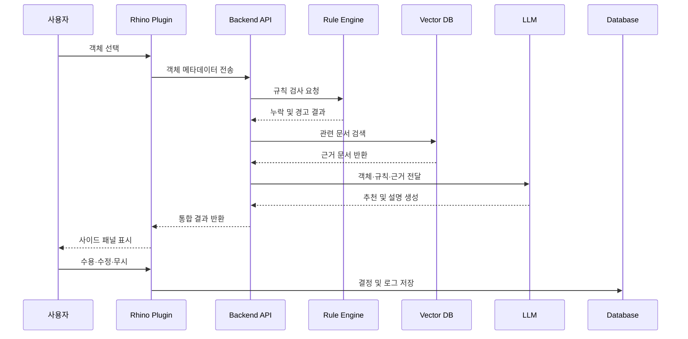
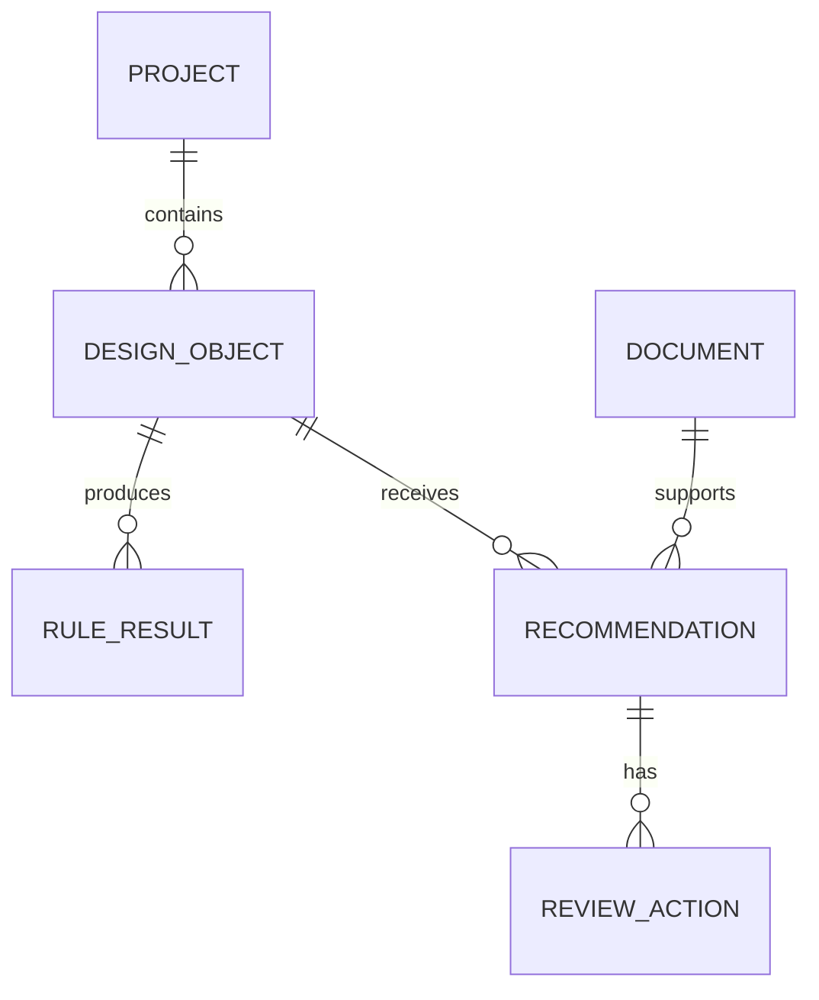
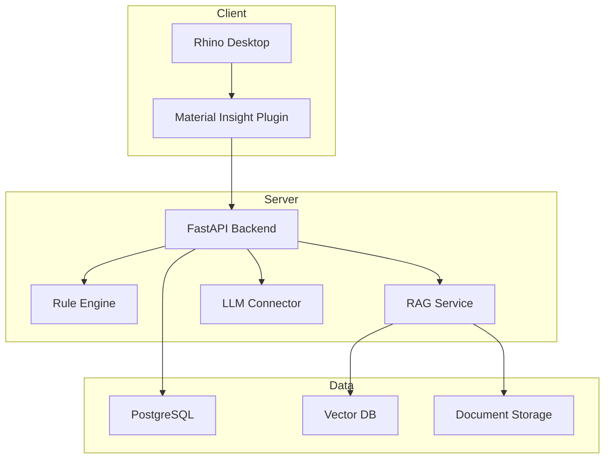

# 6. 기술 아키텍처

## 6.1 아키텍처 개요

Material Insight AI는 다음 6개 계층으로 구성된다.

1. Rhino Plugin
2. Object Inspector
3. Rule Engine
4. RAG Search Layer
5. LLM Recommendation Layer
6. Review 및 Logging Layer

핵심 원칙은 **객체 추출, 규칙 검사, 문서 검색, 자연어 설명, 사용자 승인**을 분리하는 것이다.

---

## 6.2 전체 시스템 구조



---

## 6.3 주요 구성요소

### 6.3.1 Rhino Plugin

Rhino 내부에서 사용자가 직접 접하는 계층이다.

주요 역할:

- 객체 선택 이벤트 감지
- 객체 속성 수집
- Agent 백엔드 호출
- 결과 패널 표시
- 사용자 결정 반영

플러그인은 C#과 RhinoCommon SDK를 기반으로 구현한다.

### 6.3.2 Object Inspector

선택 객체의 정보를 Rhino 공식 JSON이 아니라 Material Insight 전용 review-object payload 구조로 변환한다.

```json
{
  "object_id": "W-012",
  "object_type": "interior_wall",
  "layer": "A-WALL",
  "material": null,
  "thickness_mm": 75,
  "space_type": "meeting_room"
}
```

객체 유형을 확정할 수 없는 경우에는 추정값을 표시하고 사용자 확인을 요청한다.

### 6.3.3 Agent Backend API

플러그인과 AI 모듈 사이의 중간 계층이다.

주요 역할:

- 요청 검증
- 프로젝트 컨텍스트 결합
- 규칙 검사 및 검색 작업 실행
- LLM 호출 관리
- 결과 형식 통합
- 로그 저장

MVP에서는 Python 기반 FastAPI를 사용한다.

### 6.3.4 Rule Engine

정확하게 판별할 수 있는 조건을 검사한다.

예시:

- 재료 속성 누락
- 두께 값 미입력
- 허용 형식 오류
- 검토 상태 누락
- 동일 유형 객체 간 불일치

규칙 엔진의 결과는 LLM이 임의로 변경할 수 없도록 별도 필드로 유지한다.

### 6.3.5 RAG Search Layer

관련 문서를 검색해 추천의 근거를 제공한다.

구성:

- 문서 전처리
- Chunk 분할
- Embedding 생성
- Vector DB 저장
- 메타데이터 필터
- 유사도 검색
- 출처 및 버전 반환

검색 대상:

- 사내 설계 기준
- 프로젝트 시방서
- 제조사 카탈로그
- 과거 승인 사례
- 검토 체크리스트

### 6.3.6 LLM Recommendation Layer

Rule Engine 결과와 RAG 검색 결과를 바탕으로 설명형 결과를 생성한다.

LLM 입력:

- 객체 정보
- 프로젝트 컨텍스트
- 규칙 검사 결과
- 검색 문서 조각
- 출력 형식 지시

LLM 출력:

- 문제 요약
- 재료 후보
- 두께 검토 안내
- 성능상 주의사항
- 추가 확인 항목
- 전문가 검토 필요 여부

### 6.3.7 Review 및 Logging Layer

사용자의 판단과 변경 이력을 저장한다.

저장 항목:

- 객체 ID
- 추천 결과
- 사용자 행동
- 수정 전후 값
- 참고 문서
- 승인자
- 처리 시간
- 오류 정보

이 데이터는 추후 평가와 품질 개선에 활용한다.

---

## 6.4 요청 처리 흐름



---

## 6.5 데이터 구조

### 주요 엔터티

| 엔터티 | 주요 필드 |
|---|---|
| Project | project_id, type, region, stage |
| DesignObject | object_id, type, layer, material, thickness |
| RuleResult | rule_id, severity, message |
| Document | document_id, version, type, status |
| Recommendation | recommendation_id, content, confidence |
| ReviewAction | action, user_id, reason, timestamp |

### 관계



---

## 6.6 배포 구조

MVP에서는 플러그인과 백엔드를 분리한다.



### MVP 배포 방식

- Rhino Plugin: 사용자 PC
- Backend: 로컬 서버 또는 클라우드
- Vector DB: 백엔드와 동일 서버
- PostgreSQL: 개발용 단일 인스턴스
- LLM: 외부 API 또는 사내 모델

실제 기업 적용 시에는 프로젝트 기밀을 고려해 사내망 또는 전용 클라우드 배포가 적합하다.

---

## 6.7 보안 구조

### 데이터 최소화

전체 Rhino 파일을 서버에 업로드하지 않고, 선택 객체의 필요한 메타데이터만 전송한다.

### 접근 제어

- 프로젝트별 권한 분리
- 사용자 역할 기반 접근
- 관리자만 문서 등록 가능
- 고위험 기능은 승인 권한 필요

### 문서 보안

- 프로젝트별 Vector DB 분리
- 원본 문서 암호화
- 문서 버전과 상태 관리
- 비활성 문서 검색 제외

### 로그 보안

- 고객명과 위치 정보 마스킹
- 보존 기간 설정
- 민감한 프롬프트 저장 제한
- 관리자 접근 기록 유지

---

## 6.8 신뢰성 설계

### LLM 장애 시

LLM 호출이 실패해도 Rule Engine의 결과는 표시한다.

### 검색 결과가 없을 때

근거가 없다는 사실을 명시하고 일반적인 확정 추천은 생성하지 않는다.

### 오래된 문서가 검색될 때

문서 버전 경고를 표시하고 사용자 승인을 제한한다.

### 입력값이 불완전할 때

추가 입력을 요청하고 결과의 신뢰도를 낮게 표시한다.

---

## 6.9 기술 스택

| 영역 | 기술 |
|---|---|
| Plugin | C#, RhinoCommon SDK |
| Backend | Python, FastAPI |
| Rule Engine | Python 또는 YAML 기반 규칙 |
| Database | PostgreSQL |
| Vector Search | Chroma, Qdrant 또는 pgvector |
| Document Processing | Python, PDF Parser |
| LLM | 외부 LLM API 또는 사내 모델 |
| Embedding | 범용 또는 한국어 지원 임베딩 모델 |
| UI | Rhino Panel, WPF 또는 Eto.Forms |
| Deployment | Docker |

MVP에서는 관리 편의성을 위해 PostgreSQL과 pgvector를 함께 사용하는 구성이 적합하다.

---

## 6.10 확장 아키텍처

향후에는 다음 기능을 추가할 수 있다.

- AutoCAD 및 Revit 연동
- IFC 객체 매핑
- Jira, Notion, Slack 등의 이슈 시스템 연동
- 제조사 재료 API 연동
- 자동 재료표 생성
- 프로젝트 전체 QA 대시보드
- 조직별 승인 워크플로우
- 사내 LLM 배포

---

## 6.11 소결

Material Insight AI는 Rhino 플러그인, 규칙 엔진, RAG, LLM, 사용자 승인 계층을 분리해 설계한다.

이 구조는 다음 장점을 갖는다.

- LLM 의존도 감소
- 근거 기반 추천 가능
- 장애 시 일부 기능 유지
- 사용자 승인 절차 보장
- 보안과 로그 관리 용이
- 향후 BIM 및 기업 시스템으로 확장 가능

다음 장에서는 RAG, Human-in-the-loop, 위험 통제와 평가 지표를 구체적으로 정리한다.
