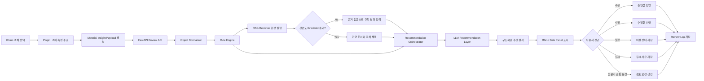
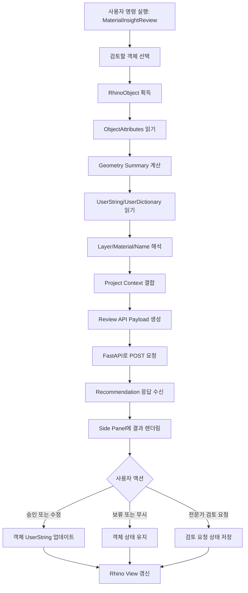
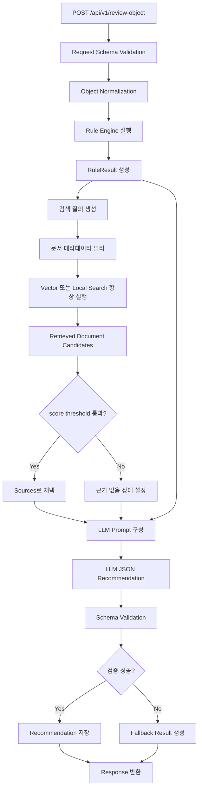
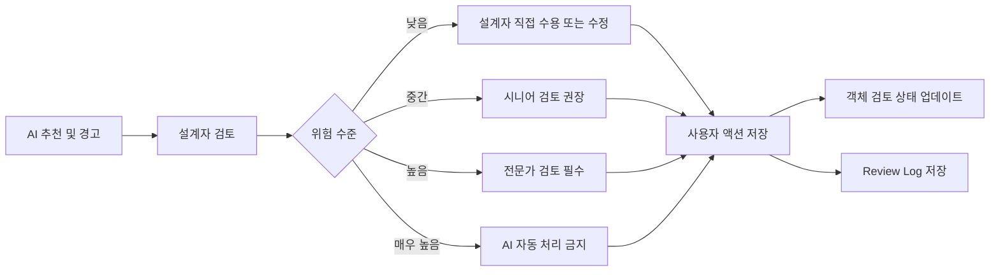
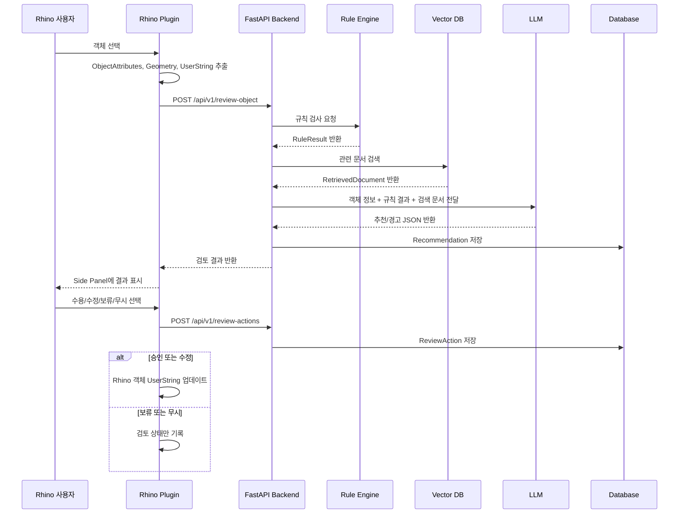
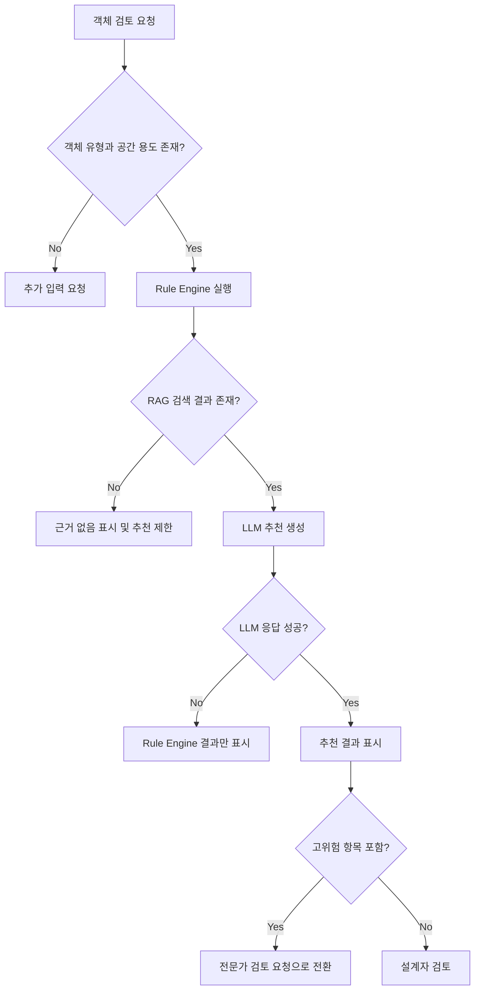
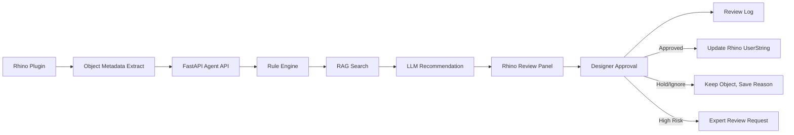

# 11. Material Insight AI 처리 흐름 다이어그램

## 11.1 전체 처리 흐름

---

## 11.2 Rhino Plugin 내부 흐름

---

## 11.3 백엔드 Agent 처리 흐름

---

## 11.4 Human-in-the-loop 흐름

---

## 11.5 데이터 흐름 상세

---

## 11.6 예외 처리 흐름

---

## 11.7 발표용 핵심 흐름

발표에서는 아래 문장과 함께 다이어그램을 설명하면 된다.

> Material Insight AI는 Rhino 객체를 직접 수정하는 자동 설계 도구가 아니라, 객체 정보를 읽고 규칙 검사와 문서 검색을 수행한 뒤, 근거가 포함된 추천을 Rhino 패널에 표시하는 Human-in-the-loop Agent다.

발표용 6단계:

1. Rhino에서 회의실 벽체 선택
2. Plugin이 객체 ID, 레이어, 재료, 두께, 공간 용도 추출
3. Rule Engine이 재료 누락과 두께 검토 필요 탐지
4. RAG는 항상 실행하고 score threshold를 통과한 시방서와 카탈로그만 근거로 채택
5. LLM이 추천과 경고를 근거와 함께 정리
6. 설계자가 수정 후 수용하고 로그 저장

---

## 11.8 구현 파일 매핑

| 처리 단계 | 구현 위치 예시 |
|---|---|
| Rhino 객체 선택 | `plugin/RhinoMaterialInsight/Commands/ReviewObjectCommand.cs` |
| 객체 속성 추출 | `plugin/RhinoMaterialInsight/Services/ObjectInspector.cs` |
| API 호출 | `plugin/RhinoMaterialInsight/Services/AgentApiClient.cs` |
| 결과 패널 | `plugin/RhinoMaterialInsight/Panels/ReviewPanel.cs` |
| Review API | `backend/app/api/routes_review.py` |
| 객체 정규화 | `backend/app/services/object_normalizer.py` |
| Rule Engine | `backend/app/services/rule_engine.py` |
| RAG 검색 | `backend/app/services/rag_retriever.py` |
| LLM 추천 | `backend/app/services/recommendation_orchestrator.py` |
| 사용자 액션 저장 | `backend/app/api/routes_actions.py` |
| 로그 저장 | `backend/app/services/review_logger.py` |

---

## 11.9 최종 요약 다이어그램

