# 관심 산업 기반 AI Agent 도입 전략 및 Delivery 설계

## CAD/Rhino 기반 건축·공간 설계자를 위한 재료-성능 주석형 AI Agent

### Material Insight AI

> Rhino/CAD 객체의 재료·두께·속성을 검사하고, 관련 시방서와 기준을 근거로 추천과 경고를 제공하는 플러그인형 AI Agent

- **산업 분야:** 건축·인테리어·공간 설계
- **주요 사용자:** CAD/Rhino 설계자
- **Agent 유형:** 플러그인형 Human-in-the-loop AI Agent
- **핵심 기술:** RhinoCommon, Rule Engine, RAG, LLM, Vector DB

---

## 목차

1. [주제 선정 배경](#1-주제-선정-배경)
2. [산업 및 업무 특성 분석](#2-산업-및-업무-특성-분석)
3. [현재 AI 도입 현황](#3-현재-ai-도입-현황)
4. [향후 AI Agent 도입 후보 및 MVP 선정](#4-향후-ai-agent-도입-후보-및-mvp-선정)
5. [MVP AI Agent 상세 설계](#5-mvp-ai-agent-상세-설계)
6. [기술 아키텍처](#6-기술-아키텍처)
7. [RAG, Human-in-the-loop 및 평가 설계](#7-rag-human-in-the-loop-및-평가-설계)
8. [프로토타입 및 데모 시나리오](#8-프로토타입-및-데모-시나리오)
9. [기대 효과, 한계 및 참고문헌](#9-기대-효과-한계-및-참고문헌)

---
# 1. 주제 선정 배경

## 1.1 프로젝트 주제

> **나는 건축·공간 설계 산업의 CAD/Rhino 설계자를 위해, 설계 객체의 재료 정보 누락과 부재 두께·성능 검토의 비효율을 줄이는 Rhino/CAD 플러그인형 AI Agent를 설계한다.**

본 프로젝트의 최종 주제는 **CAD/Rhino 기반 건축·공간 설계자를 위한 재료-성능 주석형 AI Agent**이다. 프로젝트에서 제안하는 AI Agent는 Rhino 또는 CAD 환경에서 설계자가 특정 객체를 선택했을 때 해당 객체의 유형, 치수, 레이어, 재료 속성, 공간 용도와 같은 메타데이터를 분석한다. 이후 재료 후보, 일반적인 두께 검토 범위, 누락된 속성, 성능상 주의사항, 대체 재료와 관련 기준 문서를 주석 또는 사이드 패널 형태로 제공한다.

이 Agent의 목적은 설계 도면을 자동으로 생성하거나 설계자의 판단을 대체하는 것이 아니다. 설계 과정에서 반복적으로 발생하는 정보 확인과 1차 검토를 지원하고, 설계자가 더 빠르고 일관된 판단을 내릴 수 있도록 돕는 것이 핵심이다.

---

## 1.2 산업 및 업무 배경

건축·인테리어·공간 설계 업무는 고객 요구를 시각적인 형태로 표현하는 작업이지만, 실제 실무는 단순한 도면 작성이나 3D 모델링만으로 끝나지 않는다. 설계자는 공간의 용도, 사용 인원, 구조적 조건, 시공성, 비용, 유지관리, 단열, 차음, 내화, 마감 특성 등을 동시에 고려해야 한다. 하나의 벽체나 바닥 객체를 설계할 때도 형상과 치수뿐 아니라 재료, 두께, 성능, 시방 조건과 같은 비형상 정보가 함께 검토되어야 한다.

Rhino는 정밀한 곡선과 자유형 표면을 다루는 NURBS 기반 3D CAD 도구로, 건축·산업 디자인과 복잡한 형상 설계에 활용된다. 또한 SDK와 플러그인 구조를 제공하기 때문에 사용자 정의 명령, 패널, 객체 분석 기능을 추가할 수 있다. 이러한 확장성은 설계자가 사용하는 기존 작업 환경 안에 AI Agent를 배치하기에 적합한 조건이다.

그러나 Rhino와 일반 CAD 중심의 작업에서는 BIM 도구에 비해 객체의 의미와 재료·성능 정보가 체계적으로 연결되지 않는 경우가 많다. 동일한 벽체라도 객체명, 레이어명, 블록명, 색상 또는 사용자가 입력한 속성에 따라 의미가 표현되며, 프로젝트와 사용자마다 정보 입력 방식이 달라질 수 있다. 이 때문에 형상은 완성되었지만 재료, 용도, 두께 근거 또는 검토 상태가 누락되는 문제가 발생한다.

---

## 1.3 현행 업무의 핵심 문제

### 1.3.1 형상 정보와 재료·성능 정보의 분리

CAD/Rhino 모델에는 객체의 위치, 길이, 면적, 체적과 같은 형상 정보가 존재하지만, 해당 객체가 실제로 어떤 재료와 구성으로 시공되어야 하는지는 별도의 도면, 재료표, 시방서 또는 담당자의 경험에 의존하는 경우가 많다.

예를 들어 모델에 `Wall_01`이라는 벽체가 존재하더라도 다음 정보가 모두 포함되어 있다고 보장할 수 없다.

- 벽체의 실제 용도
- 마감재와 구조재의 구성
- 요구 차음 성능
- 내화 또는 단열 요구사항
- 권장 두께와 검토 근거
- 적용한 제조사 제품과 시방 정보

따라서 설계자는 모델을 확인하면서 별도의 문서와 카탈로그를 동시에 검색해야 한다. 모델과 문서가 분리되어 있기 때문에 검토 과정이 길어지고, 문서의 내용을 모델의 어떤 객체에 적용했는지 추적하기도 어렵다.

### 1.3.2 반복적인 기준 문서 검색

설계자는 재료를 선택하거나 부재 구성을 검토할 때 다음과 같은 자료를 반복적으로 확인한다.

- 사내 설계 표준
- 프로젝트 시방서
- 제조사 자재 카탈로그
- 과거 프로젝트 도면
- 구조·단열·차음·내화 관련 기준
- 발주처의 요구사항과 협의 기록

이 자료들은 PDF, 문서 파일, 웹페이지, 도면 주석 등 여러 위치에 분산되어 있다. 같은 유형의 벽체나 바닥을 반복해서 설계하더라도 필요한 근거를 매번 다시 찾아야 하며, 검색어와 문서 구조를 잘 모르는 초급 설계자는 필요한 정보를 찾는 데 더 많은 시간이 걸린다.

### 1.3.3 부재 두께와 구성 판단의 부담

부재 두께는 단순한 숫자가 아니라 재료, 구조 방식, 공간 용도, 요구 성능과 연결된 값이다. 회의실 구획벽은 일반 칸막이보다 차음 요구가 높을 수 있고, 외벽은 단열·방수·외장재 조건을 함께 검토해야 한다. 슬래브는 구조 방식과 경간, 하중 조건에 따라 전문가의 검토가 필요하다.

그럼에도 초기 설계 단계에서는 제한된 정보로 빠르게 대안을 작성해야 하므로 임시값이나 과거 프로젝트의 값을 그대로 사용하는 경우가 발생할 수 있다. 이후 검토 단계에서 문제가 발견되면 도면, 모델, 재료표와 관련 문서를 다시 수정해야 하며 이는 재작업 비용으로 이어진다.

### 1.3.4 설계자 경험에 따른 품질 편차

숙련된 설계자는 객체의 용도와 형상을 보고 필요한 재료와 검토 항목을 빠르게 판단할 수 있다. 반면 초급 설계자는 어떤 문서를 확인해야 하는지, 어떤 속성을 입력해야 하는지, 어떤 항목을 구조 또는 시공 담당자에게 전달해야 하는지 판단하기 어렵다.

따라서 동일한 조직과 프로젝트에서도 작업자에 따라 다음과 같은 차이가 발생할 수 있다.

- 속성 입력의 완성도
- 기준 문서 검색 속도
- 위험 항목의 발견 시점
- 재료 선택의 일관성
- 검토 요청의 적절성

이 문제는 단순한 작업 속도의 차이를 넘어 설계 품질과 협업 효율의 편차로 이어질 수 있다.

### 1.3.5 검토 근거와 변경 이력의 추적 어려움

설계 검토 과정에서는 “왜 이 재료를 선택했는가”, “왜 두께를 변경했는가”, “누가 검토했는가”가 중요하다. 그러나 검토 결과가 메신저, 회의록, 이메일 또는 구두 협의에 흩어져 있으면 최종 판단의 근거를 추적하기 어렵다.

특히 프로젝트 후반에 담당자가 변경되거나 유사 프로젝트에서 기존 판단을 재사용하려는 경우, 도면만으로는 당시의 판단 과정과 참고 자료를 알기 어렵다. 설계 객체와 추천 근거, 사용자 결정, 검토 상태를 함께 기록할 수 있는 구조가 필요하다.

---

## 1.4 기존 접근 방식의 한계

현재 설계자는 문제를 해결하기 위해 주로 수작업 검색, 체크리스트, BIM 전환, 일반형 생성 AI 또는 개별 플러그인을 사용한다. 그러나 각 방식에는 한계가 존재한다.

| 기존 방식 | 장점 | 한계 |
|---|---|---|
| 수작업 문서 검색 | 정확한 원문 확인 가능 | 시간이 오래 걸리고 검색 역량에 따라 결과가 달라짐 |
| 사내 체크리스트 | 검토 항목을 표준화할 수 있음 | 현재 선택한 객체와 자동으로 연결되지 않음 |
| BIM 기반 객체 관리 | 객체 속성과 정보를 구조화하기 좋음 | 초기 자유형 설계 또는 Rhino 중심 업무에서는 적용 부담이 존재함 |
| 일반형 생성 AI | 질문에 대한 빠른 설명 가능 | 프로젝트 객체와 문서 근거를 직접 인식하지 못하며 환각 가능성이 있음 |
| 룰 기반 CAD 플러그인 | 정해진 조건을 빠르게 검사함 | 비정형 문서와 프로젝트 맥락을 해석하기 어려움 |
| 제조사 검색 서비스 | 제품 정보가 구체적임 | 여러 제조사와 기준을 통합적으로 비교하기 어려움 |

따라서 필요한 것은 하나의 기술로 모든 판단을 자동화하는 시스템이 아니다. **객체 메타데이터를 읽는 플러그인, 명확한 조건을 검사하는 규칙 엔진, 관련 문서를 검색하는 RAG, 결과를 설명하는 LLM, 최종 결정을 수행하는 설계자**를 결합한 업무 보조 구조가 더 현실적이다.

---

## 1.5 플러그인형 AI Agent가 필요한 이유

### 1.5.1 설계자가 사용 중인 화면에서 동작

별도의 웹서비스에 파일을 업로드하는 방식은 사용자가 작업을 중단하고 다른 시스템으로 이동해야 한다. 또한 업로드한 결과와 원본 모델의 특정 객체를 다시 연결해야 한다.

반면 플러그인형 Agent는 Rhino/CAD 내부의 객체 선택 이벤트와 연동할 수 있다. 설계자는 작업 중인 객체를 클릭하는 것만으로 필요한 정보를 확인할 수 있고, 추천 결과를 현재 객체 및 프로젝트 문맥과 연결할 수 있다.

### 1.5.2 객체 단위의 문맥 확보

일반적인 챗봇은 사용자가 질문에 포함한 정보만을 기반으로 답변한다. 플러그인은 선택 객체에서 다음과 같은 데이터를 직접 추출할 수 있다.

- 객체 ID와 객체 유형
- 길이, 면적, 체적, 두께 등의 치수
- 레이어, 블록, 그룹 정보
- 사용자 정의 속성
- 현재 지정된 재료
- 프로젝트와 공간의 용도
- 인접 객체 또는 관련 객체 정보

이 데이터를 기반으로 질문을 자동 구성하면, 사용자가 모든 정보를 직접 입력하는 것보다 더 일관되고 구체적인 결과를 제공할 수 있다.

### 1.5.3 규칙 기반 검토와 생성형 AI의 역할 분리

건축 설계에서는 명확한 조건과 설명이 필요한 판단이 함께 존재한다. 예를 들어 재료 속성이 비어 있는지는 규칙으로 확실하게 판단할 수 있지만, 여러 기준 문서의 내용을 요약해 사용자에게 설명하는 작업은 LLM이 더 적합하다.

따라서 본 프로젝트는 다음과 같이 역할을 분리한다.

- **Rule Engine:** 누락 속성, 값의 범위, 필수 검토 항목 등 결정적인 조건 검사
- **RAG Retriever:** 사내 표준, 시방서, 카탈로그, 과거 사례에서 관련 근거 검색
- **LLM Agent:** 검색 결과와 객체 정보를 조합해 이해하기 쉬운 추천·경고 문구 생성
- **Designer:** 추천 수용, 수정, 보류, 무시 및 전문가 검토 요청 결정

이 구조는 LLM이 모든 것을 임의로 판단하게 하는 것보다 결과의 신뢰성과 설명 가능성을 높일 수 있다.

### 1.5.4 Human-in-the-loop 적용

건축 설계는 안전, 법규, 공사비, 시공성과 관련된 고책임 업무이므로 AI의 출력을 자동으로 설계에 반영해서는 안 된다. 특히 구조와 법규 관련 판단은 프로젝트의 전체 조건을 검토할 수 있는 전문가의 승인이 필요하다.

본 Agent는 다음과 같은 원칙을 따른다.

1. AI는 추천과 경고를 제공한다.
2. 추천에는 가능한 한 근거 문서와 출처를 함께 표시한다.
3. 설계자가 추천의 수용 여부를 결정한다.
4. 고위험 항목은 시니어 설계자 또는 구조·법규 전문가에게 전달한다.
5. 승인되지 않은 값은 모델에 자동 반영하지 않는다.
6. 사용자의 결정과 수정 이유를 로그로 남긴다.

따라서 본 프로젝트에서 AI는 **자동 설계자**가 아니라 **근거를 제시하는 설계 검토 보조자**로 정의된다.

---

## 1.6 제안하는 해결책

본 프로젝트에서 제안하는 **Material Insight AI**는 Rhino/CAD 환경 안에서 동작하는 플러그인형 Agent이다. 사용자가 객체를 선택하면 플러그인이 객체 메타데이터를 수집하고, 규칙 엔진과 RAG 검색을 수행한 후, LLM이 결과를 주석형 정보로 정리한다.

### 핵심 기능

- 선택 객체의 재료 및 주요 속성 확인
- 누락된 재료·두께·용도 속성 탐지
- 객체 및 공간 용도에 따른 재료 후보 제시
- 일반적인 두께 검토 범위와 주의사항 제공
- 시방서, 카탈로그, 사내 기준 및 과거 사례 검색
- 대체 재료와 추가 검토 항목 제안
- 설계자의 승인·보류·무시·수정 처리
- 고위험 항목에 대한 전문가 검토 요청 생성
- 추천 결과와 사용자 결정의 이력 저장

### 기본 사용 흐름

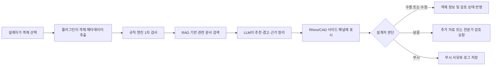

---

## 1.7 프로젝트 목표

본 프로젝트는 다음 다섯 가지 목표를 갖는다.

### 목표 1. 반복적인 검토 시간을 줄인다

객체와 관련된 문서를 자동으로 검색하고 주요 내용을 요약하여, 설계자가 여러 파일과 카탈로그를 반복적으로 탐색하는 시간을 줄인다.

### 목표 2. 속성 누락을 조기에 발견한다

재료, 두께, 용도, 검토 상태 등 필수 속성을 초기 설계 단계에서 확인하여 후반 수정과 재작업 가능성을 낮춘다.

### 목표 3. 설계 판단의 근거를 제공한다

단순히 “추천한다”는 문장을 출력하는 것이 아니라, 어떤 객체 정보와 문서 근거를 바탕으로 추천했는지를 함께 제시한다.

### 목표 4. 설계 품질의 일관성을 높인다

조직의 설계 표준과 과거 프로젝트 지식을 Agent의 지식 기반으로 활용하여 작업자별 경험 차이로 인한 편차를 줄인다.

### 목표 5. 인간의 최종 책임을 유지한다

AI가 설계 값을 자동 확정하지 않고, 설계자와 전문가의 검토·승인 절차 안에서 사용되도록 구성한다.

---

## 1.8 기대되는 사용자 가치

| 사용자 | 기존 불편 | Agent 도입 후 기대 가치 |
|---|---|---|
| 초급 설계자 | 확인해야 할 기준과 문서를 알기 어려움 | 객체별 체크 항목과 근거를 안내받음 |
| 실무 설계자 | 문서 검색과 속성 입력을 반복함 | 현재 작업 화면에서 즉시 추천과 경고 확인 |
| 시니어 검토자 | 누락 및 위험 객체를 수작업으로 탐색함 | 우선순위가 지정된 검토 목록 확인 |
| 프로젝트 관리자 | 변경 근거와 검토 상태 추적이 어려움 | 객체별 결정 이력과 검토 진행 상태 관리 |
| 조직 관리자 | 프로젝트 지식이 개인에게 축적됨 | 사내 표준과 피드백을 재사용 가능한 지식으로 축적 |

---

## 1.9 MVP 범위

프로젝트의 범위를 지나치게 넓히지 않기 위해 초기 MVP에서는 모든 건축 객체와 법규를 다루지 않는다. 우선 빈도가 높고 데모가 명확한 객체와 기능에 집중한다.

### MVP 대상 객체

- 비내력 내벽
- 바닥 마감
- 천장
- 일반 슬래브 검토 요청 항목

### MVP 지원 기능

- 객체 속성 읽기
- 재료 미지정 여부 확인
- 두께 값 입력 여부와 일반 범위 비교
- 공간 용도 기반 검토 체크리스트 제공
- 내부 샘플 시방서 및 재료 카탈로그 RAG 검색
- 추천·경고·출처 표시
- 사용자의 승인·수정·무시 처리
- 검토 로그 저장

### MVP에서 제외하는 기능

- 구조 안전성의 자동 확정
- 법규 적합성의 최종 판정
- 전체 건축물의 자동 설계
- 제조사 제품의 자동 발주
- AI 추천값의 무승인 자동 반영
- 모든 CAD/BIM 프로그램과의 동시 연동

이러한 범위 설정은 제한된 프로젝트 기간 안에서 핵심 가설을 검증하고, 고위험 업무의 자동화를 피하기 위한 것이다.

---

## 1.10 핵심 검증 가설

본 프로젝트는 다음 가설을 검증하는 것을 목표로 한다.

> 설계자가 Rhino/CAD에서 객체를 선택했을 때, 객체 정보와 기준 문서를 결합한 근거 기반 추천을 즉시 제공하면 재료·속성 누락을 더 빨리 발견하고 문서 검색 및 1차 검토 시간을 줄일 수 있다.

이를 평가하기 위해 후속 장에서 다음 지표를 구체화한다.

- 객체 속성 누락 탐지율
- 잘못된 경고 비율
- 관련 문서 검색 정확도
- 평균 응답 시간
- 추천 수용률
- 객체당 검토 소요 시간
- 사용자 만족도
- 전문가 검토로 전환된 고위험 항목 비율

---

## 1.11 본 보고서의 전개 방향

이후 보고서는 다음 순서로 프로젝트의 타당성과 구현 가능성을 분석한다.

1. 건축·공간 설계 산업과 CAD/Rhino 업무 특성 분석
2. 건축 설계 분야의 현재 AI 도입 사례와 한계 조사
3. 적용 가능한 AI Agent 후보 10개 도출 및 비교
4. Material Insight AI를 MVP로 선정한 근거 제시
5. 사용자 시나리오, 데이터, 도구, RAG 및 업무 흐름 설계
6. 플러그인·규칙 엔진·검색 계층·LLM을 포함한 기술 아키텍처 설계
7. Human-in-the-loop, 위험 통제 및 평가 지표 정의
8. 프로토타입 화면과 End-to-End 데모 시나리오 제시

---

## 참고 자료

1. Robert McNeel & Associates, *Rhino Developer Documentation*.
2. Robert McNeel & Associates, *RhinoCommon API Documentation*.
3. Autodesk, *Building Information Modeling and Object Properties Documentation*.
4. buildingSMART International, *openBIM and IFC Resources*.

> 구체적인 산업 사례, 제품 기능 및 기술 현황에 대한 출처는 `03-ai-landscape.md`와 최종 참고문헌에서 상세히 정리한다.

# 2. 산업 및 업무 특성 분석

## 2.1 분석 대상 산업의 범위

본 프로젝트의 대상은 건축·인테리어·공간 설계 산업 중에서도 **CAD/Rhino를 활용해 2D 도면과 3D 형상을 작성하고, 이를 재료·시방·구조·시공 정보와 연결하는 설계 업무**이다.

건축 산업 전체에는 기획, 설계, 인허가, 구조·설비 엔지니어링, 견적, 조달, 시공, 감리, 운영 및 유지관리까지 다양한 단계가 포함된다. 그러나 본 과제에서는 범위를 지나치게 넓히지 않고 다음 사용자와 업무에 집중한다.

- 건축 설계자
- 인테리어 및 공간 디자이너
- Rhino/CAD 모델러
- 설계 검토자
- 설계 프로젝트 관리자
- 구조·시공·자재 담당자와 협업하는 실무자

핵심 분석 대상 업무는 **설계 객체에 재료·두께·성능 정보를 부여하고, 관련 기준과 시방을 확인하며, 검토 결과를 기록하는 과정**이다.

---

## 2.2 산업의 구조적 특성

### 2.2.1 프로젝트 기반 산업

건축·공간 설계는 동일한 제품을 반복 생산하는 산업이 아니라, 프로젝트마다 요구사항과 조건이 달라지는 프로젝트 기반 산업이다. 프로젝트의 결과는 대지, 고객 요구, 예산, 일정, 법규, 구조 방식, 시공 조건과 사용 목적에 따라 달라진다.

이러한 특성 때문에 하나의 기준이나 과거 사례를 그대로 적용하기 어렵다. 설계자는 기존 자료를 참고하되 현재 프로젝트의 맥락에 맞게 재해석해야 한다.

프로젝트 기반 업무의 대표적인 특징은 다음과 같다.

- 프로젝트마다 고객 요구와 공간 용도가 다름
- 설계 변경이 빈번하게 발생함
- 여러 전문 분야가 동시에 참여함
- 단계별 산출물이 서로 연결되어 있음
- 결정 근거와 변경 이력의 추적이 중요함
- 일정 지연이나 오류가 후속 공정에 영향을 줌

따라서 AI Agent도 고정된 정답을 출력하기보다는, 현재 프로젝트의 맥락을 입력받아 적절한 근거와 검토 항목을 제시해야 한다.

### 2.2.2 다수 이해관계자의 협업

하나의 설계안은 단독 설계자의 작업만으로 완성되지 않는다. 발주처, 건축 설계자, 인테리어 디자이너, 구조·기계·전기 엔지니어, 시공사, 자재 공급업체, 감리자와 인허가 기관 등이 서로 다른 관점에서 결과물을 검토한다.

각 참여자는 동일한 모델이나 도면을 보더라도 관심 정보가 다르다.

| 이해관계자 | 주요 관심 사항 | 주로 사용하는 정보 |
|---|---|---|
| 고객·발주처 | 공간 품질, 예산, 일정, 요구사항 반영 | 요구사항 문서, 제안서, 변경 요청 |
| 건축 설계자 | 공간 구성, 형태, 법규, 도면 완성도 | CAD/Rhino 모델, 도면, 설계 기준 |
| 인테리어 디자이너 | 마감재, 색상, 사용성, 디테일 | 재료 보드, 카탈로그, 상세도 |
| 구조 엔지니어 | 하중, 경간, 구조 방식, 안전성 | 구조 모델, 계산서, 구조 기준 |
| 설비 엔지니어 | 배관·덕트·전기 설비와 공간 간섭 | MEP 모델, 장비 사양, 협업 모델 |
| 시공사 | 시공 가능성, 공정, 원가, 자재 조달 | 시공도, 시방서, 견적서 |
| 자재 공급업체 | 제품 성능, 규격, 납기, 단가 | 제품 카탈로그, 시험성적서 |
| 감리·인허가 기관 | 법규 및 기준 적합성 | 제출 도면, 허가 문서, 검토 기록 |
| 프로젝트 관리자 | 일정, 책임, 승인 상태, 이슈 관리 | 회의록, 변경 이력, 이슈 목록 |

본 프로젝트의 Agent는 이들 모두를 직접 대체하지 않는다. 1차 사용자는 CAD/Rhino 설계자이며, 필요할 경우 검토 결과를 다른 이해관계자에게 전달하는 역할을 수행한다.

### 2.2.3 정보 집약적 산업

건축 설계는 시각적인 작업으로 보이지만 실제로는 많은 문서와 데이터를 동시에 다루는 정보 집약적 업무이다. 설계자는 형상을 작성하면서도 다음 자료를 반복적으로 확인한다.

- 고객 요구사항
- 공간 프로그램
- 설계 기준서
- 법규 및 인허가 기준
- 구조·단열·차음·내화 기준
- 프로젝트 시방서
- 제조사 재료 카탈로그
- 시험성적서와 인증 정보
- 과거 프로젝트 사례
- 회의록과 변경 요청
- 견적 및 자재 단가
- 공정 및 조달 정보

이 자료들은 구조화 정도와 형식이 다르다. 객체 속성과 같은 정형 데이터도 있지만, PDF 시방서, 카탈로그, 회의록처럼 비정형 문서도 많다. 따라서 단순 데이터베이스 조회만으로 모든 업무를 지원하기 어렵고, 규칙 기반 검사와 문서 검색형 RAG를 함께 사용하는 것이 적합하다.

---

## 2.3 CAD, Rhino, BIM의 역할

### 2.3.1 CAD의 역할

CAD는 선, 곡선, 면, 치수, 문자, 블록 등을 이용해 설계 내용을 정밀하게 표현하는 도구다. 2D 도면 작성과 상세 표현에 강하며, 건축 실무에서 평면도, 입면도, 단면도와 상세도를 작성하는 데 널리 사용된다.

CAD 작업의 장점은 다음과 같다.

- 정밀한 도면 작성
- 비교적 자유로운 표현
- 기존 도면 자산과의 높은 호환성
- 실무자가 익숙한 작업 방식
- 상세도와 시공도 작성에 유리함

그러나 일반적인 CAD 객체는 실제 건축 부재의 의미를 자동으로 보장하지 않는다. 사용자가 그린 두 개의 선이 벽체인지, 가구인지, 기준선인지 프로그램이 스스로 판단하기 어렵다. 레이어명, 블록명, 주석과 사용자 규칙에 따라 의미가 부여되기 때문에 프로젝트별 입력 품질의 차이가 발생할 수 있다.

### 2.3.2 Rhino의 역할

Rhino는 NURBS 기반의 정밀한 자유형 곡선과 표면 모델링에 강점을 가진 3D CAD 도구다. 복잡한 형태, 비정형 외피, 가구, 인테리어 요소와 초기 디자인 모델을 제작하는 데 유용하다.

또한 Rhino는 RhinoCommon SDK와 플러그인 구조를 제공한다. 공식 개발 문서는 C# 기반의 일반 목적 플러그인 프로젝트를 생성하고, 플러그인 내부에 사용자 정의 명령과 UI를 추가할 수 있음을 설명한다. 객체 속성 API에서는 객체별 색상, 재료, 레이어, 이름, 고유 ID, 사용자 정의 데이터 등을 읽거나 저장할 수 있다.

이 특성은 본 프로젝트에 다음과 같은 이점을 제공한다.

- 사용자가 선택한 객체를 고유 ID로 식별 가능
- 레이어와 객체 이름을 분석 가능
- 재료 인덱스와 재료 출처 확인 가능
- UserData 또는 UserDictionary에 사용자 정의 속성 저장 가능
- 명령, 패널, 이벤트 기반 기능을 플러그인으로 추가 가능
- 기존 Rhino 작업 흐름 안에 Agent UI를 배치 가능

그러나 Rhino의 자유도는 동시에 정보 표준화의 어려움으로 이어진다. 사용자가 객체를 자유롭게 생성하고 이름과 레이어를 임의로 정할 수 있기 때문에, 동일한 건축 부재도 프로젝트마다 다른 방식으로 표현될 수 있다.

### 2.3.3 BIM의 역할

BIM은 건축물의 형상뿐 아니라 부재의 의미, 속성, 관계와 생애주기 정보를 함께 관리하는 접근 방식이다. BIM 환경에서는 벽, 문, 창, 바닥과 같은 객체가 단순한 선이나 면이 아니라 의미를 가진 건축 객체로 관리된다.

BIM의 주요 장점은 다음과 같다.

- 객체와 속성의 연결
- 도면과 모델의 연동
- 수량과 일정 정보의 활용
- 분야 간 협업
- 변경 사항의 일관된 반영
- 설계, 시공, 운영 정보의 재사용

그러나 모든 프로젝트가 처음부터 BIM 중심으로 수행되는 것은 아니다. 초기 형상 탐색, 인테리어 디자인, 비정형 외피 설계 또는 기존 CAD 자산을 활용하는 업무에서는 Rhino와 CAD가 계속 사용된다. 또한 BIM 모델로 전환하기 전에 많은 판단과 수정이 발생한다.

따라서 본 프로젝트는 CAD/Rhino를 BIM으로 대체하려는 것이 아니라, **정보가 부족한 자유형 설계 환경에 객체 단위 검토와 지식 검색 기능을 보완하는 것**을 목표로 한다.

### 2.3.4 IFC와 상호운용성

buildingSMART의 IFC는 건축·엔지니어링·건설 분야의 정보를 소프트웨어 중립적으로 교환하기 위한 개방형 데이터 표준이다. IFC는 객체와 속성, 관계를 구조화해 서로 다른 BIM 소프트웨어 사이의 정보 교환을 지원한다.

본 프로젝트의 초기 MVP가 IFC 전체를 구현할 필요는 없지만, 다음과 같은 확장 방향에서 IFC 개념을 참고할 수 있다.

- 객체 유형의 표준화
- 재료와 속성의 공통 이름 정의
- 외부 BIM 모델과의 데이터 교환
- 프로젝트 간 정보 재사용
- 향후 BIM 검토 도구와의 연동

초기에는 Rhino 객체의 레이어, 이름, 형상, 사용자 정의 속성을 사용하고, 이후에는 IFC 객체 유형 또는 사내 표준 분류체계와 연결하는 단계적 접근이 현실적이다.

---

## 2.4 건축·공간 설계의 주요 업무 프로세스

프로젝트마다 세부 절차는 다르지만 일반적인 흐름은 다음과 같이 정리할 수 있다.

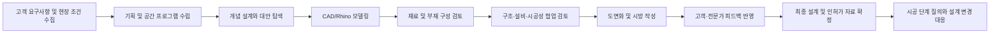

### 2.4.1 요구사항 수집

프로젝트 초기에는 발주처의 목적, 예산, 일정, 공간별 요구, 브랜드 방향과 운영 조건을 파악한다. 이 단계에서 수집한 정보는 이후 재료와 성능 판단의 기준이 된다.

예를 들어 같은 벽체라도 다음 조건에 따라 요구가 달라진다.

- 회의실인지 복도인지
- 습식 공간인지 건식 공간인지
- 외부에 노출되는지
- 소음 차단이 중요한지
- 내화 구획인지
- 유지보수가 쉬워야 하는지

Agent가 정확한 추천을 하려면 객체 정보뿐 아니라 이러한 프로젝트 맥락도 입력받아야 한다.

### 2.4.2 개념 설계 및 형태 탐색

개념 설계에서는 공간 배치와 형태 대안을 빠르게 검토한다. Rhino와 Grasshopper는 복잡한 형상과 파라메트릭 대안을 탐색하는 데 유용하다.

이 단계에서는 아직 모든 속성이 확정되지 않기 때문에, Agent가 확정값을 요구하기보다 다음 정보를 제공하는 것이 적절하다.

- 현재 누락된 정보
- 다음 단계에서 확인해야 할 항목
- 재료 후보군
- 위험도가 높은 가정
- 전문가 협업이 필요한 조건

### 2.4.3 기본·실시설계 모델링

형태가 구체화되면 객체의 치수, 위치, 레이어, 재료와 구성 정보가 추가된다. 이 단계에서 속성 누락과 값의 불일치가 누적되기 쉽다.

본 Agent의 주요 개입 시점은 이 단계다. 객체를 선택하거나 전체 모델을 검사해 다음 작업을 지원할 수 있다.

- 객체 유형 추정 또는 사용자 확인
- 필수 속성 입력 여부 검사
- 재료와 두께의 기본 범위 확인
- 유사 객체 간 속성 일관성 검사
- 관련 시방서와 과거 사례 검색

### 2.4.4 전문 분야 협업 검토

건축, 구조, 설비, 시공 담당자는 각자의 모델과 문서를 교환하면서 충돌과 위험을 검토한다. 이 과정에서 단순 형상 충돌뿐 아니라 의미와 성능 기준의 불일치도 발생한다.

예를 들면 다음과 같다.

- 차음이 필요한 공간인데 일반 칸막이가 지정됨
- 습식 공간에 부적절한 마감재가 선택됨
- 내화 구획에 필요한 성능 정보가 없음
- 슬래브 두께가 입력되었지만 구조 검토 상태가 없음
- 제조사 제품이 단종되었거나 최신 자료가 아님

Agent는 이를 최종 판정하지 않고, 검토 필요 항목과 근거를 구조화해 담당자에게 전달해야 한다.

### 2.4.5 도면·시방·재료표 작성

최종 산출물에는 모델뿐 아니라 도면, 상세도, 시방서와 재료표가 포함된다. 같은 정보가 여러 산출물에 반복되므로 변경 사항이 일관되게 반영되지 않을 수 있다.

객체별 재료와 검토 상태를 구조화하면 향후 다음 기능으로 확장할 수 있다.

- 재료표 자동 생성 보조
- 객체와 시방 항목 연결
- 변경된 객체 목록 추출
- 미검토 객체 목록 생성
- 검토 근거가 없는 항목 표시

---

## 2.5 반복 업무 분석

건축 설계에서 AI Agent 적용 가능성이 높은 업무는 반복 빈도가 높고, 일정한 입력과 판단 근거가 존재하며, 최종 승인을 사람이 수행할 수 있는 업무다.

| 반복 업무 | 현재 수행 방식 | 문제점 | Agent 지원 방식 |
|---|---|---|---|
| 객체별 재료 확인 | 레이어, 도면, 재료표 수동 비교 | 누락과 불일치 가능성 | 객체 속성과 재료표 자동 비교 |
| 부재 두께 확인 | 과거 도면과 기준서 참조 | 경험 의존, 검색 반복 | 기본 범위와 검토 필요 조건 표시 |
| 시방서 검색 | PDF 목차와 키워드 검색 | 문서가 많고 표현이 다름 | 객체 문맥 기반 RAG 검색 |
| 카탈로그 검색 | 제조사 사이트 개별 방문 | 최신성 및 비교 어려움 | 제품 속성 검색과 출처 표시 |
| 누락 속성 검사 | 체크리스트와 육안 검토 | 대형 모델에서 시간 증가 | 필수 속성 규칙 검사 |
| 유사 객체 일관성 검사 | 레이어별 선택 후 비교 | 예외 누락 가능성 | 동일 유형 객체의 속성 차이 탐지 |
| 검토 요청 작성 | 메신저·이메일로 설명 | 객체와 이슈 연결이 약함 | 객체 ID와 근거가 포함된 이슈 생성 |
| 변경 이력 정리 | 회의록과 파일 버전 비교 | 결정 이유 추적 어려움 | 추천·수정·승인 로그 저장 |

이들 업무 중에서 구조 계산이나 법규 최종 판정처럼 고위험 업무는 자동화 대상이 아니라 **검토 요청을 생성하는 보조 대상**으로 제한해야 한다.

---

## 2.6 판단이 필요한 업무 분석

반복 업무와 달리 다음 업무는 프로젝트 맥락과 전문성이 필요하다.

### 2.6.1 재료 적합성 판단

재료는 미관만으로 선택되지 않는다. 사용 환경, 유지관리, 화재, 습기, 마모, 비용과 조달 조건을 함께 고려해야 한다.

Agent는 후보와 체크리스트를 제시할 수 있지만 다음 상황에서는 사람의 판단이 필요하다.

- 고객이 특정 브랜드 또는 질감을 요구함
- 디자인 의도가 성능 기준과 충돌함
- 공급 가능성과 공사 일정이 불확실함
- 여러 성능을 동시에 만족해야 함
- 프로젝트에 특수한 시공 조건이 존재함

### 2.6.2 두께 및 구성 판단

벽체, 바닥, 천장과 슬래브의 두께는 여러 층의 구성과 성능 요구에 따라 달라진다. “권장 두께”를 단일 값으로 제시하면 오히려 위험할 수 있다.

따라서 Agent는 다음 형식으로 결과를 제시해야 한다.

- 일반적인 참고 범위
- 해당 범위가 적용되는 전제
- 현재 객체가 범위를 벗어났는지 여부
- 추가로 확인해야 할 성능
- 구조·시공 전문가 검토 필요 여부
- 참고한 문서와 버전

### 2.6.3 법규와 구조 관련 판단

법규와 구조 안전성은 프로젝트 위치, 용도, 규모, 구조 시스템과 최신 기준에 따라 달라진다. AI가 일부 문서를 검색할 수 있더라도 최종 적합성을 확정해서는 안 된다.

해당 영역에서 Agent의 역할은 다음으로 제한한다.

- 관련 기준 후보 검색
- 누락된 입력 조건 안내
- 위험 가능성 표시
- 전문가 검토 요청
- 검토 결과와 승인자 기록

### 2.6.4 대체안 비교

재료 대체안은 단가뿐 아니라 성능, 시공법, 납기, 디자인과 유지관리 측면을 함께 비교해야 한다. Agent는 비교표를 생성할 수 있지만 최종 선택은 설계자와 프로젝트 관계자가 결정한다.

---

## 2.7 문서 중심 업무와 지식 흐름

### 2.7.1 주요 문서 유형

| 문서 유형 | 포함 정보 | 데이터 특성 | Agent 활용 방식 |
|---|---|---|---|
| 프로젝트 요구사항 | 용도, 예산, 일정, 성능 목표 | 비정형 | 프로젝트 컨텍스트 추출 |
| 설계 기준서 | 객체별 설계 원칙 | 반정형 | RAG 검색 및 규칙 생성 |
| 시방서 | 재료, 시공법, 품질 기준 | 반정형 | 객체별 관련 조항 검색 |
| 제조사 카탈로그 | 규격, 성능, 인증, 제품 코드 | 반정형 | 재료 후보와 근거 제공 |
| 법규·표준 | 의무 조건과 기준 | 반정형·정형 | 관련 조항 검색, 전문가 검토 연결 |
| 과거 프로젝트 | 유사 객체와 결정 사례 | 비정형·정형 혼합 | 사례 기반 참고 |
| 회의록·변경 요청 | 결정, 책임자, 변경 이유 | 비정형 | 변경 맥락과 승인 상태 추출 |
| CAD/Rhino 파일 | 형상, 레이어, 객체 속성 | 정형·반정형 | 객체 메타데이터 추출 |

### 2.7.2 지식 단절 문제

현재 업무에서는 모델, 문서, 커뮤니케이션 기록이 서로 다른 시스템에 저장되는 경우가 많다. 이로 인해 다음과 같은 지식 단절이 발생한다.

- 모델 객체와 시방 조항이 직접 연결되지 않음
- 변경 요청의 근거가 모델에 남지 않음
- 과거 프로젝트의 판단을 검색하기 어려움
- 최신 문서와 오래된 문서가 혼재함
- 개인의 경험이 조직 지식으로 전환되지 않음

Agent는 이 자료를 완전히 하나의 데이터베이스로 통합하기보다, 객체를 중심으로 필요한 자료를 검색하고 연결하는 **지식 접근 계층**으로 설계할 수 있다.

---

## 2.8 주요 데이터 분석

### 2.8.1 객체 및 형상 데이터

- 객체 ID
- 객체 형식: Curve, Surface, Brep, Mesh, Block 등
- 위치와 좌표
- 길이, 면적, 체적
- 경계 상자
- 두께 또는 두께 추정값
- 인접 객체와 교차 관계

### 2.8.2 객체 속성 데이터

RhinoCommon의 `ObjectAttributes`를 통해 레이어, 재료, 이름, 고유 ID와 사용자 정의 정보를 활용할 수 있다.

- 객체 이름
- 레이어 인덱스와 레이어 경로
- 재료 인덱스와 재료 출처
- 그룹 및 블록 정보
- 객체 표시 상태
- UserData
- UserDictionary
- 사용자 문자열
- 외부 참조 URL

프로젝트에서는 사용자 정의 속성을 다음과 같이 구성할 수 있다.

```yaml
object_type: interior_wall
space_type: meeting_room
material_code: null
thickness_mm: 75
fire_rating: null
acoustic_required: true
review_status: pending
source_document: null
```

### 2.8.3 프로젝트 컨텍스트 데이터

- 프로젝트 유형
- 건물 용도
- 지역 및 적용 기준
- 설계 단계
- 공간별 요구사항
- 고객의 우선순위
- 예산 등급
- 구조 시스템
- 시공 방식
- 승인자와 담당자

### 2.8.4 지식 베이스 데이터

- 사내 설계 표준
- 프로젝트 시방서
- 재료 카탈로그
- 과거 프로젝트 사례
- 법규와 기술 기준
- 승인된 설계 상세
- 자주 발생한 검토 이슈
- 사용자 피드백과 추천 수용 기록

### 2.8.5 로그 및 평가 데이터

- Agent 요청 시간
- 선택 객체 ID
- 입력 컨텍스트
- 검색된 문서와 문서 버전
- 생성된 추천
- 사용자의 수용·수정·무시 행동
- 수정 이유
- 전문가 검토 결과
- 응답 시간
- 오류 및 실패 기록

로그는 성능 개선에 중요하지만, 프로젝트 정보와 사용자 행동을 포함할 수 있으므로 최소 수집과 접근 통제가 필요하다.

---

## 2.9 데이터 품질 문제

AI Agent의 성능은 입력 데이터의 품질에 크게 영향을 받는다. 건축 모델에서는 다음 문제가 자주 발생할 수 있다.

- 레이어명이 프로젝트마다 다름
- 객체 이름이 비어 있음
- 동일 객체 유형이 다른 방식으로 모델링됨
- 단위가 불명확하거나 혼재함
- 재료명이 약어 또는 별칭으로 입력됨
- 속성값이 최신 상태가 아님
- 과거 프로젝트 문서가 현재 기준과 충돌함
- 제조사 카탈로그의 버전 정보가 없음
- PDF 표와 이미지의 텍스트 추출 품질이 낮음

따라서 시스템은 입력값을 그대로 신뢰해서는 안 된다. 다음과 같은 데이터 품질 관리가 필요하다.

1. 프로젝트 단위와 좌표계 확인
2. 레이어 및 객체 분류 매핑
3. 재료명 표준화 사전
4. 필수 속성 스키마
5. 문서 버전과 유효기간 관리
6. 출처별 신뢰도 등급
7. 정보 부족 시 확정 답변 금지
8. 사용자 확인 요청 기능

---

## 2.10 규제, 책임 및 보안 이슈

### 2.10.1 설계 책임

건축 설계 결과는 안전과 재산에 영향을 줄 수 있다. AI 추천이 잘못되어도 최종 결과에 대한 책임은 프로젝트 참여자와 승인 체계 안에서 관리되어야 한다.

시스템은 다음 원칙을 가져야 한다.

- AI 출력은 참고 정보로 명시
- 최종값 자동 확정 금지
- 구조·법규 항목은 전문가 승인 필수
- 추천 근거와 출처 표시
- 승인자와 승인 시간 기록
- 변경 전후 값과 사유 기록

### 2.10.2 기준의 최신성

법규, 기술 기준과 제조사 제품 정보는 변경될 수 있다. 오래된 문서를 검색하면 잘못된 추천이 생성될 수 있다.

통제 방안은 다음과 같다.

- 문서 등록일과 개정일 저장
- 최신 버전 우선 검색
- 폐기 문서 검색 제외
- 출처와 문서 버전 표시
- 고위험 답변의 유효성 검토
- 주기적인 지식 베이스 갱신

### 2.10.3 프로젝트 기밀

설계 도면에는 고객명, 위치, 보안 구역, 시설 배치와 아직 공개되지 않은 디자인이 포함될 수 있다. 외부 LLM API에 모델 전체 또는 원본 문서를 전송하면 정보 유출 위험이 발생한다.

필요한 통제는 다음과 같다.

- 전체 파일 대신 필요한 객체 메타데이터만 전송
- 고객명과 위치 등 식별 정보 마스킹
- 사내망 또는 전용 배포 옵션
- 전송 및 저장 데이터 암호화
- 역할 기반 접근 제어
- 프로젝트별 지식 베이스 분리
- 로그 보존 기간 설정
- 외부 모델 제공자의 데이터 처리 조건 검토

### 2.10.4 지식재산권

도면, 설계 기준, 제조사 카탈로그에는 저작권과 사용 조건이 존재할 수 있다. Agent는 원문 전체를 재배포하는 방식보다 필요한 범위의 근거를 제시하고 원본 문서로 연결하는 방식이 적합하다.

### 2.10.5 프롬프트 인젝션과 문서 오염

RAG 시스템은 문서에 포함된 악의적 문장이나 잘못된 지시를 모델이 따르는 위험이 있다. 외부 카탈로그와 협력사 문서를 수집할 경우 특히 주의가 필요하다.

통제 방안은 다음과 같다.

- 신뢰 가능한 문서만 지식 베이스에 등록
- 문서 내용과 시스템 지시 분리
- 검색 결과를 명령이 아닌 참고 데이터로 처리
- 허용된 Tool만 실행
- 모델이 객체를 직접 수정하지 못하게 제한
- 관리자 승인 없는 문서 자동 등록 금지

---

## 2.11 산업의 주요 Pain Point 정리

| Pain Point | 원인 | 업무 영향 | Agent 기회 |
|---|---|---|---|
| 재료 정보 누락 | 자유로운 모델링과 속성 입력 규칙 부족 | 도면·시방 불일치, 후반 수정 | 필수 속성 검사 |
| 반복적인 문서 검색 | 문서가 여러 시스템에 분산 | 검토 시간 증가 | 객체 문맥 기반 RAG |
| 두께 판단의 경험 의존 | 조건과 기준이 복합적 | 품질 편차와 재작업 | 범위·전제·검토 항목 제시 |
| 모델과 결정 근거의 분리 | 이메일·회의록 중심 협업 | 변경 이유 추적 어려움 | 객체별 검토 로그 |
| 기준 최신성 문제 | 개정 문서와 과거 문서 혼재 | 잘못된 기준 적용 | 버전 기반 검색 |
| 전문 분야 전달 누락 | 이슈가 비정형 메시지로 전달 | 협업 지연 | 구조화된 검토 요청 |
| 초급 인력의 온보딩 부담 | 암묵지가 개인에게 집중 | 교육 시간 증가 | 근거가 포함된 가이드 |
| 프로젝트 기밀 유출 위험 | 외부 서비스로 원본 전송 | 보안과 계약 위험 | 최소 데이터 전송·사내 배포 |

---

## 2.12 AI Agent 도입 적합성 평가

본 업무가 AI Agent에 적합한지 다음 기준으로 평가하였다.

| 평가 기준 | 평가 | 근거 |
|---|---|---|
| 업무 반복성 | 높음 | 재료·속성·기준 확인이 객체마다 반복됨 |
| 데이터 존재 여부 | 중상 | 객체 속성, 시방서, 카탈로그, 사례가 존재함 |
| 규칙화 가능성 | 중상 | 누락 검사와 일부 범위 검토는 규칙화 가능 |
| 자연어 처리 필요성 | 높음 | 시방서와 카탈로그가 문서 중심임 |
| 도구 연동 가능성 | 높음 | RhinoCommon 플러그인과 객체 API 활용 가능 |
| 사용자 가치 | 높음 | 설계 화면에서 검색·검토 시간을 줄일 수 있음 |
| 완전 자동화 위험 | 높음 | 구조·법규·재료 판단에 책임 문제가 있음 |
| Human-in-the-loop 적합성 | 매우 높음 | AI 추천 후 설계자가 승인하는 흐름이 자연스러움 |
| MVP 구현 가능성 | 중상 | 제한된 객체와 샘플 문서로 데모 가능 |
| 확장 가능성 | 높음 | BIM, 이슈 관리, 재료표, 기업 지식으로 확장 가능 |

분석 결과, 이 업무는 **완전 자동화 대상은 아니지만 Agent 기반 의사결정 지원에는 적합한 영역**이다. 명확한 검사는 규칙 엔진이 담당하고, 관련 문서 검색은 RAG가 담당하며, 최종 판단은 설계자가 수행하는 역할 분담이 필요하다.

---

## 2.13 AI Agent 개입 지점

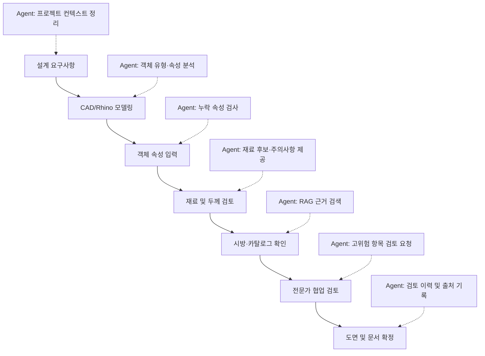

가장 현실적인 초기 개입 지점은 **객체 속성 입력, 재료·두께 1차 검토, 관련 문서 검색과 전문가 검토 요청**이다.

---

## 2.14 산업 분석에 따른 설계 원칙

산업과 업무 특성을 분석한 결과, 본 Agent에는 다음 원칙이 필요하다.

1. **객체 중심성**  
   모든 추천은 현재 선택한 객체와 프로젝트 컨텍스트에 연결한다.

2. **근거 우선**  
   추천 문장보다 검색한 문서, 규칙과 전제를 함께 제시한다.

3. **역할 분리**  
   규칙 검사, 문서 검색, 자연어 설명과 인간 승인을 분리한다.

4. **불확실성 표시**  
   정보가 부족하면 추정값과 신뢰도를 표시하고 추가 입력을 요청한다.

5. **고위험 자동화 금지**  
   구조와 법규 관련 결과는 검토 요청으로 전환한다.

6. **최소 데이터 전송**  
   모델 전체가 아니라 필요한 메타데이터와 검색 문맥만 사용한다.

7. **버전 및 이력 관리**  
   문서 버전, 추천 근거, 사용자 결정과 승인 상태를 기록한다.

8. **단계적 확장**  
   비내력 내벽과 마감재 등 제한된 범위에서 시작해 BIM과 기업 시스템으로 확장한다.

---

## 2.15 소결

건축·공간 설계 산업은 프로젝트별 조건이 다르고, 여러 이해관계자가 협업하며, 모델과 다수의 문서를 동시에 검토해야 하는 복합 업무 환경이다. 특히 CAD/Rhino 중심의 자유로운 설계 환경은 형태 탐색에 강하지만 객체의 의미와 재료·성능 정보가 일관되게 입력되지 않을 수 있다.

이 때문에 설계자는 반복적으로 문서를 검색하고, 속성 누락을 확인하며, 경험을 바탕으로 재료와 두께를 검토한다. 그러나 구조와 법규를 포함한 최종 판단은 책임과 위험이 크기 때문에 AI가 자동으로 확정하기 어렵다.

따라서 본 프로젝트의 적절한 전략은 설계자를 대체하는 자동 설계 시스템이 아니라, Rhino/CAD 객체와 관련 문서를 연결하고 검토 근거를 제시하는 **플러그인형 Human-in-the-loop AI Agent**를 구축하는 것이다. 이 분석 결과는 이후 AI 도입 사례 조사, Agent 후보 도출과 MVP 설계의 기준으로 사용한다.

---

## 참고 자료

1. Robert McNeel & Associates, **Your First Plugin (Windows)**, Rhino Developer Documentation.  
   <https://developer.rhino3d.com/guides/rhinocommon/your-first-plugin-windows/>

2. Robert McNeel & Associates, **Rhino.DocObjects.ObjectAttributes Class**, RhinoCommon API Documentation.  
   <https://developer.rhino3d.com/api/rhinocommon/rhino.docobjects.objectattributes>

3. buildingSMART International, **Industry Foundation Classes (IFC)**.  
   <https://www.buildingsmart.org/standards/bsi-standards/industry-foundation-classes/>

4. Autodesk, **What Is BIM?**  
   <https://www.autodesk.com/solutions/aec/bim>

> 국내 법규와 구조·재료 기준은 MVP의 최종 판정 규칙으로 직접 사용하지 않고, 공식 원문과 전문가 검토를 연결하는 참고 지식으로 제한한다.

# 3. 현재 AI 도입 현황

## 3.1 조사 목적

건축·공간 설계 분야에서는 AI가 이미 **대안 생성, 대지 분석, 렌더링, 타당성 검토**에 활용되고 있다. 그러나 대부분은 초기 설계나 시각화에 집중되어 있으며, CAD/Rhino 객체의 재료·두께·성능 정보를 근거 문서와 연결해 검토하는 기능은 제한적이다.

본 장에서는 현재 활용 중인 대표 사례 4개를 비교하고, 본 프로젝트의 차별점을 도출한다.

---

## 3.2 대표 사례

### 사례 1. Autodesk Forma

Autodesk Forma는 초기 기획 및 개념 설계 단계에서 대지와 건물 배치를 분석하는 AI 기반 클라우드 도구다. 자동 면적 산정, 대지·건물 배치 대안 생성, 소음·바람·탄소 분석 등을 지원하며 Rhino와 Revit 등 기존 도구와도 연동된다.

| 항목 | 내용 |
|---|---|
| 해결 문제 | 초기 대지 검토와 설계 대안 비교에 많은 시간이 소요되는 문제 |
| 주요 기술 | 생성형 설계, 예측 분석, 환경 시뮬레이션, 클라우드 협업 |
| 주요 사용자 | 건축가, 도시계획가, 부동산 개발자 |
| 기대 효과 | 여러 배치안을 빠르게 비교하고 데이터 기반 의사결정 가능 |
| 현재 한계 | 초기 계획 단계에 강하지만 개별 객체의 재료·시방·두께 검토는 중심 기능이 아님 |

Forma는 AI가 설계자의 선택을 돕는 방식이 실제 제품으로 구현되고 있음을 보여준다. 다만 본 프로젝트가 다루는 객체 단위 재료 검토보다 상위 단계의 도시·대지 계획에 초점이 맞추어져 있다.

---

### 사례 2. TestFit

TestFit은 부동산 개발과 건축 초기 단계에서 대지 조건, 도로, 주차, 건물 배치 등을 자동 생성해 사업성과 설계 가능성을 검토하는 플랫폼이다. 사용자는 AI가 생성한 배치안을 직접 수정할 수 있다.

| 항목 | 내용 |
|---|---|
| 해결 문제 | 초기 배치안과 사업성 검토에 수일 또는 수주가 걸리는 문제 |
| 주요 기술 | 생성형 설계, 제약조건 기반 최적화, 공간 배치 자동화 |
| 주요 사용자 | 개발사, 건축가, 시공사, 도시계획 담당자 |
| 기대 효과 | 대지별 가능성을 빠르게 검토하고 설계 대안을 반복 생성 |
| 현재 한계 | 재료·시방·성능 검토보다 배치와 사업성 분석에 집중 |

TestFit의 장점은 AI가 결과를 한 번 생성하고 끝나는 것이 아니라 사용자가 직접 수정하면서 대안을 발전시킬 수 있다는 점이다. 이는 본 프로젝트의 Human-in-the-loop 방식과 유사하다.

---

### 사례 3. Veras

Veras는 Revit, Rhino, SketchUp 등 설계 프로그램에 연결해 현재 모델을 기반으로 이미지를 생성하는 AI 시각화 도구다. 사용자는 프롬프트와 Geometry Override 설정을 이용해 원본 형상을 유지하거나 새로운 디자인 대안을 탐색할 수 있다.

| 항목 | 내용 |
|---|---|
| 해결 문제 | 초기 렌더링과 재료·분위기 시각화에 많은 시간이 필요한 문제 |
| 주요 기술 | 생성형 이미지 AI, 프롬프트 기반 편집, 이미지 선택 영역 재생성 |
| 주요 사용자 | 건축가, 인테리어 디자이너, 시각화 담당자 |
| 기대 효과 | 모델을 기반으로 빠르게 디자인 이미지와 재료 분위기 탐색 |
| 현재 한계 | 시각적 재료 표현은 가능하지만 실제 제품 성능, 시방, 두께 근거를 검증하지 않음 |

Veras는 Rhino 내부에 AI 기능을 연결할 수 있다는 점에서 본 프로젝트와 가장 유사하다. 그러나 Veras의 주요 목적은 시각화이며, 본 프로젝트는 설계 객체의 정보 누락과 기술적 검토에 초점을 둔다.

---

### 사례 4. BIM 기반 자동 검토

Revit, Navisworks와 같은 BIM 도구에서는 객체 속성 검사, 간섭 검토, 수량 산출과 설계 규칙 확인이 이미 활용되고 있다. 이러한 기능은 전통적인 머신러닝보다는 객체 데이터와 규칙 기반 자동화에 가까우나, 최근에는 AI 분석 및 문서 검색과 결합되는 방향으로 발전하고 있다.

| 항목 | 내용 |
|---|---|
| 해결 문제 | 설계 요소 간 충돌과 속성 누락을 사람이 직접 검사하는 문제 |
| 주요 기술 | BIM 객체 분석, 규칙 엔진, Clash Detection, 데이터 검증 |
| 주요 사용자 | BIM 코디네이터, 설계 검토자, 시공사 |
| 기대 효과 | 설계 오류를 시공 전에 발견하고 협업 품질 향상 |
| 현재 한계 | 명확한 규칙 검사는 강하지만 비정형 시방서 해석과 설명형 추천은 제한적 |

이 사례는 본 프로젝트에서 LLM만 사용해서는 안 되며, 규칙 엔진을 함께 사용해야 한다는 근거가 된다.

---

## 3.3 사례 비교

| 사례 | 주요 적용 단계 | 핵심 강점 | 본 프로젝트와의 차이 |
|---|---|---|---|
| Autodesk Forma | 기획·개념 설계 | 대지 분석과 환경 성능 비교 | 객체별 재료·두께 검토가 아님 |
| TestFit | 사업성·초기 배치 | 빠른 배치안 생성과 수정 | 건축 상세정보보다 배치에 집중 |
| Veras | 디자인·시각화 | Rhino/Revit 모델 기반 이미지 생성 | 기술 성능보다 시각적 결과 중심 |
| BIM 자동 검토 | 실시설계·협업 | 객체 속성과 충돌 검사 | 비정형 문서 검색과 설명 기능이 약함 |
| Material Insight AI | 기본·실시설계 | 객체, 규칙, 문서 근거를 결합한 검토 | 재료·두께·성능 주석에 특화 |

---

## 3.4 현재 AI 도입의 공통 한계

대표 사례를 비교하면 다음과 같은 한계가 나타난다.

1. **초기 설계와 시각화에 집중**  
   대안 생성과 렌더링 기능은 발전했지만 실제 설계 객체의 재료·시방 검토는 상대적으로 부족하다.

2. **모델과 문서가 분리됨**  
   AI가 모델을 분석하거나 문서를 검색할 수는 있어도, 특정 객체와 기준 문서를 직접 연결하는 기능은 제한적이다.

3. **설명 가능한 근거 부족**  
   생성 결과가 빠르더라도 왜 해당 결과가 적절한지 기준과 출처를 제시하지 못하는 경우가 있다.

4. **고위험 판단 자동화의 어려움**  
   구조, 법규, 내화와 같은 항목은 프로젝트 조건이 복잡해 전문가의 최종 검토가 필요하다.

5. **자유형 CAD/Rhino 정보의 비표준화**  
   객체 의미와 속성이 BIM처럼 정형화되어 있지 않아 AI가 바로 이해하기 어렵다.

---

## 3.5 본 프로젝트의 차별점

Material Insight AI는 기존 AI 도구와 경쟁하기보다, 이들이 충분히 다루지 못한 **객체 단위 기술 검토 영역**을 보완한다.

### 핵심 차별점

- Rhino/CAD에서 선택한 객체를 직접 분석
- 재료와 두께 속성의 누락 여부 검사
- 규칙 엔진과 RAG를 함께 사용
- 추천 결과에 시방서와 카탈로그 출처 표시
- 구조·법규 항목은 자동 확정하지 않고 검토 요청으로 전환
- 설계자의 승인·수정·무시 이력을 저장

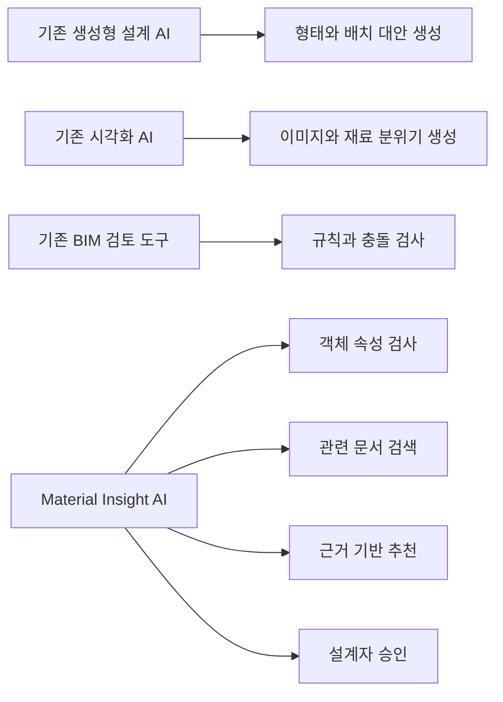

---

## 3.6 소결

현재 건축 설계 분야의 AI는 초기 대안 생성, 환경 분석, 사업성 검토, 시각화와 BIM 자동 검사 분야에서 빠르게 활용되고 있다. 그러나 CAD/Rhino 설계자가 실제 업무 중 반복적으로 수행하는 **재료 정보 확인, 두께 검토, 시방서 검색, 속성 누락 탐지**를 하나의 흐름으로 지원하는 도구는 상대적으로 부족하다.

따라서 본 프로젝트는 기존 AI 서비스의 기능을 반복하는 것이 아니라, Rhino/CAD 객체와 기술 문서를 연결하는 실무형 검토 Agent로 차별화할 수 있다.

---

## 참고 자료

1. Autodesk, **Forma Site Design Overview**  
   <https://www.autodesk.com/products/forma/overview>

2. TestFit, **Real Estate Feasibility Platform**  
   <https://www.testfit.io/>

3. EvolveLAB, **Veras AI Visualization**  
   <https://www.evolvelab.io/veras>

4. Autodesk, **Building Information Modeling Solutions**  
   <https://www.autodesk.com/solutions/aec/bim>

# 4. 향후 AI Agent 도입 후보 및 MVP 선정

## 4.1 후보 도출 기준

건축·공간 설계 업무에서 도입 가능한 Agent 후보를 다음 기준으로 비교하였다.

- 사용자 문제가 명확한가
- 반복 빈도가 높은가
- 데이터 확보가 가능한가
- 기술적으로 구현 가능한가
- 위험을 통제할 수 있는가
- MVP로 검증하기 쉬운가

---

## 4.2 AI Agent 후보 10개

| 번호 | Agent 후보 | 대상 사용자 | 해결 문제 | 기대 효과 | 기술 난이도 | 위험도 | 데이터 접근성 |
|---:|---|---|---|---|---|---|---|
| 1 | 재료 추천 Agent | 건축·인테리어 설계자 | 객체별 적합한 재료를 찾기 어려움 | 재료 선정 시간 단축 | 중 | 중 | 중 |
| 2 | 벽체 두께 검토 Agent | 설계자 | 벽체 두께 판단과 검토 반복 | 누락과 재작업 감소 | 중 | 중 | 중 |
| 3 | 속성 누락 탐지 Agent | CAD/Rhino 사용자 | 재료·두께·용도 속성 누락 | 검토 품질 향상 | 중 | 하 | 상 |
| 4 | 시방서 질의응답 Agent | 설계자·시공 담당자 | 관련 조항 검색 시간 증가 | 문서 검색 시간 단축 | 중 | 중 | 상 |
| 5 | 대체 재료 추천 Agent | 설계자·견적 담당자 | 비용·성능 대체안 비교 어려움 | 원가와 조달 대응력 향상 | 중상 | 중 | 중 |
| 6 | 설계 기준 체크 Agent | 시니어 설계자 | 사내 기준과 모델의 불일치 | 설계 일관성 향상 | 중상 | 중 | 중상 |
| 7 | 법규 검토 보조 Agent | 인허가 담당자 | 관련 법규 탐색과 검토 부담 | 검토 누락 감소 | 상 | 상 | 중 |
| 8 | 구조 검토 요청 Agent | 설계자·구조 엔지니어 | 위험 객체 전달과 협업 누락 | 협업 속도 향상 | 중 | 중상 | 중 |
| 9 | 유사 프로젝트 검색 Agent | 설계팀 | 과거 설계 사례 재사용 어려움 | 조직 지식 활용도 향상 | 중 | 하 | 중 |
| 10 | 설계 QA 종합 Agent | 설계 검토자 | 전체 모델의 품질 검토 부담 | 검토 자동화 범위 확대 | 상 | 상 | 중 |

---

## 4.3 후보 비교 분석

### 빠르게 구현 가능한 후보

다음 후보는 규칙과 구조화된 속성을 중심으로 구현할 수 있어 MVP에 적합하다.

- 속성 누락 탐지 Agent
- 벽체 두께 검토 Agent
- 설계 기준 체크 Agent

이들은 입력과 출력이 비교적 명확하고 데모 결과를 보여주기 쉽다.

### 사용자 가치가 높은 후보

다음 후보는 설계자가 반복적으로 수행하는 업무를 줄여 실무 가치가 높다.

- 재료 추천 Agent
- 시방서 질의응답 Agent
- 대체 재료 추천 Agent
- 유사 프로젝트 검색 Agent

다만 데이터 품질과 문서 관리 체계가 결과에 큰 영향을 준다.

### 위험도가 높은 후보

다음 후보는 전문가 판단이 필요해 자동화 범위를 제한해야 한다.

- 법규 검토 보조 Agent
- 구조 검토 요청 Agent
- 설계 QA 종합 Agent

특히 법규와 구조 관련 결과는 확정 판단이 아니라 검토 필요성을 알리는 수준으로 제한해야 한다.

---

## 4.4 우선순위 평가

각 후보를 사용자 가치, 구현 가능성, 위험 통제, 데이터 접근성 기준으로 5점 척도로 평가하였다.

| 후보 | 사용자 가치 | 구현 가능성 | 위험 통제 | 데이터 접근성 | 총점 |
|---|---:|---:|---:|---:|---:|
| 재료 추천 Agent | 5 | 4 | 4 | 3 | 16 |
| 벽체 두께 검토 Agent | 5 | 4 | 3 | 3 | 15 |
| 속성 누락 탐지 Agent | 4 | 5 | 5 | 5 | 19 |
| 시방서 질의응답 Agent | 4 | 4 | 4 | 5 | 17 |
| 대체 재료 추천 Agent | 4 | 3 | 3 | 3 | 13 |
| 설계 기준 체크 Agent | 4 | 4 | 4 | 4 | 16 |
| 법규 검토 보조 Agent | 5 | 2 | 2 | 3 | 12 |
| 구조 검토 요청 Agent | 4 | 3 | 3 | 3 | 13 |
| 유사 프로젝트 검색 Agent | 4 | 4 | 5 | 3 | 16 |
| 설계 QA 종합 Agent | 5 | 2 | 2 | 3 | 12 |

속성 누락 탐지 Agent가 가장 높은 점수를 받았지만, 단독 기능만으로는 Agent의 차별성과 사용자 가치가 제한적이다. 반면 재료 추천, 두께 검토, 시방서 검색을 결합하면 하나의 연속된 업무 흐름을 만들 수 있다.

---

## 4.5 MVP Agent 선정

최종 MVP는 다음과 같이 정의한다.

> **Material Insight AI: CAD/Rhino 객체의 재료·두께·속성을 검사하고, 관련 시방서와 기준을 근거로 추천과 경고를 제공하는 플러그인형 AI Agent**

이 MVP는 단일 기능이 아니라 다음 네 가지 핵심 기능을 결합한다.

1. 객체 속성 누락 탐지
2. 재료 후보 추천
3. 두께와 성능 검토 보조
4. 관련 문서 RAG 검색

---

## 4.6 선정 이유

### 1. 실제 업무에서 반복 빈도가 높다

설계자는 객체를 작성할 때마다 재료, 두께, 용도와 검토 상태를 확인한다. 따라서 특정 프로젝트에만 필요한 기능보다 활용 빈도가 높다.

### 2. 사용자 가치가 명확하다

“객체를 선택하면 바로 검토 정보가 표시된다”는 사용 방식은 직관적이며, 설계자가 얻는 시간 절감 효과도 설명하기 쉽다.

### 3. Rhino 플러그인과 자연스럽게 연결된다

객체 선택, 속성 추출, 사이드 패널 출력이라는 흐름을 RhinoCommon 기반 플러그인으로 구현할 수 있다.

### 4. 규칙 엔진과 RAG의 장점을 함께 보여줄 수 있다

누락 속성은 규칙으로 검사하고, 비정형 시방서와 카탈로그는 RAG로 검색할 수 있다. 이를 통해 단순 챗봇이 아닌 Agent 구조를 보여줄 수 있다.

### 5. 위험을 통제할 수 있다

AI는 최종 설계를 확정하지 않고 추천과 경고만 제공한다. 구조와 법규 관련 항목은 전문가 검토 요청으로 전환한다.

### 6. 데모 구성이 쉽다

벽체 객체를 선택하고, 재료 누락과 두께 경고를 표시한 뒤, 관련 시방서와 추천을 보여주는 End-to-End 데모를 구성할 수 있다.

---

## 4.7 MVP와 확장 기능 구분

### MVP 포함 기능

- 객체 선택 및 메타데이터 추출
- 재료·두께·용도 속성 검사
- 관련 시방서 검색
- 재료 후보와 주의사항 제공
- 사용자 승인·수정·무시
- 검토 로그 저장

### 향후 확장 기능

- 법규 자동 검토 보조
- 구조 엔지니어 협업 요청
- BIM/IFC 연동
- 재료표 자동 생성
- 자재 단가와 납기 연동
- 프로젝트 전체 QA 대시보드
- 조직별 학습 데이터 활용

---

## 4.8 소결

후보 10개를 비교한 결과, 단일 기능보다 **속성 누락 탐지, 재료 추천, 두께 검토, 시방서 검색을 하나의 객체 중심 업무 흐름으로 통합하는 Agent**가 가장 높은 실무 가치와 구현 가능성을 가진다.

따라서 본 프로젝트는 Material Insight AI를 MVP로 선정하고, 다음 장에서 사용자 시나리오, 입력과 출력, 업무 흐름, 데이터와 도구를 구체적으로 설계한다.

# 5. MVP AI Agent 상세 설계

## 5.1 Agent 개요

**Material Insight AI**는 Rhino/CAD에서 선택한 객체의 속성을 분석하고, 재료·두께·성능 관련 누락과 위험 요소를 탐지한 뒤, 관련 시방서와 기준 문서를 근거로 추천을 제공하는 플러그인형 AI Agent다.

본 Agent는 설계자의 판단을 대체하지 않는다. AI는 추천, 경고, 참고 자료를 제공하고 최종 반영 여부는 설계자가 결정한다.

---

## 5.2 대상 사용자

### 1차 사용자

- 건축 설계자
- 인테리어 디자이너
- Rhino/CAD 모델러
- CAD 오퍼레이터

### 2차 사용자

- 시니어 설계 검토자
- 프로젝트 관리자
- 구조 엔지니어
- 시공 및 자재 담당자

---

## 5.3 핵심 사용자 시나리오

### 시나리오 1. 재료 속성이 누락된 벽체 검토

설계자가 Rhino에서 회의실 구획벽 객체를 선택한다.

Agent는 객체의 레이어, 두께, 공간 용도와 재료 속성을 분석한다. 재료가 지정되지 않은 것을 확인하고 관련 시방서와 과거 사례를 검색한다.

결과 패널에는 다음 내용이 표시된다.

- 재료 속성 누락 경고
- 회의실 벽체에 필요한 차음 검토 안내
- 경량철골 및 석고보드 조합 후보
- 일반적인 두께 검토 범위
- 참고 시방서와 문서 출처
- `수용`, `수정`, `보류`, `무시` 버튼

설계자는 추천을 참고해 재료와 두께를 수정하고 검토 완료 상태로 변경한다.

### 시나리오 2. 두께가 얇은 객체 검토

설계자가 두께 75mm로 설정된 벽체를 선택한다.

규칙 엔진은 공간 용도와 현재 두께를 비교해 추가 검토가 필요하다고 판단한다. Agent는 단순히 오류라고 단정하지 않고 다음과 같이 안내한다.

> 현재 두께는 회의실 구획벽의 일반 검토 범위보다 얇을 수 있습니다. 차음 요구사항과 벽체 구성 확인이 필요합니다.

사용자는 근거 문서를 확인한 뒤 값을 수정하거나 시니어 설계자에게 검토를 요청한다.

### 시나리오 3. 전체 모델 누락 검사

사용자가 `전체 모델 검사` 명령을 실행한다.

Agent는 대상 객체를 순회하면서 다음 항목을 검사한다.

- 재료 미지정 객체
- 두께 미입력 객체
- 용도 정보 누락 객체
- 동일 유형 간 속성 불일치
- 검토 상태가 없는 고위험 객체

결과는 우선순위가 포함된 검토 목록으로 제공된다.

---

## 5.4 입력 데이터

### 객체 데이터

| 입력 | 설명 |
|---|---|
| Object ID | Rhino 객체의 고유 식별자 |
| Object Type | Curve, Surface, Brep, Block 등 |
| Layer | 객체가 속한 레이어 |
| Name | 객체 이름 |
| Geometry | 길이, 면적, 체적, 경계 정보 |
| Material | 현재 지정된 재료 |
| User Attributes | 사용자 정의 속성 |
| Group/Block | 그룹과 블록 정보 |

### 프로젝트 컨텍스트

| 입력 | 설명 |
|---|---|
| Project Type | 신축, 리모델링, 인테리어 등 |
| Space Type | 회의실, 복도, 화장실, 사무실 등 |
| Design Stage | 개념, 기본, 실시설계 |
| Building Use | 업무, 주거, 상업, 교육 등 |
| Region | 적용 법규와 기준 확인을 위한 지역 |
| Priority | 비용, 성능, 미관, 시공성 등의 우선순위 |

### 지식 데이터

- 사내 설계 기준
- 프로젝트 시방서
- 제조사 카탈로그
- 과거 프로젝트 사례
- 검토 체크리스트
- 승인된 재료 및 상세 목록

---

## 5.5 출력 데이터

Agent는 결과를 다음 구조로 제공한다.

```json
{
  "object_id": "W-012",
  "status": "review_required",
  "detected_issues": [
    "material_missing",
    "thickness_review_required"
  ],
  "recommended_materials": [
    "경량철골 + 석고보드",
    "고밀도 차음 보드 조합"
  ],
  "thickness_guidance": {
    "current_mm": 75,
    "reference_range_mm": "100-150",
    "warning": "공간 용도와 차음 요구 확인 필요"
  },
  "evidence": [
    {
      "document": "사내 시방서",
      "section": "4.2 회의실 구획벽"
    }
  ],
  "required_action": "designer_review"
}
```

### 사용자 화면에 표시되는 정보

- 현재 객체 요약
- 탐지된 문제
- 추천 재료 후보
- 두께 검토 정보
- 성능상 주의사항
- 관련 문서와 출처
- 추천 신뢰도
- 추가 입력 요청
- 승인·수정·보류·무시 버튼

---

## 5.6 업무 흐름

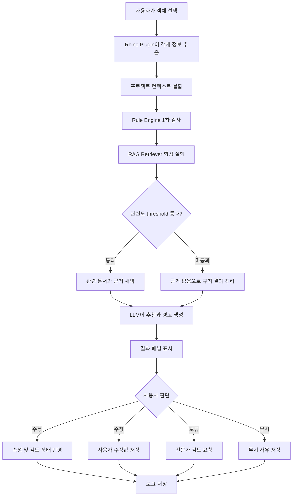

---

## 5.7 주요 기능 모듈

### 1. Object Inspector

선택 객체의 형상과 속성을 읽고 Agent가 사용할 Material Insight 전용 review-object 데이터로 변환한다.

주요 기능:

- 객체 ID 추출
- 레이어와 이름 확인
- 재료와 사용자 정의 속성 확인
- 길이·면적·체적 계산
- 객체 유형과 공간 용도 매핑

### 2. Rule Engine

명확한 조건을 규칙으로 검사한다.

예시 규칙:

```yaml
rule_id: WALL_MATERIAL_REQUIRED
target: interior_wall
condition:
  material: null
result:
  severity: warning
  message: 재료 정보가 입력되지 않았습니다.
```

규칙 엔진이 담당하는 항목은 다음과 같다.

- 필수 속성 누락
- 값 형식 오류
- 범위 벗어남
- 검토 상태 누락
- 동일 유형 객체 간 불일치

### 3. RAG Retriever

객체 정보와 탐지된 문제를 검색 질의로 변환하고 관련 문서를 검색한다.

검색 대상:

- 프로젝트 시방서
- 사내 설계 기준
- 제조사 카탈로그
- 승인된 과거 프로젝트
- 기술 체크리스트

### 4. LLM Agent

규칙 결과와 검색 문서를 바탕으로 사람이 이해하기 쉬운 문장을 생성한다.

LLM의 역할:

- 검색 결과 요약
- 추천 후보 설명
- 위험과 전제 표시
- 추가 확인 항목 제시
- 전문가 검토 필요 여부 설명

LLM이 수행하지 않는 역할:

- 구조 안전성 확정
- 법규 적합성 최종 판정
- 근거 없는 재료 수치 생성
- 사용자 승인 없는 객체 자동 수정

### 5. Review Panel

Rhino/CAD 내부 사이드 패널에서 결과를 제공한다.

주요 UI 요소:

- 객체 정보 카드
- 문제 및 위험도 표시
- 추천 결과
- 근거 문서 링크
- 신뢰도와 정보 부족 표시
- 사용자 행동 버튼
- 검토 이력

### 6. Feedback Logger

사용자의 결정을 기록한다.

저장 항목:

- 추천 내용
- 수용·수정·보류·무시 여부
- 수정 전후 값
- 사용자 의견
- 문서 출처
- 승인자
- 처리 시간

---

## 5.8 외부 도구 및 API

| 도구 | 역할 |
|---|---|
| RhinoCommon SDK | 객체 선택, 속성 추출, 패널 UI 구현 |
| C# Plugin | Rhino 내부 연동 |
| FastAPI | Agent 백엔드 API |
| PostgreSQL | 객체 검토 이력 및 사용자 행동 저장 |
| Vector Database | 시방서와 카탈로그 임베딩 검색 |
| LLM API | 검색 결과 기반 추천 문장 생성 |
| Embedding Model | 문서와 질의 벡터화 |
| Object Storage | 원본 문서와 카탈로그 저장 |
| Issue Tracker API | 고위험 항목의 검토 요청 생성 |

MVP에서는 복잡도를 줄이기 위해 Rhino Plugin, FastAPI, 간단한 Vector DB와 LLM API를 중심으로 구성한다.

---

## 5.9 RAG 활용 방식

본 Agent는 문서의 내용을 모델이 임의로 기억하는 방식보다, 필요한 순간에 관련 문서를 검색하는 RAG 방식을 사용한다.

### 검색 절차

1. 객체와 프로젝트 컨텍스트 수집
2. 규칙 엔진으로 문제 유형 분류
3. 검색 질의 생성
4. 문서 메타데이터 필터 적용
5. 유사 문서 조각 검색
6. 출처와 버전 확인
7. LLM에 객체 정보와 검색 결과 전달
8. 추천과 근거 생성

### 메타데이터 예시

```yaml
document_id: SPEC-2026-014
document_type: internal_specification
category: interior_wall
space_type: meeting_room
version: 3.1
effective_date: 2026-01-01
status: active
```

문서 최신성과 신뢰도를 보장하기 위해 비활성 문서와 이전 버전은 기본 검색 대상에서 제외한다.

---

## 5.10 Human-in-the-loop 설계

| 위험 수준 | 예시 | 처리 방식 |
|---|---|---|
| 낮음 | 재료 속성 누락 | 설계자가 직접 수정 |
| 중간 | 일반 범위를 벗어난 두께 | 시니어 설계자 검토 권장 |
| 높음 | 구조, 내화, 법규 관련 문제 | 전문가 검토 필수 |
| 매우 높음 | 안전에 영향을 줄 수 있는 판단 | AI 자동 처리 금지 |

### 사용자 행동

- **수용:** 추천값 또는 체크리스트를 채택
- **수정:** 사용자가 값을 변경해 반영
- **보류:** 추가 자료가 필요해 미결 상태 유지
- **무시:** 추천을 적용하지 않고 이유 기록
- **검토 요청:** 시니어 또는 전문가에게 전달

---

## 5.11 예외 및 실패 처리

### 정보가 부족한 경우

객체 유형이나 공간 용도를 판단할 수 없으면 확정 추천을 생성하지 않는다.

출력 예시:

> 현재 객체의 용도와 공간 정보가 부족해 재료를 추천할 수 없습니다. 객체 유형과 공간 용도를 입력해 주세요.

### 검색 결과가 없는 경우

> 등록된 시방서와 카탈로그에서 관련 근거를 찾지 못했습니다. 일반 안내만 제공하며 전문가 확인이 필요합니다.

### 문서가 오래된 경우

> 검색된 문서는 이전 버전입니다. 최신 기준 확인 전에는 추천값을 반영하지 마세요.

### 시스템 오류가 발생한 경우

규칙 검사 결과는 유지하되 LLM 추천을 생략하고 오류 상태를 표시한다.

---

## 5.12 MVP 성공 기준

MVP는 다음 조건을 만족하면 기본 가설을 검증한 것으로 판단한다.

- 사용자가 Rhino에서 객체를 선택할 수 있음
- 객체의 레이어, 이름, 재료, 사용자 속성을 추출할 수 있음
- 재료와 두께 누락 규칙을 검사할 수 있음
- 샘플 시방서에서 관련 문서를 검색할 수 있음
- 추천, 경고, 출처를 패널에 표시할 수 있음
- 사용자가 수용·수정·무시를 선택할 수 있음
- 결과와 사용자 행동이 로그에 저장됨

---

## 5.13 MVP 범위 요약

| 구분 | MVP 포함 | 향후 확장 |
|---|---|---|
| 대상 프로그램 | Rhino | AutoCAD, Revit, 기타 BIM |
| 대상 객체 | 내벽, 바닥, 천장 | 구조체, 외벽, 설비 객체 |
| 문서 | 샘플 시방서와 카탈로그 | 기업 전체 지식 베이스 |
| 검토 | 누락·일반 범위·체크리스트 | 법규·구조 통합 검토 |
| 반영 방식 | 사용자 승인 후 반영 | 기업 승인 워크플로우 연동 |
| 사용자 | 단일 설계자 중심 | 다중 사용자 협업 |

---

## 5.14 소결

Material Insight AI의 MVP는 Rhino 객체 분석, 규칙 기반 검사, 문서 검색형 RAG, LLM 설명, 설계자 승인으로 구성된다.

핵심은 LLM이 설계를 대신하는 것이 아니라, 규칙과 문서 근거를 결합해 설계자가 더 빠르고 일관된 판단을 내리도록 지원하는 것이다. 다음 장에서는 이를 구현하기 위한 기술 아키텍처와 데이터 흐름을 구체화한다.

# 6. 기술 아키텍처

## 6.1 아키텍처 개요

Material Insight AI는 다음 6개 계층으로 구성된다.

1. Rhino Plugin
2. Object Inspector
3. Rule Engine
4. RAG Search Layer
5. LLM Recommendation Layer
6. Review 및 Logging Layer

핵심 원칙은 **객체 추출, 규칙 검사, 문서 검색, 자연어 설명, 사용자 승인**을 분리하는 것이다.

---

## 6.2 전체 시스템 구조

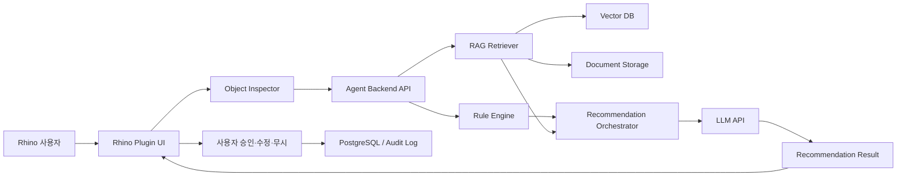

---

## 6.3 주요 구성요소

### 6.3.1 Rhino Plugin

Rhino 내부에서 사용자가 직접 접하는 계층이다.

주요 역할:

- 객체 선택 이벤트 감지
- 객체 속성 수집
- Agent 백엔드 호출
- 결과 패널 표시
- 사용자 결정 반영

플러그인은 C#과 RhinoCommon SDK를 기반으로 구현한다.

### 6.3.2 Object Inspector

선택 객체의 정보를 Rhino 공식 JSON이 아니라 Material Insight 전용 review-object payload 구조로 변환한다.

```json
{
  "object_id": "W-012",
  "object_type": "interior_wall",
  "layer": "A-WALL",
  "material": null,
  "thickness_mm": 75,
  "space_type": "meeting_room"
}
```

객체 유형을 확정할 수 없는 경우에는 추정값을 표시하고 사용자 확인을 요청한다.

### 6.3.3 Agent Backend API

플러그인과 AI 모듈 사이의 중간 계층이다.

주요 역할:

- 요청 검증
- 프로젝트 컨텍스트 결합
- 규칙 검사 및 검색 작업 실행
- LLM 호출 관리
- 결과 형식 통합
- 로그 저장

MVP에서는 Python 기반 FastAPI를 사용한다.

### 6.3.4 Rule Engine

정확하게 판별할 수 있는 조건을 검사한다.

예시:

- 재료 속성 누락
- 두께 값 미입력
- 허용 형식 오류
- 검토 상태 누락
- 동일 유형 객체 간 불일치

규칙 엔진의 결과는 LLM이 임의로 변경할 수 없도록 별도 필드로 유지한다.

### 6.3.5 RAG Search Layer

관련 문서를 검색해 추천의 근거를 제공한다.

구성:

- 문서 전처리
- Chunk 분할
- Embedding 생성
- Vector DB 저장
- 메타데이터 필터
- 유사도 검색
- 출처 및 버전 반환

검색 대상:

- 사내 설계 기준
- 프로젝트 시방서
- 제조사 카탈로그
- 과거 승인 사례
- 검토 체크리스트

### 6.3.6 LLM Recommendation Layer

Rule Engine 결과와 RAG 검색 결과를 바탕으로 설명형 결과를 생성한다.

LLM 입력:

- 객체 정보
- 프로젝트 컨텍스트
- 규칙 검사 결과
- 검색 문서 조각
- 출력 형식 지시

LLM 출력:

- 문제 요약
- 재료 후보
- 두께 검토 안내
- 성능상 주의사항
- 추가 확인 항목
- 전문가 검토 필요 여부

### 6.3.7 Review 및 Logging Layer

사용자의 판단과 변경 이력을 저장한다.

저장 항목:

- 객체 ID
- 추천 결과
- 사용자 행동
- 수정 전후 값
- 참고 문서
- 승인자
- 처리 시간
- 오류 정보

이 데이터는 추후 평가와 품질 개선에 활용한다.

---

## 6.4 요청 처리 흐름

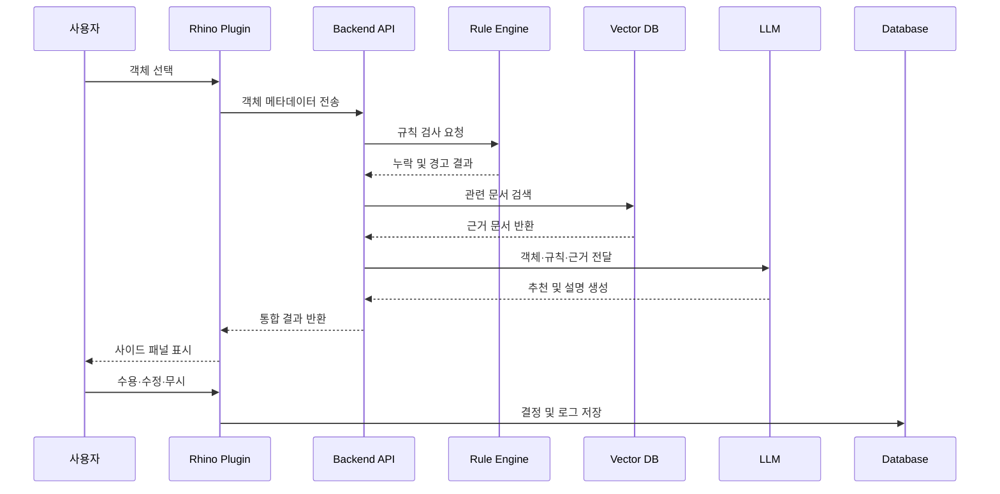

---

## 6.5 데이터 구조

### 주요 엔터티

| 엔터티 | 주요 필드 |
|---|---|
| Project | project_id, type, region, stage |
| DesignObject | object_id, type, layer, material, thickness |
| RuleResult | rule_id, severity, message |
| Document | document_id, version, type, status |
| Recommendation | recommendation_id, content, confidence |
| ReviewAction | action, user_id, reason, timestamp |

### 관계

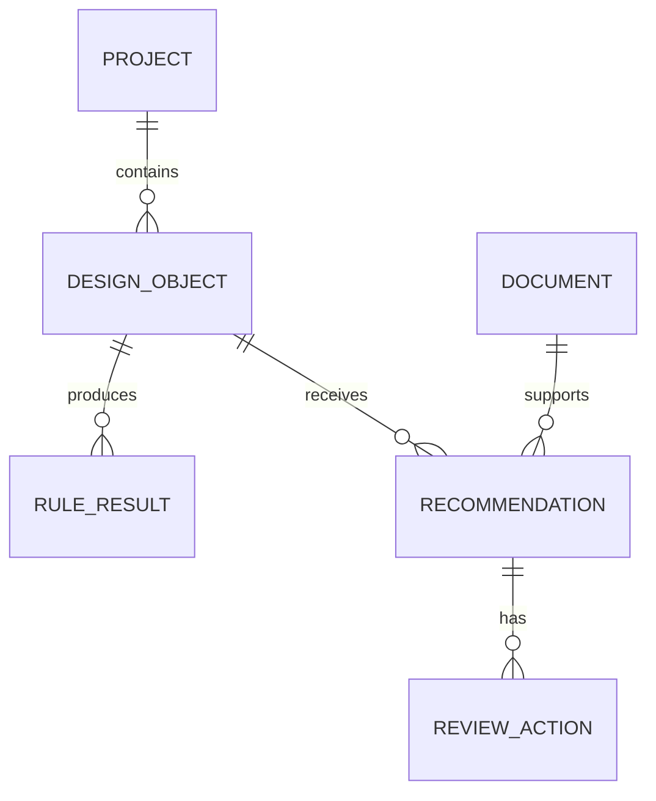

---

## 6.6 배포 구조

MVP에서는 플러그인과 백엔드를 분리한다.

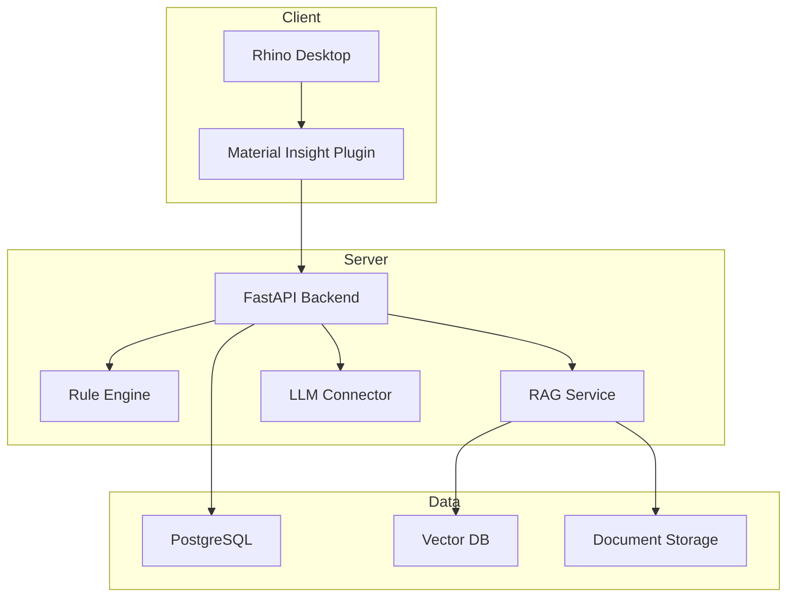

### MVP 배포 방식

- Rhino Plugin: 사용자 PC
- Backend: 로컬 서버 또는 클라우드
- Vector DB: 백엔드와 동일 서버
- PostgreSQL: 개발용 단일 인스턴스
- LLM: 외부 API 또는 사내 모델

실제 기업 적용 시에는 프로젝트 기밀을 고려해 사내망 또는 전용 클라우드 배포가 적합하다.

---

## 6.7 보안 구조

### 데이터 최소화

전체 Rhino 파일을 서버에 업로드하지 않고, 선택 객체의 필요한 메타데이터만 전송한다.

### 접근 제어

- 프로젝트별 권한 분리
- 사용자 역할 기반 접근
- 관리자만 문서 등록 가능
- 고위험 기능은 승인 권한 필요

### 문서 보안

- 프로젝트별 Vector DB 분리
- 원본 문서 암호화
- 문서 버전과 상태 관리
- 비활성 문서 검색 제외

### 로그 보안

- 고객명과 위치 정보 마스킹
- 보존 기간 설정
- 민감한 프롬프트 저장 제한
- 관리자 접근 기록 유지

---

## 6.8 신뢰성 설계

### LLM 장애 시

LLM 호출이 실패해도 Rule Engine의 결과는 표시한다.

### 검색 결과가 없을 때

근거가 없다는 사실을 명시하고 일반적인 확정 추천은 생성하지 않는다.

### 오래된 문서가 검색될 때

문서 버전 경고를 표시하고 사용자 승인을 제한한다.

### 입력값이 불완전할 때

추가 입력을 요청하고 결과의 신뢰도를 낮게 표시한다.

---

## 6.9 기술 스택

| 영역 | 기술 |
|---|---|
| Plugin | C#, RhinoCommon SDK |
| Backend | Python, FastAPI |
| Rule Engine | Python 또는 YAML 기반 규칙 |
| Database | PostgreSQL |
| Vector Search | Chroma, Qdrant 또는 pgvector |
| Document Processing | Python, PDF Parser |
| LLM | 외부 LLM API 또는 사내 모델 |
| Embedding | 범용 또는 한국어 지원 임베딩 모델 |
| UI | Rhino Panel, WPF 또는 Eto.Forms |
| Deployment | Docker |

MVP에서는 관리 편의성을 위해 PostgreSQL과 pgvector를 함께 사용하는 구성이 적합하다.

---

## 6.10 확장 아키텍처

향후에는 다음 기능을 추가할 수 있다.

- AutoCAD 및 Revit 연동
- IFC 객체 매핑
- Jira, Notion, Slack 등의 이슈 시스템 연동
- 제조사 재료 API 연동
- 자동 재료표 생성
- 프로젝트 전체 QA 대시보드
- 조직별 승인 워크플로우
- 사내 LLM 배포

---

## 6.11 소결

Material Insight AI는 Rhino 플러그인, 규칙 엔진, RAG, LLM, 사용자 승인 계층을 분리해 설계한다.

이 구조는 다음 장점을 갖는다.

- LLM 의존도 감소
- 근거 기반 추천 가능
- 장애 시 일부 기능 유지
- 사용자 승인 절차 보장
- 보안과 로그 관리 용이
- 향후 BIM 및 기업 시스템으로 확장 가능

다음 장에서는 RAG, Human-in-the-loop, 위험 통제와 평가 지표를 구체적으로 정리한다.

# 7. RAG, Human-in-the-loop 및 평가 설계

## 7.1 RAG 활용 목적

Material Insight AI는 재료, 시방, 과거 사례와 설계 기준을 모델이 임의로 생성하지 않고, 관련 문서를 검색해 근거와 함께 제시하기 위해 RAG를 사용한다.

RAG의 역할은 다음과 같다.

- 객체와 관련된 문서 검색
- 최신 문서 우선 제공
- 추천 근거와 출처 표시
- 사내 설계 기준 재사용
- 과거 승인 사례 참고
- LLM 환각 감소

---

## 7.2 RAG 처리 흐름

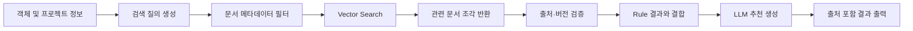

### 검색 질의 예시

```text
객체 유형: 비내력 내벽
공간 용도: 회의실
현재 두께: 75mm
재료: 미지정
검색 목적: 차음 성능과 권장 벽체 구성
```

---

## 7.3 지식 베이스 구성

| 데이터 소스 | 활용 목적 | 우선순위 |
|---|---|---:|
| 프로젝트 시방서 | 현재 프로젝트 기준 확인 | 1 |
| 사내 설계 표준 | 조직 공통 기준 적용 | 2 |
| 승인된 과거 사례 | 유사 설계 참고 | 3 |
| 제조사 카탈로그 | 재료 규격과 성능 확인 | 4 |
| 일반 체크리스트 | 추가 검토 항목 제공 | 5 |

문서에는 다음 메타데이터를 저장한다.

```yaml
document_id: SPEC-INT-024
document_type: project_specification
category: interior_wall
space_type: meeting_room
version: 2.1
effective_date: 2026-03-01
status: active
source: internal
```

---

## 7.4 문서 관리 원칙

RAG의 품질은 문서 최신성과 신뢰도에 좌우된다. 따라서 다음 원칙을 적용한다.

1. 활성 상태의 최신 문서만 기본 검색
2. 문서 버전과 개정일 표시
3. 프로젝트 문서를 사내 일반 기준보다 우선
4. 출처가 불명확한 문서 제외
5. 관리자 승인 후 지식 베이스 등록
6. 검색 결과가 없으면 근거 없음 표시
7. 원문 링크 또는 문서 위치 제공

---

## 7.5 Human-in-the-loop 설계

건축 설계는 안전, 법규, 비용과 책임이 연결되는 업무이므로 AI 결과를 자동 반영하지 않는다.

### 기본 승인 흐름

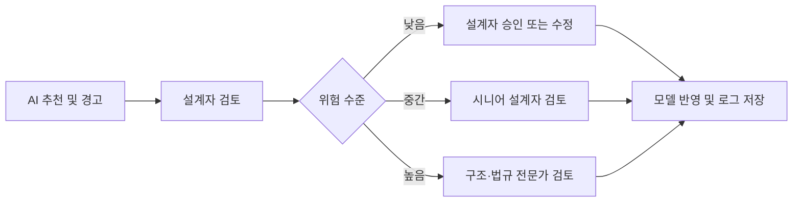

### 사용자 행동

| 행동 | 의미 |
|---|---|
| 수용 | AI 추천을 그대로 채택 |
| 수정 | 사용자가 값을 변경한 뒤 반영 |
| 보류 | 추가 자료 확인 후 결정 |
| 무시 | 추천을 적용하지 않고 사유 기록 |
| 검토 요청 | 시니어 또는 전문가에게 전달 |

---

## 7.6 위험 수준 분류

| 수준 | 예시 | 처리 방식 |
|---|---|---|
| 낮음 | 재료 속성 누락 | 설계자가 직접 수정 |
| 중간 | 일반 범위를 벗어난 두께 | 시니어 검토 권장 |
| 높음 | 내화, 구조, 법규 관련 문제 | 전문가 승인 필수 |
| 매우 높음 | 안전에 영향을 주는 자동 변경 | AI 수행 금지 |

Agent는 구조 안전성과 법규 적합성을 확정하지 않고, 검토 필요성과 관련 근거만 제공한다.

---

## 7.7 주요 위험 요소와 통제 방안

| 위험 요소 | 발생 가능 문제 | 통제 방안 |
|---|---|---|
| LLM 환각 | 존재하지 않는 기준이나 수치 생성 | RAG 근거 제한, 출처 표시, 규칙 엔진 병행 |
| 오래된 문서 | 폐기된 기준 적용 | 버전·유효기간 관리, 최신 문서 우선 |
| 잘못된 객체 분류 | 부적절한 재료 추천 | 신뢰도 표시, 사용자 확인 요청 |
| 프로젝트 맥락 부족 | 일반 기준을 특수 프로젝트에 적용 | 프로젝트 유형과 공간 용도 필수 입력 |
| 과도한 자동화 | 잘못된 값이 모델에 반영 | 사용자 승인 없는 자동 수정 금지 |
| 보안 유출 | 도면과 고객 정보 외부 전송 | 최소 메타데이터 전송, 마스킹, 권한 제어 |
| 문서 오염 | 악의적 또는 부정확한 문서 검색 | 관리자 승인 문서만 등록 |
| 책임 불명확 | 오류 발생 시 판단 주체 추적 불가 | 승인자, 시간, 변경 사유 로그 저장 |
| 과도한 경고 | 사용자가 경고를 무시하게 됨 | 우선순위와 심각도 분류 |
| 검색 실패 | 근거 없는 추천 생성 | 근거 없음 표시, 추천 제한 |

---

## 7.8 평가 지표

### 정량 지표

| 지표 | 정의 | 목표 예시 |
|---|---|---:|
| 속성 누락 탐지율 | 실제 누락 중 Agent가 탐지한 비율 | 90% 이상 |
| 오탐률 | 정상 객체를 문제로 분류한 비율 | 10% 이하 |
| 문서 검색 적합도 | 상위 검색 결과가 질문과 관련된 비율 | 80% 이상 |
| 추천 수용률 | 전체 추천 중 사용자가 수용한 비율 | 60% 이상 |
| 검토 시간 단축률 | 기존 대비 객체당 검토 시간 감소율 | 30% 이상 |
| 평균 응답 시간 | 객체 선택부터 결과 표시까지 시간 | 5초 이내 |
| 전문가 전환 정확도 | 고위험 항목이 적절히 전달된 비율 | 90% 이상 |

### 정성 지표

- 추천 설명이 이해하기 쉬운가
- 근거 문서가 신뢰할 수 있는가
- Rhino 작업 흐름을 방해하지 않는가
- 사용자가 결과를 통제할 수 있는가
- 초급 설계자의 검토 업무에 도움이 되는가
- 시니어 설계자의 검토 부담을 줄이는가

---

## 7.9 평가 방법

### 테스트 데이터셋

다음 유형의 객체를 포함한 샘플 프로젝트를 구성한다.

- 재료가 정상 입력된 객체
- 재료가 누락된 객체
- 두께가 일반 범위를 벗어난 객체
- 공간 용도가 누락된 객체
- 구조 검토가 필요한 객체
- 서로 다른 문서 버전이 연결된 객체

### 비교 실험

동일한 검토 작업을 두 방식으로 수행한다.

1. 기존 방식: 설계자가 직접 문서 검색 및 검토
2. Agent 방식: Material Insight AI 사용

비교 항목:

- 작업 시간
- 누락 탐지 수
- 잘못된 경고 수
- 검색한 문서 수
- 사용자 만족도
- 최종 수정 결과

---

## 7.10 로그와 피드백 활용

사용자의 승인과 수정 기록은 향후 시스템 개선에 사용한다.

활용 예시:

- 자주 수용되는 추천 유형 파악
- 반복적으로 무시되는 경고 조정
- 잘못 검색되는 문서 개선
- 공간 용도별 규칙 보완
- 사용자별 UI 개선
- 조직 표준과 실제 업무 차이 분석

단, 사용자 로그를 자동 학습에 사용하기 전에는 데이터 품질과 개인정보를 검토해야 한다.

---

## 7.11 실패 시나리오

### 실패 시나리오 1. 객체 정보 부족

객체의 레이어와 이름이 불명확해 Agent가 유형을 판단하지 못한다.

**대응**

- 객체 유형 입력 요청
- 추정 결과와 신뢰도 표시
- 확정 추천 생성 금지

### 실패 시나리오 2. 오래된 시방서 검색

과거 프로젝트 문서가 최신 기준보다 높은 유사도로 검색된다.

**대응**

- 활성 문서 필터
- 개정일 기반 우선순위
- 오래된 문서 경고

### 실패 시나리오 3. 과도한 일반화

일반적인 벽체 기준을 특수 방음실에 적용한다.

**대응**

- 공간 용도 필수 입력
- 특수 공간 감지 시 전문가 검토
- 일반 범위와 적용 전제 명시

### 실패 시나리오 4. LLM 서비스 장애

LLM API가 응답하지 않는다.

**대응**

- Rule Engine 결과는 그대로 표시
- 문서 검색 결과만 제공
- 재시도와 오류 로그 저장

---

## 7.12 소결

Material Insight AI의 신뢰성은 LLM 성능만으로 확보할 수 없다. 최신 문서를 검색하는 RAG, 명확한 조건을 검사하는 Rule Engine, 최종 결정을 담당하는 설계자와 전문가가 함께 구성되어야 한다.

본 설계는 다음 원칙을 따른다.

- 근거 없는 추천 금지
- 고위험 자동화 금지
- 문서 버전과 출처 표시
- 사용자 승인 절차 유지
- 모든 결정과 변경 이력 기록
- 정량·정성 지표를 통한 지속 평가

다음 장에서는 실제 발표와 시연에 사용할 수 있는 프로토타입 및 데모 시나리오를 설계한다.

# 8. 프로토타입 및 데모 시나리오

## 8.1 데모 목적

본 데모의 목적은 Material Insight AI가 단순한 챗봇이 아니라, Rhino 객체를 읽고 규칙 검사와 문서 검색을 수행한 뒤 설계자의 판단까지 연결하는 **업무형 AI Agent**임을 보여주는 것이다.

데모에서는 다음 흐름을 검증한다.

1. 객체 선택
2. 속성 추출
3. 누락 및 위험 탐지
4. 관련 문서 검색
5. 추천과 경고 생성
6. 사용자 승인 또는 수정
7. 검토 이력 저장

---

## 8.2 프로토타입 화면 구성

### 화면 1. 객체 정보 패널

선택한 객체의 기본 정보를 표시한다.

- 객체 ID
- 객체 유형
- 레이어
- 공간 용도
- 현재 재료
- 현재 두께
- 검토 상태

### 화면 2. AI 검토 결과

Agent가 탐지한 문제와 추천을 표시한다.

- 누락 속성
- 위험 수준
- 재료 후보
- 두께 검토 안내
- 성능상 주의사항
- 관련 문서 출처
- 추천 신뢰도

### 화면 3. 사용자 액션

사용자가 다음 행동을 선택할 수 있다.

- 수용
- 수정
- 보류
- 무시
- 전문가 검토 요청

### 화면 4. 전체 모델 QA 목록

모델 전체를 검사한 결과를 우선순위별로 보여준다.

- 재료 누락 객체
- 두께 검토 필요 객체
- 공간 용도 누락 객체
- 고위험 검토 대상
- 처리 완료 여부

---

## 8.3 대표 데모 시나리오

### 시나리오 A. 회의실 구획벽 검토

#### 입력 객체

```yaml
object_id: W-012
object_type: interior_wall
space_type: meeting_room
material: null
thickness_mm: 75
review_status: pending
```

#### Agent 처리

1. 재료 속성 누락 탐지
2. 회의실 공간 용도 확인
3. 두께 75mm를 일반 검토 범위와 비교
4. 차음 관련 시방서 검색
5. 추천과 경고 생성

#### 출력 예시

> **검토 필요**
>
> 현재 객체에는 재료 정보가 입력되어 있지 않습니다.  
> 회의실 구획벽은 차음 성능 검토가 필요할 수 있습니다.  
> 경량철골과 석고보드 조합을 후보로 검토하고, 현재 두께 75mm가 프로젝트 기준을 만족하는지 확인하세요.
>
> **참고 문서:** 사내 시방서 4.2 회의실 구획벽  
> **권장 행동:** 시니어 설계자 검토 후 재료와 두께 수정

#### 사용자 행동

- 재료: `경량철골 + 석고보드`
- 두께: `125mm`
- 상태: `검토 완료`
- 행동: `수정 후 수용`

---

### 시나리오 B. 전체 모델 누락 검사

사용자가 `Scan Model` 버튼을 실행한다.

#### 검사 결과 예시

| 분류 | 객체 수 | 우선순위 |
|---|---:|---|
| 재료 미지정 | 18 | 중 |
| 두께 미입력 | 7 | 중 |
| 두께 검토 필요 | 5 | 높음 |
| 공간 용도 누락 | 9 | 낮음 |
| 구조 전문가 검토 필요 | 2 | 매우 높음 |

사용자는 위험도가 높은 객체부터 선택해 개별 검토를 수행한다.

---

## 8.4 End-to-End 데모 흐름

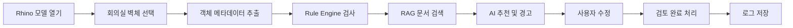

발표에서는 이 흐름을 2~3분 안에 보여주는 것이 적절하다.

---

## 8.5 대화형 출력 예시

### 사용자 요청

```text
선택한 벽체의 재료와 두께를 검토해줘.
```

### Agent 응답

```text
객체 W-012를 분석했습니다.

탐지된 문제
- 재료 속성이 비어 있습니다.
- 현재 두께 75mm는 회의실 구획벽 기준으로 추가 검토가 필요합니다.

추천
- 경량철골 + 석고보드 조합 검토
- 차음 성능을 고려한 충진재 및 보드 겹수 확인
- 두께 100~150mm 범위 참고

근거
- 사내 시방서 4.2 회의실 구획벽
- 승인 프로젝트 사례 PRJ-021

주의
- 본 결과는 참고용이며 최종 반영 전 시니어 설계자 검토가 필요합니다.
```

---

## 8.6 시스템 프롬프트 예시

```text
당신은 건축·공간 설계자를 지원하는 AI Agent다.

입력으로 제공된 CAD/Rhino 객체 정보, 프로젝트 컨텍스트,
Rule Engine 결과와 검색 문서를 바탕으로 재료, 두께,
성능상 주의사항과 추가 검토 항목을 설명한다.

반드시 다음 원칙을 따른다.

1. 검색 문서에 없는 수치나 기준을 임의로 만들지 않는다.
2. 구조 및 법규 적합성을 확정하지 않는다.
3. 추천에는 근거 문서와 출처를 표시한다.
4. 정보가 부족하면 추가 입력을 요청한다.
5. 고위험 항목은 전문가 검토로 전환한다.
6. 출력은 문제, 추천, 근거, 주의사항, 사용자 행동 순서로 작성한다.
```

---

## 8.7 사용자 프롬프트 템플릿

```text
[객체 정보]
객체 ID: {{object_id}}
객체 유형: {{object_type}}
공간 용도: {{space_type}}
현재 재료: {{material}}
현재 두께: {{thickness_mm}}

[프로젝트 정보]
프로젝트 유형: {{project_type}}
설계 단계: {{design_stage}}
지역: {{region}}

[Rule Engine 결과]
{{rule_results}}

[검색 문서]
{{retrieved_documents}}

위 정보를 바탕으로 다음 형식으로 답하라.

1. 탐지된 문제
2. 추천 재료
3. 두께 검토
4. 성능상 주의사항
5. 참고 근거
6. 사용자에게 필요한 다음 행동
```

---

## 8.8 Tool 목록

| Tool | 역할 |
|---|---|
| `get_selected_object` | Rhino에서 현재 선택 객체 정보 추출 |
| `get_project_context` | 프로젝트 유형과 공간 용도 조회 |
| `run_rule_check` | 속성 누락과 값 범위 검사 |
| `search_documents` | 시방서와 카탈로그 검색 |
| `get_document_source` | 문서 버전과 출처 반환 |
| `create_recommendation` | 결과 구조화 |
| `update_object_attribute` | 승인 후 객체 속성 수정 |
| `create_review_request` | 전문가 검토 요청 생성 |
| `save_review_log` | 사용자 행동과 결과 저장 |

Agent는 모든 Tool을 자유롭게 실행하지 않는다. 객체 수정과 검토 요청은 사용자 승인 후에만 실행한다.

---

## 8.9 데모용 API 예시

### 요청

```json
POST /api/v1/review-object
{
  "project_id": "PRJ-001",
  "object": {
    "object_id": "W-012",
    "object_type": "interior_wall",
    "space_type": "meeting_room",
    "material": null,
    "thickness_mm": 75
  }
}
```

### 응답

```json
{
  "status": "review_required",
  "severity": "medium",
  "issues": [
    "material_missing",
    "thickness_review_required"
  ],
  "recommendation": {
    "material_candidates": [
      "경량철골 + 석고보드"
    ],
    "message": "회의실 구획벽은 차음 성능 검토가 필요합니다."
  },
  "sources": [
    {
      "document_id": "SPEC-INT-024",
      "section": "4.2"
    }
  ],
  "required_action": "designer_review"
}
```

---

## 8.10 발표용 데모 구성

### 1단계. 문제 제시

“현재 객체에는 재료가 입력되어 있지 않고, 두께가 적절한지 확인하려면 여러 문서를 직접 검색해야 합니다.”

### 2단계. 객체 선택

Rhino에서 회의실 벽체를 클릭한다.

### 3단계. Agent 분석

사이드 패널에서 다음 과정이 표시된다.

- 객체 정보 확인
- 규칙 검사 완료
- 관련 문서 검색
- 추천 생성

### 4단계. 결과 확인

재료 누락, 두께 검토 경고, 관련 시방서와 추천 결과를 보여준다.

### 5단계. 사용자 승인

설계자가 재료와 두께를 수정한 뒤 검토 완료 버튼을 누른다.

### 6단계. 이력 확인

추천 내용, 수정값, 처리자와 시간이 기록된 로그를 보여준다.

---

## 8.11 실패 데모 시나리오

성공 사례만 보여주기보다 Agent가 모르는 상황에서 어떻게 대응하는지도 제시한다.

### 입력

```yaml
object_type: unknown
space_type: null
material: null
thickness_mm: null
```

### 출력

> 객체 유형과 공간 용도를 확인할 수 없어 재료와 두께를 추천할 수 없습니다.  
> 객체 유형과 공간 정보를 입력한 뒤 다시 검토하세요.

이 결과는 Agent가 근거 없이 답변하지 않도록 설계되었음을 보여준다.

---

## 8.12 프로토타입 구현 범위

### 구현 가능 범위

- Rhino 객체 선택
- 객체 속성 추출
- 규칙 기반 누락 검사
- 샘플 문서 검색
- AI 추천 결과 표시
- 사용자 행동 저장

### 화면 설계로 대체 가능한 범위

- 다중 사용자 승인
- 구조 엔지니어 시스템 연동
- 실제 제조사 API
- 전체 법규 데이터베이스
- 기업용 보안 배포

---

## 8.13 데모 성공 기준

데모는 다음 조건을 만족하면 성공한 것으로 본다.

- 객체 선택 결과가 패널에 표시됨
- 누락 속성과 위험이 정확히 탐지됨
- 관련 문서 출처가 표시됨
- AI 추천이 구조화된 형태로 출력됨
- 사용자가 수용·수정·무시를 선택할 수 있음
- 사용자 행동이 로그에 저장됨
- 정보 부족 시 추천을 중단함

---

## 8.14 소결

본 데모는 Material Insight AI가 Rhino 객체, 규칙 엔진, RAG, LLM, 사용자 승인을 하나의 흐름으로 연결한다는 점을 보여준다.

핵심 시연 장면은 다음과 같다.

> **객체 선택 → 누락 탐지 → 문서 검색 → 근거 기반 추천 → 사용자 수정 및 승인 → 이력 저장**

이 흐름을 통해 본 Agent가 단순한 질의응답 도구가 아니라 실제 설계 업무에 적용 가능한 의사결정 지원 시스템임을 설명할 수 있다.

# 9. 기대 효과, 한계 및 참고문헌

## 9.1 기대 효과

Material Insight AI는 설계자의 판단을 자동화하기보다, 반복적인 정보 확인과 1차 검토를 지원하는 데 목적이 있다.

### 업무 효율 향상

- 객체별 재료와 두께 검토 시간 단축
- 시방서와 카탈로그 검색 시간 감소
- 누락 객체를 전체 모델에서 빠르게 탐지
- 반복적인 검토 요청 작성 자동화

### 설계 품질 향상

- 객체 속성 누락 조기 발견
- 유사 객체 간 정보 일관성 향상
- 추천 근거와 문서 출처 제공
- 초급 설계자의 검토 항목 이해 지원

### 협업과 지식 관리 개선

- 객체별 검토 상태와 변경 이유 기록
- 시니어 설계자와 전문가에게 구조화된 검토 요청 전달
- 사내 설계 기준과 과거 사례 재사용
- 개인 경험을 조직 지식으로 전환

---

## 9.2 예상되는 한계

### 1. 입력 데이터 품질 의존

레이어, 객체명, 재료와 공간 용도가 불명확하면 Agent도 정확한 판단을 수행하기 어렵다. 따라서 객체 분류 규칙과 필수 속성 체계가 필요하다.

### 2. 프로젝트별 차이

같은 객체 유형이라도 건물 용도, 지역, 고객 요구와 구조 방식에 따라 적절한 구성이 달라질 수 있다. 일반적인 추천을 모든 프로젝트에 그대로 적용해서는 안 된다.

### 3. 구조 및 법규 판단의 제한

구조 안전성과 법규 적합성은 전체 프로젝트 조건과 최신 기준을 종합적으로 검토해야 한다. Agent는 관련 근거와 검토 필요성을 제공하되 최종 판단을 수행하지 않는다.

### 4. 문서 최신성 문제

RAG에 오래된 시방서나 카탈로그가 등록되면 잘못된 근거가 검색될 수 있다. 문서 버전, 유효기간과 승인 상태를 지속적으로 관리해야 한다.

### 5. 초기 구축 비용

플러그인 개발뿐 아니라 객체 분류체계, 규칙, 문서 메타데이터와 승인 프로세스를 함께 설계해야 한다. 기업 적용 시 기술 개발보다 데이터 정비에 더 많은 노력이 필요할 수 있다.

---

## 9.3 향후 확장 방향

MVP 검증 이후 다음 단계로 확장할 수 있다.

1. AutoCAD와 Revit 연동
2. IFC 기반 객체 유형과 속성 매핑
3. 구조·법규 전문가 검토 워크플로우 연동
4. 재료표와 검토 보고서 자동 생성
5. 제조사 제품 정보와 단가 API 연동
6. 프로젝트 전체 QA 대시보드
7. 사내 LLM 또는 전용 클라우드 배포
8. 다중 사용자 승인과 권한 관리

---

## 9.4 결론

본 프로젝트는 건축·공간 설계 업무에서 반복적으로 발생하는 재료 정보 누락, 부재 두께 검토, 시방서 검색과 변경 이력 관리 문제를 해결하기 위해 **Rhino/CAD 플러그인형 AI Agent**를 제안하였다.

현재 건축 분야의 AI는 초기 설계 대안 생성, 대지 분석, 시각화와 BIM 검토에 활발히 적용되고 있다. 그러나 자유형 CAD/Rhino 객체와 기술 문서를 연결해 재료·두께·성능 검토를 지원하는 영역은 상대적으로 부족하다.

Material Insight AI는 다음 요소를 결합한다.

- Rhino 객체 메타데이터 추출
- Rule Engine 기반 누락과 범위 검사
- RAG 기반 시방서와 카탈로그 검색
- LLM 기반 설명형 추천
- 설계자와 전문가의 최종 승인
- 검토 결과와 변경 이력 저장

이 구조의 핵심은 AI가 설계자를 대체하지 않는다는 점이다. AI는 반복적인 정보 탐색과 1차 검토를 수행하고, 설계자는 프로젝트 맥락과 전문성을 바탕으로 최종 판단을 내린다.

따라서 Material Insight AI는 제한된 범위의 MVP로 구현 가능하면서도, 향후 BIM, 기업 지식 관리와 협업 시스템으로 확장할 수 있는 현실적인 AI Agent 도입 전략이다.

---

## 9.5 참고문헌 및 공식 자료

### Rhino 및 플러그인 개발

1. Robert McNeel & Associates, **Your First Plugin (Windows)**, Rhino Developer Documentation.  
   <https://developer.rhino3d.com/guides/rhinocommon/your-first-plugin-windows/>

2. Robert McNeel & Associates, **Rhino.DocObjects.ObjectAttributes Class**, RhinoCommon API Documentation.  
   <https://developer.rhino3d.com/api/rhinocommon/rhino.docobjects.objectattributes>

### BIM 및 데이터 표준

3. buildingSMART International, **Industry Foundation Classes (IFC)**.  
   <https://www.buildingsmart.org/standards/bsi-standards/industry-foundation-classes/>

4. Autodesk, **What Is BIM?**  
   <https://www.autodesk.com/solutions/aec/bim>

### 건축·설계 AI 사례

5. Autodesk, **Forma Site Design Overview**.  
   <https://www.autodesk.com/products/forma/overview>

6. TestFit, **Real Estate Feasibility Platform**.  
   <https://www.testfit.io/>

7. EvolveLAB, **Veras AI Visualization**.  
   <https://www.evolvelab.io/veras>

### 기술 및 구현 자료

8. FastAPI, **FastAPI Documentation**.  
   <https://fastapi.tiangolo.com/>

9. PostgreSQL, **PostgreSQL Documentation**.  
   <https://www.postgresql.org/docs/>

10. pgvector, **Open-source Vector Similarity Search for PostgreSQL**.  
    <https://github.com/pgvector/pgvector>

---

## 9.6 제출 전 참고문헌 보완 사항

최종 제출 전에는 다음 자료를 추가하는 것이 좋다.

- 국내 건축법과 관련 시행령
- 국토교통부 고시 및 건축 기준
- KS 재료·차음·내화 관련 표준
- 실제 제조사 자재 카탈로그
- 과거 설계 프로젝트 사례
- 수업에서 제공된 AI Agent 및 RAG 자료

법규와 표준은 반드시 최신 공식 원문을 확인하고, 보고서에는 문서명, 발행기관, 개정일과 접근일을 함께 기록한다.

---

## 9.7 최종 보고서 구성

최종 보고서는 다음 Markdown 문서를 순서대로 결합해 구성한다.

```text
README.md
docs/
├── 01-background.md
├── 02-industry-analysis.md
├── 03-ai-landscape.md
├── 04-agent-candidates.md
├── 05-mvp-design.md
├── 06-architecture.md
├── 07-rag-hitl.md
├── 08-demo.md
└── 09-reference.md
```

각 문서를 하나의 보고서로 결합한 뒤 표지, 목차, 페이지 번호와 참고문헌 형식을 최종 정리한다.
