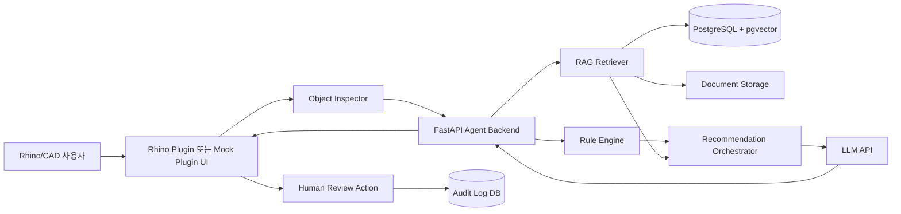

# Material Insight AI 구현 가이드
## Rhino/CAD 객체 기반 재료·두께·성능 검토 Agent MVP 구현 문서

> 목적: 이 문서는 다른 LLM 또는 개발자가 그대로 읽고 vibe coding 방식으로 MVP를 구현할 수 있도록, 과제 요구사항과 `docs/01~09` 설계 문서의 내용을 실제 개발 단위로 변환한 실행 가이드다. 핵심은 **설계 문서와 구현 결과의 일치도**를 높이는 것이다.

---

## 0. 한 줄 결론

이 프로젝트는 **Rhino 플러그인형 객체 검토 Agent**로 구현한다.  
MVP의 중심 흐름은 다음과 같다.

1. Rhino/CAD에서 설계 객체 선택
2. 객체 메타데이터 추출
3. Rule Engine으로 누락·범위·검토 상태 검사
4. RAG로 관련 시방서·카탈로그·사내 기준 검색
5. LLM이 추천·경고·근거를 구조화
6. 설계자가 수용·수정·보류·무시·검토 요청 중 선택
7. 사용자 결정과 변경 이력 저장

이 Agent는 설계를 자동 확정하지 않는다. AI는 **근거 기반 검토 보조자**이고, 최종 판단은 설계자 또는 전문가가 수행한다.

---

## 1. 구현 방식 추천

### 1.1 후보 비교

#### A. 웹 챗봇 단독 구현

장점:
- 구현이 빠르다.
- 프론트엔드와 백엔드만으로 데모가 가능하다.
- LLM/RAG 흐름을 보여주기 쉽다.

한계:
- Rhino/CAD 객체를 직접 선택하는 설계와 맞지 않는다.
- 객체 ID, 레이어, 재료, 두께, 사용자 속성 추출이 약해진다.
- 과제 문서의 핵심인 “플러그인형 AI Agent”와 일치도가 낮다.

#### B. Rhino 플러그인 전체 구현

장점:
- 설계 문서와 가장 잘 맞는다.
- 실제 사용자 흐름을 Rhino 안에서 보여줄 수 있다.
- 객체 선택, 속성 추출, 패널 UI, 승인 반영을 자연스럽게 구현할 수 있다.

한계:
- C# RhinoCommon 개발 환경이 필요하다.
- 제한된 기간에 완성도 높은 플러그인을 만들기 부담될 수 있다.
- 데모 환경 의존성이 커진다.

#### C. 하이브리드 MVP 구현

권장 방식:
- 백엔드는 FastAPI로 실제 Agent 흐름을 구현한다.
- Rhino 플러그인은 최소 기능만 구현하거나, 플러그인 입력을 흉내 내는 데모 UI를 함께 둔다.
- 핵심 API와 데이터 구조는 실제 Rhino 플러그인에서 바로 호출 가능한 형태로 만든다.

장점:
- 설계 문서와 구현 결과를 맞추기 쉽다.
- 플러그인 개발 리스크를 줄인다.
- 발표에서 실제 Agent 흐름을 End-to-End로 보여줄 수 있다.
- Rhino 연동이 완전하지 않아도 플러그인 경계를 명확히 설명할 수 있다.

### 1.2 최종 추천

### 추천: **FastAPI Agent Backend + Rule Engine + pgvector RAG + Minimal Rhino Plugin 또는 Mock Plugin UI**

구현 우선순위는 다음과 같다.

1. FastAPI 백엔드
2. 객체 검토 API
3. Rule Engine
4. 샘플 문서 RAG
5. LLM 추천 생성
6. Review/Logging
7. 간단한 Rhino Plugin 또는 플러그인 대체 데모 UI

발표와 과제 평가에서는 다음 문장을 강조한다.

> 본 MVP는 Rhino 객체에서 추출되는 메타데이터를 Rhino 공식 JSON이 아닌 Material Insight 전용 review-object payload로 받아, 규칙 검사와 RAG 검색, LLM 추천, 설계자 승인 및 로그 저장까지 연결하는 플러그인형 Agent 백엔드를 구현하였다.

---

## 2. 권장 기술 스택

## 2.1 백엔드

- **Python 3.11+**
- **FastAPI**: Agent API 서버
- **Pydantic**: 요청/응답 및 내부 상태 스키마
- **SQLAlchemy 또는 SQLModel**: 로그와 리뷰 액션 저장
- **PostgreSQL**: 프로젝트, 객체, 추천, 리뷰 로그 저장
- **pgvector**: 문서 임베딩 검색
- **httpx**: 외부 LLM API 호출
- **pytest**: 규칙과 API 테스트

## 2.2 Rhino/CAD 연동

- **C#**
- **RhinoCommon SDK**
- **Eto.Forms 또는 WPF**: Rhino 패널 UI

MVP에서 Rhino 개발이 어렵다면 다음 대체안을 허용한다.

- `mock-plugin-ui`: Rhino에서 추출될 객체 JSON을 입력하는 웹 UI
- `sample_objects/*.json`: 데모 객체 fixture
- README에 Rhino Plugin 연동 경계와 API 호출 방식 명시

단, 설계 문서와 일치도를 위해 API 이름과 데이터 구조는 Rhino Plugin 기준으로 설계한다.

## 2.3 RAG 계층

- **문서 저장**: `data/documents`
- **문서 메타데이터**: YAML 또는 JSON
- **Chunking**: 문단 또는 제목 단위
- **Vector DB**: PostgreSQL + pgvector 권장
- **Embedding Model**: 한국어 문서 검색 가능한 임베딩 모델

MVP에서는 샘플 시방서와 카탈로그 5~10개를 직접 작성해 사용해도 된다.

## 2.4 LLM 계층

- OpenAI 호환 Chat/Responses API 또는 로컬 LLM
- 반드시 구조화 출력 JSON을 사용한다.
- LLM은 Rule Engine 결과를 변경하지 않고, 설명과 추천을 생성하는 역할만 담당한다.

---

## 3. MVP 구현 범위

### 3.1 반드시 구현할 기능

1. 객체 JSON 입력
2. 객체 메타데이터 표준화
3. 재료 누락 검사
4. 두께 미입력 및 범위 검토
5. 공간 용도 누락 검사
6. 검토 상태 누락 검사
7. 샘플 문서 RAG 검색
8. LLM 추천·경고 생성
9. 출처와 문서 버전 표시
10. 사용자 액션 저장
11. 전체 모델 QA 목록 생성

### 3.2 구현하면 좋은 기능

- Rhino에서 실제 선택 객체 속성 추출
- 승인 후 Rhino 객체 UserDictionary 업데이트
- 전문가 검토 요청 생성
- 추천 이력 조회 화면
- 문서 업로드 및 인덱싱 API

### 3.3 MVP에서 제외할 기능

- 구조 안전성 자동 확정
- 법규 적합성 최종 판정
- 제조사 제품 자동 발주
- 전체 건물 자동 설계
- 모든 CAD/BIM 프로그램 연동
- 실시간 다중 사용자 협업

---

## 4. 전체 시스템 아키텍처



핵심 설계 원칙:

- 객체 추출은 플러그인 또는 Mock Plugin이 담당한다.
- 명확한 판단은 Rule Engine이 담당한다.
- 문서 근거는 RAG가 담당한다.
- 설명형 추천은 LLM이 담당한다.
- 객체 수정과 최종 반영은 사용자 승인 이후에만 수행한다.

---

## 5. 권장 프로젝트 구조

```text
material-insight-ai/
  backend/
    app/
      api/
        routes_review.py
        routes_documents.py
        routes_actions.py
      core/
        config.py
        logging.py
      models/
        object.py
        rule.py
        recommendation.py
        document.py
        review_action.py
      services/
        object_normalizer.py
        rule_engine.py
        rag_retriever.py
        recommendation_orchestrator.py
        llm_client.py
        review_logger.py
      prompts/
        recommendation_system.txt
        recommendation_user_template.txt
      db/
        session.py
        schema.py
      tests/
        test_rule_engine.py
        test_review_api.py
        test_rag_retriever.py
    main.py
    pyproject.toml
    README.md
  plugin/
    RhinoMaterialInsight/
      Commands/
      Panels/
      Services/
      Models/
      RhinoMaterialInsight.csproj
  frontend/
    mock-plugin-ui/
      src/
      package.json
  data/
    sample_objects/
      wall_meeting_room_missing_material.json
      wall_unknown_context.json
      floor_valid_material.json
    documents/
      specs/
      catalogs/
      standards/
    rules/
      material_rules.yaml
      thickness_rules.yaml
  infra/
    docker-compose.yml
  docs/
    api-spec.md
    demo-script.md
```

MVP 시간이 짧다면 `plugin/`은 skeleton만 만들고 `frontend/mock-plugin-ui`로 데모해도 된다. 다만 README에는 실제 Rhino Plugin이 호출할 API를 명확히 써야 한다.

---

## 6. 핵심 데이터 모델

## 6.1 객체 입력 모델

```python
from typing import Optional, Literal, Dict, Any
from pydantic import BaseModel, Field

class GeometrySummary(BaseModel):
    length_mm: Optional[float] = None
    area_m2: Optional[float] = None
    volume_m3: Optional[float] = None
    bbox: Optional[Dict[str, Any]] = None

class DesignObjectInput(BaseModel):
    object_id: str
    object_type: Optional[str] = None
    layer: Optional[str] = None
    name: Optional[str] = None
    material: Optional[str] = None
    thickness_mm: Optional[float] = None
    space_type: Optional[str] = None
    review_status: Optional[str] = None
    geometry: GeometrySummary = Field(default_factory=GeometrySummary)
    user_attributes: Dict[str, Any] = Field(default_factory=dict)

class ProjectContext(BaseModel):
    project_id: str
    project_type: Optional[str] = None
    design_stage: Optional[str] = None
    building_use: Optional[str] = None
    region: Optional[str] = None
    priority: Optional[str] = None
```

## 6.2 규칙 결과 모델

```python
class RuleResult(BaseModel):
    rule_id: str
    severity: Literal["low", "medium", "high", "critical"]
    issue_code: str
    message: str
    field: Optional[str] = None
    requires_rag: bool = False
    requires_expert_review: bool = False
```

## 6.3 검색 문서 모델

```python
class RetrievedDocument(BaseModel):
    document_id: str
    title: str
    section: Optional[str] = None
    chunk_text: str
    document_type: str
    version: Optional[str] = None
    effective_date: Optional[str] = None
    status: Literal["active", "inactive", "deprecated"] = "active"
    source: Optional[str] = None
    score: float
```

## 6.4 추천 결과 모델

```python
class RecommendationResult(BaseModel):
    status: Literal["ok", "review_required", "blocked", "error"]
    severity: Literal["low", "medium", "high", "critical"]
    summary: str
    detected_issues: list[str]
    material_candidates: list[str] = []
    thickness_guidance: dict = {}
    performance_notes: list[str] = []
    required_action: Literal[
        "none",
        "designer_review",
        "senior_review",
        "expert_review",
        "need_more_input"
    ]
    confidence: float
    sources: list[RetrievedDocument] = []
    disclaimers: list[str] = []
```

## 6.5 리뷰 액션 모델

```python
class ReviewActionRequest(BaseModel):
    recommendation_id: str
    user_id: str
    action: Literal["accept", "edit", "hold", "ignore", "request_expert_review"]
    edited_values: dict = {}
    reason: Optional[str] = None
```

---

## 7. Rule Engine 설계

## 7.1 역할

Rule Engine은 LLM보다 먼저 실행된다. 다음처럼 확정적으로 판단 가능한 항목을 검사한다.

- 재료 속성 누락
- 두께 값 누락
- 공간 용도 누락
- 검토 상태 누락
- 일반 범위 이탈
- 구조·법규 관련 검토 필요 표시

LLM은 Rule Engine의 결과를 임의로 삭제하거나 완화해서는 안 된다.

## 7.2 YAML 규칙 예시

```yaml
rules:
  - rule_id: WALL_MATERIAL_REQUIRED
    target_object_type: interior_wall
    condition:
      field: material
      operator: is_null
    result:
      severity: medium
      issue_code: material_missing
      message: 재료 정보가 입력되어 있지 않습니다.
      requires_rag: true
      requires_expert_review: false

  - rule_id: MEETING_ROOM_WALL_THICKNESS_REVIEW
    target_object_type: interior_wall
    condition:
      all:
        - field: space_type
          operator: equals
          value: meeting_room
        - field: thickness_mm
          operator: less_than
          value: 100
    result:
      severity: medium
      issue_code: thickness_review_required
      message: 회의실 구획벽의 두께와 차음 성능 검토가 필요합니다.
      requires_rag: true
      requires_expert_review: false

  - rule_id: STRUCTURAL_SLAB_EXPERT_REVIEW
    target_object_type: slab
    condition:
      field: user_attributes.structural_role
      operator: equals
      value: load_bearing
    result:
      severity: high
      issue_code: structural_review_required
      message: 구조 관련 항목은 전문가 검토가 필요합니다.
      requires_rag: true
      requires_expert_review: true
```

## 7.3 완료 기준

- 샘플 객체 10개에 대해 규칙 결과가 예상대로 나온다.
- `material_missing`, `thickness_review_required`, `space_type_missing`, `expert_review_required`를 구분한다.
- LLM 없이도 기본 경고를 반환할 수 있다.

---

## 8. RAG 설계

## 8.1 검색 대상

MVP 문서 데이터는 다음 5종을 준비한다.

1. 회의실 구획벽 시방서
2. 일반 사무공간 벽체 기준
3. 바닥 마감재 카탈로그
4. 천장 마감 체크리스트
5. 과거 승인 사례

## 8.2 문서 메타데이터

```yaml
document_id: SPEC-INT-024
title: 회의실 구획벽 시방 기준
document_type: project_specification
category: interior_wall
space_type: meeting_room
version: "2.1"
effective_date: "2026-03-01"
status: active
source: internal
```

## 8.3 검색 질의 생성

객체 정보와 RuleResult를 결합해 질의를 만든다.

```text
객체 유형: interior_wall
공간 용도: meeting_room
현재 재료: 미지정
현재 두께: 75mm
탐지 이슈: material_missing, thickness_review_required
검색 목적: 회의실 구획벽 재료 후보, 차음 검토, 일반 두께 참고 범위
```

## 8.4 RAG 원칙

- Retrieval은 항상 실행한다.
- LLM prompt에 포함할 sources는 relevance score threshold를 통과한 결과만 채택한다.
- threshold를 통과한 문서가 없으면 “근거 없음”을 명시하고, LLM은 문서 근거가 있는 것처럼 답하지 않는다.
- `status=active` 문서를 우선 검색한다.
- 프로젝트 시방서를 사내 일반 기준보다 우선한다.
- 검색 후보가 있더라도 threshold를 통과하지 못하면 “근거 없음”으로 처리한다.
- 오래된 문서는 경고와 함께 표시한다.
- LLM에 문서 원문 전체를 넣지 않고 필요한 chunk와 출처만 전달한다.

## 8.5 완료 기준

- 샘플 객체 `W-012`에 대해 회의실 구획벽 문서가 상위 결과로 나온다.
- 검색 결과에는 `document_id`, `section`, `version`, `source`, `score`가 포함된다.
- 검색 결과가 없는 객체에 대해 추천을 제한한다.

---

## 9. LLM Recommendation Layer

## 9.1 LLM의 역할

LLM은 다음만 수행한다.

- Rule Engine 결과 설명
- 검색 문서 요약
- 재료 후보와 주의사항 정리
- 추가 확인 항목 제시
- 사용자에게 필요한 다음 행동 안내

LLM이 하면 안 되는 일:

- 구조 안전성 확정
- 법규 적합성 최종 판정
- 검색 문서에 없는 수치 생성
- 사용자 승인 없는 객체 수정
- Rule Engine 결과 무시

## 9.2 시스템 프롬프트

```text
당신은 건축·공간 설계자를 지원하는 Material Insight AI Agent다.

입력으로 제공된 CAD/Rhino 객체 정보, 프로젝트 컨텍스트,
Rule Engine 결과와 검색 문서만 사용해 재료, 두께, 성능상 주의사항,
추가 검토 항목을 설명한다.

반드시 다음 원칙을 따른다.
1. 검색 문서와 입력 데이터에 없는 수치나 기준을 임의로 만들지 않는다.
2. 구조 및 법규 적합성을 확정하지 않는다.
3. 추천에는 근거 문서와 출처를 표시한다.
4. 정보가 부족하면 추가 입력을 요청한다.
5. 고위험 항목은 전문가 검토로 전환한다.
6. AI 추천은 참고용이며 최종 판단은 설계자 또는 전문가가 수행한다.
7. 출력은 지정된 JSON schema를 따른다.
```

## 9.3 사용자 프롬프트 템플릿

```text
[객체 정보]
{{object_json}}

[프로젝트 정보]
{{project_context_json}}

[Rule Engine 결과]
{{rule_results_json}}

[검색 문서]
{{retrieved_documents_json}}

위 정보를 바탕으로 다음 JSON 필드를 채워라.
- summary
- detected_issues
- material_candidates
- thickness_guidance
- performance_notes
- required_action
- confidence
- disclaimers
```

## 9.4 완료 기준

- JSON schema validation이 통과한다.
- 근거 문서가 없을 때 확정 추천을 생성하지 않는다.
- 구조·법규 관련 이슈는 `expert_review`로 분류한다.

---

## 10. API 설계

## 10.1 객체 검토 API

### `POST /api/v1/review-object`

Request:

```json
{
  "project": {
    "project_id": "PRJ-001",
    "project_type": "interior",
    "design_stage": "basic_design",
    "building_use": "office",
    "region": "KR"
  },
  "object": {
    "object_id": "W-012",
    "object_type": "interior_wall",
    "layer": "A-WALL",
    "name": "MeetingRoom_Wall_012",
    "space_type": "meeting_room",
    "material": null,
    "thickness_mm": 75,
    "review_status": "pending"
  }
}
```

Response:

```json
{
  "recommendation_id": "REC-0001",
  "status": "review_required",
  "severity": "medium",
  "summary": "재료 정보가 누락되어 있고 회의실 구획벽의 두께와 차음 성능 검토가 필요합니다.",
  "detected_issues": [
    "material_missing",
    "thickness_review_required"
  ],
  "material_candidates": [
    "경량철골 + 석고보드",
    "차음 보드 조합"
  ],
  "thickness_guidance": {
    "current_mm": 75,
    "message": "현재 두께는 회의실 구획벽 기준으로 추가 검토가 필요할 수 있습니다."
  },
  "performance_notes": [
    "회의실은 차음 요구사항을 확인해야 합니다."
  ],
  "sources": [
    {
      "document_id": "SPEC-INT-024",
      "title": "회의실 구획벽 시방 기준",
      "section": "4.2",
      "version": "2.1"
    }
  ],
  "required_action": "designer_review",
  "confidence": 0.78
}
```

## 10.2 전체 모델 검사 API

### `POST /api/v1/scan-model`

Request:

```json
{
  "project_id": "PRJ-001",
  "objects": [
    {
      "object_id": "W-012",
      "object_type": "interior_wall",
      "space_type": "meeting_room",
      "material": null,
      "thickness_mm": 75
    }
  ]
}
```

Response:

```json
{
  "summary": {
    "total_objects": 42,
    "material_missing": 18,
    "thickness_missing": 7,
    "thickness_review_required": 5,
    "space_type_missing": 9,
    "expert_review_required": 2
  },
  "items": [
    {
      "object_id": "W-012",
      "severity": "medium",
      "issues": ["material_missing", "thickness_review_required"]
    }
  ]
}
```

## 10.3 사용자 액션 저장 API

### `POST /api/v1/review-actions`

Request:

```json
{
  "recommendation_id": "REC-0001",
  "user_id": "designer-01",
  "action": "edit",
  "edited_values": {
    "material": "경량철골 + 석고보드",
    "thickness_mm": 125,
    "review_status": "completed"
  },
  "reason": "회의실 차음 검토 후 두께를 보정함"
}
```

Response:

```json
{
  "review_action_id": "ACT-0001",
  "status": "saved"
}
```

---

## 11. 구현 Step by Step

## Step 1. 프로젝트 초기화

목표:
- 백엔드와 데이터 폴더 골격을 만든다.

해야 할 일:
1. `backend/` FastAPI 프로젝트 생성
2. `/health` API 생성
3. `data/sample_objects`와 `data/documents` 생성
4. `infra/docker-compose.yml`에 PostgreSQL 구성

완료 기준:
- 서버 실행 후 `/health`가 성공한다.
- 샘플 객체 JSON을 읽을 수 있다.

---

## Step 2. Pydantic 스키마 정의

목표:
- 설계 문서의 입력·출력 구조를 코드로 고정한다.

해야 할 일:
1. `DesignObjectInput`
2. `ProjectContext`
3. `RuleResult`
4. `RetrievedDocument`
5. `RecommendationResult`
6. `ReviewActionRequest`

완료 기준:
- 샘플 request가 validation을 통과한다.

---

## Step 3. Rule Engine 구현

목표:
- LLM 없이도 기본 누락과 위험을 판별한다.

해야 할 일:
1. YAML 규칙 로더 작성
2. `is_null`, `equals`, `less_than`, `greater_than` 연산자 구현
3. `all`, `any` 조건 처리
4. 규칙 결과를 `RuleResult`로 반환

완료 기준:
- `W-012` 입력 시 `material_missing`, `thickness_review_required`가 나온다.
- unknown 객체는 `need_more_input`으로 처리된다.

---

## Step 4. 샘플 문서와 RAG 인덱싱

목표:
- 시방서와 카탈로그를 검색 가능한 상태로 만든다.

해야 할 일:
1. 샘플 문서 작성
2. 문서 메타데이터 작성
3. chunk 분할
4. embedding 생성
5. pgvector 저장
6. 검색 API 구현

완료 기준:
- 회의실 벽체 질의에 `SPEC-INT-024`가 검색된다.
- 검색 결과에 출처와 버전이 포함된다.

---

## Step 5. Recommendation Orchestrator 구현

목표:
- 객체 입력에서 최종 추천 결과까지 흐름을 연결한다.

처리 순서:
1. 객체 입력 validation
2. object normalize
3. rule check
4. document search 항상 실행
5. relevance score threshold로 sources 채택 여부 판단
6. sources가 없으면 “근거 없음” 상태로 prompt 구성
7. LLM recommendation
8. response 저장 및 반환

완료 기준:
- `POST /api/v1/review-object` 한 번으로 end-to-end 결과가 나온다.

---

## Step 6. LLM Client 구현

목표:
- 검색 문서와 규칙 결과를 바탕으로 구조화 추천을 생성한다.

해야 할 일:
1. system prompt 작성
2. user prompt template 작성
3. JSON schema 출력 강제
4. 실패 시 fallback 구현

Fallback 원칙:
- LLM 실패 시 Rule Engine 결과와 RAG 출처만 반환한다.
- 사용자는 “AI 설명 생성 실패, 규칙 검사 결과만 표시”를 볼 수 있어야 한다.

완료 기준:
- 정상 응답은 `RecommendationResult` schema를 통과한다.
- LLM 장애 상황에서도 API가 실패하지 않는다.

---

## Step 7. Review Logger 구현

목표:
- 사용자의 수용·수정·보류·무시·검토 요청을 저장한다.

저장 항목:
- recommendation_id
- object_id
- user_id
- action
- edited_values
- reason
- sources
- timestamp

완료 기준:
- `POST /api/v1/review-actions` 호출 시 DB에 기록된다.
- 수정 전후 값을 조회할 수 있다.

---

## Step 8. Mock Plugin UI 구현

목표:
- Rhino가 없어도 발표 가능한 데모 화면을 만든다.

화면 구성:
1. 샘플 객체 선택
2. 객체 정보 패널
3. AI 검토 결과 패널
4. 출처 문서 패널
5. 사용자 액션 버튼
6. 전체 모델 QA 목록

완료 기준:
- `W-012` 선택 후 검토 결과가 표시된다.
- 사용자가 수정 후 수용을 저장할 수 있다.

---

## Step 9. Rhino Plugin 최소 구현

목표:
- 가능하면 실제 Rhino에서 객체 선택과 API 호출을 보여준다.

최소 기능:
1. `MaterialInsightReview` 명령 생성
2. 현재 선택 객체의 ID, 이름, 레이어, 재료 읽기
3. UserDictionary에서 `object_type`, `space_type`, `thickness_mm` 읽기
4. FastAPI `/review-object` 호출
5. 패널 또는 메시지 박스에 요약 표시

완료 기준:
- Rhino 객체 선택 후 백엔드 응답을 받을 수 있다.

대체 가능:
- Rhino 개발 환경이 없으면 `plugin/`에 skeleton과 README만 두고, Mock Plugin UI로 시연한다.

---

## Step 10. 전체 모델 QA 구현

목표:
- 단일 객체 검토 외에 과제 문서의 “전체 모델 누락 검사” 시나리오를 구현한다.

해야 할 일:
1. 객체 배열 입력
2. 각 객체에 Rule Engine 실행
3. severity별 정렬
4. 요약 카운트 생성
5. UI에 우선순위 목록 표시

완료 기준:
- 재료 미지정, 두께 미입력, 공간 용도 누락, 전문가 검토 필요 건수가 표시된다.

---

## Step 11. 테스트 구현

목표:
- 설계한 기능이 문서와 일치하는지 검증한다.

테스트 케이스:
1. 재료 누락 벽체
2. 두께가 얇은 회의실 벽체
3. 정상 입력 객체
4. 공간 용도 누락 객체
5. 구조 검토 필요 슬래브
6. RAG 검색 결과 없음
7. 오래된 문서 검색
8. LLM 장애 fallback

완료 기준:
- 핵심 테스트가 자동으로 통과한다.
- README에 실행 방법이 있다.

---

## 12. 데모 시나리오

## 12.1 성공 시나리오: 회의실 구획벽

입력:

```yaml
object_id: W-012
object_type: interior_wall
space_type: meeting_room
material: null
thickness_mm: 75
review_status: pending
```

처리:

1. 재료 누락 탐지
2. 회의실 공간 용도 확인
3. 두께 75mm 검토 필요 판단
4. 관련 시방서 검색
5. 재료 후보와 차음 주의사항 생성
6. 설계자가 재료와 두께 수정
7. 검토 완료 로그 저장

출력 핵심:

```text
현재 객체에는 재료 정보가 입력되어 있지 않습니다.
회의실 구획벽은 차음 성능 검토가 필요할 수 있습니다.
경량철골 + 석고보드 조합을 후보로 검토하고,
현재 두께는 프로젝트 기준과 시방서를 확인한 뒤 조정하세요.
```

사용자 액션:

```yaml
action: edit
material: 경량철골 + 석고보드
thickness_mm: 125
review_status: completed
```

## 12.2 실패 시나리오: 정보 부족

입력:

```yaml
object_id: OBJ-UNKNOWN
object_type: null
space_type: null
material: null
thickness_mm: null
```

출력:

```text
객체 유형과 공간 용도를 확인할 수 없어 재료와 두께를 추천할 수 없습니다.
객체 유형과 공간 정보를 입력한 뒤 다시 검토하세요.
```

이 시나리오는 Agent가 근거 없이 답하지 않는다는 점을 보여준다.

## 12.3 전체 모델 QA 시나리오

출력 예시:

| 분류 | 객체 수 | 우선순위 |
|---|---:|---|
| 재료 미지정 | 18 | 중 |
| 두께 미입력 | 7 | 중 |
| 두께 검토 필요 | 5 | 높음 |
| 공간 용도 누락 | 9 | 낮음 |
| 전문가 검토 필요 | 2 | 매우 높음 |

---

## 13. 위험 통제 구현 체크리스트

### LLM 환각 방지

- [ ] 검색 문서가 없으면 확정 추천 금지
- [ ] 출처 없는 수치 생성 금지
- [ ] JSON schema 출력 강제
- [ ] Rule Engine 결과는 별도 필드로 유지

### 구조·법규 책임 통제

- [ ] 구조/법규 키워드가 있으면 `expert_review` 표시
- [ ] 자동 반영 금지
- [ ] 전문가 검토 요청 액션 제공
- [ ] 추천 문구에 참고용 안내 포함

### 보안 통제

- [ ] 전체 Rhino 파일 업로드 금지
- [ ] 객체 메타데이터만 전송
- [ ] 고객명과 위치 등 민감정보 마스킹
- [ ] 로그 보존 범위 제한

### 문서 최신성 통제

- [ ] 문서 `status` 필드 사용
- [ ] active 문서 우선 검색
- [ ] deprecated 문서 검색 시 경고
- [ ] 버전과 개정일 표시

---

## 14. 평가 지표 구현

MVP에서 수집할 수 있는 지표:

| 지표 | 구현 방법 |
|---|---|
| 속성 누락 탐지율 | 정답 fixture와 Rule Engine 결과 비교 |
| 오탐률 | 정상 객체를 문제로 분류한 비율 계산 |
| 문서 검색 적합도 | 테스트 질의별 expected document 확인 |
| 평균 응답 시간 | API request duration 기록 |
| 추천 수용률 | review action 중 accept/edit 비율 |
| 전문가 전환 비율 | expert_review action 카운트 |

발표에서는 다음을 보여주면 좋다.

- `W-012` 검토 전후 비교
- 전체 모델 QA 요약
- 로그 테이블에 저장된 사용자 액션
- 근거 문서와 버전 표시

---

## 15. 개발자용 체크리스트

### 백엔드

- [ ] FastAPI 앱 생성
- [ ] Pydantic 모델 정의
- [ ] 샘플 객체 fixture 작성
- [ ] YAML Rule Engine 구현
- [ ] RAG 문서 인덱싱 구현
- [ ] 문서 검색 API 구현
- [ ] LLM 추천 생성 구현
- [ ] `/api/v1/review-object` 구현
- [ ] `/api/v1/scan-model` 구현
- [ ] `/api/v1/review-actions` 구현
- [ ] 로그 저장 구현
- [ ] fallback 처리 구현

### 데이터

- [ ] 회의실 벽체 시방서 샘플
- [ ] 일반 벽체 기준 샘플
- [ ] 바닥 마감재 카탈로그 샘플
- [ ] 천장 체크리스트 샘플
- [ ] 과거 승인 사례 샘플
- [ ] 문서 메타데이터 작성
- [ ] 샘플 객체 10개 작성

### UI

- [ ] 샘플 객체 선택 화면
- [ ] 객체 정보 패널
- [ ] 규칙 검사 결과 패널
- [ ] 추천 결과 패널
- [ ] 출처 문서 패널
- [ ] 수용·수정·보류·무시 버튼
- [ ] 전체 모델 QA 목록

### Rhino Plugin

- [ ] 명령 skeleton 작성
- [ ] 선택 객체 ID 읽기
- [ ] 레이어와 이름 읽기
- [ ] 재료 속성 읽기
- [ ] UserDictionary 읽기
- [ ] 백엔드 API 호출
- [ ] 결과 표시

### 테스트

- [ ] Rule Engine unit test
- [ ] RAG retrieval test
- [ ] review-object API test
- [ ] scan-model API test
- [ ] review action 저장 test
- [ ] LLM fallback test

---

## 16. 과제 보고서와 구현의 일치 포인트

평가에서 중요한 “설계와 구현의 일치도”를 위해 다음 매핑을 README와 발표자료에 반드시 넣는다.

| 보고서 설계 항목 | 구현 파일/기능 |
|---|---|
| Rhino/CAD 객체 선택 | Rhino Plugin 또는 Mock Plugin UI |
| 객체 메타데이터 추출 | Object Inspector / DesignObjectInput |
| 재료·두께 누락 검사 | Rule Engine |
| 시방서·카탈로그 검색 | RAG Retriever |
| 근거 기반 추천 | LLM Recommendation Layer |
| Human-in-the-loop | Review Action API |
| 위험 통제 | expert_review, no auto update |
| 로그 저장 | Review Logger / PostgreSQL |
| 전체 모델 검사 | scan-model API |
| 데모 시나리오 | W-012 meeting room wall |

---

## 17. 발표에서 강조할 구현 포인트

1. **Rhino 객체를 중심으로 Agent가 동작한다.**
2. **LLM이 바로 판단하지 않고 Rule Engine과 RAG 결과를 조합한다.**
3. **재료·두께·용도 누락처럼 명확한 문제는 규칙으로 탐지한다.**
4. **추천에는 시방서와 카탈로그 출처를 함께 표시한다.**
5. **구조·법규 관련 항목은 자동 확정하지 않고 전문가 검토로 전환한다.**
6. **사용자의 수용·수정·무시 행동을 로그로 남긴다.**
7. **따라서 단순 챗봇이 아니라 업무 흐름에 들어가는 AI Agent다.**

---

## 18. 다른 LLM에게 바로 넘길 수 있는 구현 지시문

아래 블록은 다른 LLM coding assistant에게 그대로 붙여도 된다.

```text
너는 Python/FastAPI/C#/RhinoCommon 기반 Material Insight AI MVP를 구현하는 시니어 엔지니어다.

목표는 Rhino/CAD 설계 객체의 재료·두께·성능 검토를 지원하는 플러그인형 AI Agent MVP를 만드는 것이다.

핵심 업무 흐름:
1. Rhino Plugin 또는 Mock Plugin UI에서 객체 메타데이터를 입력받는다.
2. FastAPI 백엔드가 객체와 프로젝트 컨텍스트를 검증한다.
3. Rule Engine이 재료 누락, 두께 누락, 공간 용도 누락, 검토 상태 누락, 전문가 검토 필요 항목을 판별한다.
4. RAG Retriever가 샘플 시방서, 카탈로그, 사내 기준 문서에서 관련 근거를 검색한다.
5. LLM Recommendation Layer가 규칙 결과와 검색 문서를 바탕으로 추천·경고·근거·다음 행동을 JSON으로 생성한다.
6. 사용자는 수용, 수정, 보류, 무시, 전문가 검토 요청 중 하나를 선택한다.
7. Review Logger가 추천 내용, 사용자 행동, 수정값, 이유, 출처, 시간을 저장한다.

중요 제약:
- AI가 구조 안전성 또는 법규 적합성을 확정하면 안 된다.
- 검색 문서에 없는 수치나 기준을 생성하면 안 된다.
- 사용자 승인 없이 Rhino 객체를 자동 수정하면 안 된다.
- Rule Engine 결과를 LLM이 삭제하거나 완화하면 안 된다.
- 전체 Rhino 파일이 아니라 필요한 객체 메타데이터만 서버로 전송한다.

우선순위:
1. backend skeleton
2. Pydantic schema
3. YAML Rule Engine
4. sample objects and documents
5. RAG indexing/retrieval
6. LLM recommendation with JSON schema
7. review-object API
8. review action logging
9. scan-model API
10. mock plugin UI
11. optional Rhino plugin skeleton

필수 데모:
- object_id W-012
- interior_wall
- meeting_room
- material null
- thickness_mm 75
- 결과: material_missing, thickness_review_required, 관련 시방서 출처, designer_review
- 사용자가 material과 thickness를 수정 후 수용하고 로그 저장

출력물:
- 실행 가능한 프로젝트 구조
- 핵심 코드 파일
- 샘플 객체 JSON
- 샘플 문서와 메타데이터
- API README
- 데모 실행 방법
- 테스트 코드
```

---

## 19. 마지막 조언

이 과제의 핵심은 “AI로 설계를 자동화한다”가 아니다.

가장 강한 구현 메시지는 다음이다.

> Material Insight AI는 Rhino/CAD 객체의 메타데이터를 읽고, Rule Engine으로 명확한 누락과 위험을 먼저 검사한 뒤, RAG로 관련 문서 근거를 찾고, LLM은 그 근거를 설계자가 이해할 수 있는 추천과 경고로 정리한다. 최종 반영은 설계자의 승인 이후에만 이루어지며, 모든 결정은 로그로 남는다.

이 문장과 실제 구현 흐름이 일치하면 과제의 주요 평가 항목인 도메인 이해, Agent 설계, 리스크 통제, 데모 완성도를 함께 만족시킬 수 있다.
